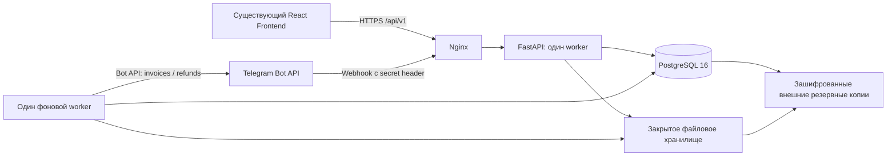
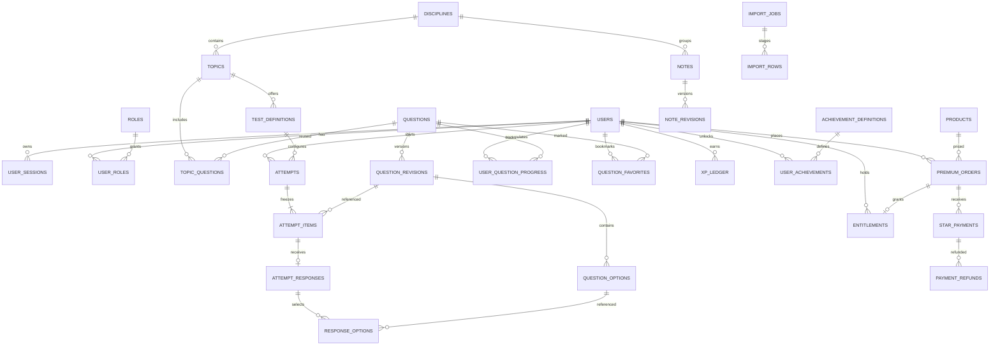

# MEDEXA 2.0 — архитектура нового Backend

Статус: проект технического задания, без реализации. Дата: 20 ноября 2026 года.

Основание аудита: ANATOMAI UI 8.3.2, ветка `fix/anatomai-scrollbars-8.3.2`, коммит `b3576d515aa39923daec20e0e420456c8bf96e7e`. Документ подготовлен в отдельной ветке `docs/medexa-backend-architecture`. Проверены исходники и существующие тесты; работающий Preview, VPS и старый Backend не исследовались и не изменялись. Данные об их фактической конфигурации отсутствуют.

**Редакция политики вопросов от 21.11.2026:** источники и лицензии необязательны; отдельный медицинский reviewer не является условием публикации. Структурно корректные собственные вопросы может публиковать администратор или уполномоченный редактор. Импортированный набор публикуется по явному подтверждению администратора. MFA, права, file security, audit и immutable версии сохраняются. Реализованные изменения схемы/DTO — `0005_publication_policy`; HTTP import в draft реализован этапом 3b.2 (`0006_import_staging`); явная публикация реализована 3b.3 (`0007_publishing`).

**Решение:** модульный монолит FastAPI с PostgreSQL как единственным источником истины. Один процесс API и небольшой обработчик фоновых заданий без Redis/Celery. Сервер хранит версии вопросов, попытки, ответы, результаты и журнал начислений. Клиент сохраняет существующие компоненты, оформление и Telegram lifecycle, получая данные через типизированный API-слой.

Решения ниже разделены на подтверждённое поведение Frontend и предлагаемое поведение нового Backend. Предлагаемые сроки сессий, лимиты, правила XP, коммерческий продукт и эксплуатационные показатели требуют проверки/утверждения до соответствующего этапа реализации. Они не описывают уже работающие возможности.

## 1. Границы проекта

- Новый Backend: Python 3.12, FastAPI, Pydantic 2, SQLAlchemy 2, Alembic, PostgreSQL 16.
- Целевая инфраструктура: Ubuntu 24.04, отдельный Docker Compose project, Nginx, VPS 1 CPU / около 2 ГБ RAM.
- Финальный бренд — MEDEXA. `@medexapp` — планируемый бот: владение, числовой bot ID, токен и настройки Mini App пока не подтверждены.
- Старый Backend не является источником данных, авторизации или миграций. Не подключать его БД, токены, тома, очереди и сетевые сервисы.
- Существующий Frontend React 19 / TypeScript / Vite и его дизайн сохраняются. Переименование бренда в интерфейсе — отдельная согласуемая задача, не часть этого документа.
- Foundation, Identity, read-only Content и MFA/draft admin реализованы в отдельных feature-ветках. Этот документ описывает также будущие этапы; наличие строки API в реестре не означает доступность endpoint. Frontend, main, Preview, Production и старый Backend не изменяются; deploy/merge отсутствуют.

## 2. Аудит Frontend UI 8.3.2

### 2.1. Источники и модель данных

| Источник | Подтверждённая модель / поведение | Следствие для Backend |
|---|---|---|
| `src/features/tests/types.ts` | `TestDefinition`: id, icon, title, meta, level, progress, color, examMinutes | Отделить каталог от пользовательского прогресса. `level` оставить внутренним необязательным полем, не возвращать в пользовательский UI |
| Там же | `TestQuestion`: id, text, answers: string[], correctAnswer: number, explanation: string | Сейчас движок поддерживает один правильный ответ и индексы. Серверу нужны стабильные ID вариантов и неизменяемые редакции |
| Там же | `TestAnswer`: questionId, selectedAnswer: number/null, correctAnswer; `TestResultData`: test, mode, total, score, answered, answers, durationSeconds | Эти клиентские значения нельзя принимать как доказательство результата |
| `src/features/tests/data.ts` | Статический `demoTests` и `demoQuestions`; `questionsForTest()` возвращает массив или [] | Нет сетевого банка вопросов. Импорт этой заготовки допускается только после редакторской проверки |
| `src/features/library/catalog.ts` | Каталог вычислен из тестов; discipline.id сейчас равен test.id, названия разбираются по `:` | Нужны отдельные Discipline, Topic, TestDefinition и явная таблица соответствия legacy ID |
| `src/App.tsx` | `CompletedTest={id, completedAt: milliseconds, result: TestResultData}`, `entries`, max 100 записей; `runId` и Set `recorded` предотвращают повтор внутри одного запуска | Нет долговременной истории и межустройственной идемпотентности |
| `statistics.ts`, `achievements.ts`, `topicSummary.ts` | Вычисления по `entries`, локальные календарные даты | Серверные агрегаты должны иметь явно заданную семантику и часовой пояс |
| `questionReview.ts` | Read-only модель допускает один или несколько правильных индексов; проверяет границы индексов | Это не поддержка multiple-choice в движке тестирования |
| `catalog.ts`, `useTelegramIdentity.ts` | Имя/фото из SDK `initDataUnsafe` или разбора initData, только для отображения | Криптографической авторизации нет; эти данные не подтверждают личность |
| `dailyTopic.ts` | Локальная дата → порядковый день → modulo стабильного отсортированного списка доступных ID | При перезагрузке выбор стабилен; изменение состава каталога может изменить тему того же дня |

В проверенном `src` не обнаружены вызовы `fetch`, `localStorage`, `sessionStorage` или IndexedDB. React state и `window.history` не являются хранилищем пользовательской истории. В проекте нет подключённой серверной истории, API-авторизации, реального XP, избранного, платежей и материалов конспектов.

Фактический банк: **4 дисциплины/теста, 10 вопросов** — anatomy: 5, physiology: 3, neuro: 1, histology: 1. Строки `meta` обещают 20/15/25/10 вопросов, но эти числа не соответствуют массивам; текущий каталог правильно считает загруженные вопросы. `progress: 68/32/...` — демонстрационные поля, не пользовательские достижения. Тема физиологии называется «Нервная система», но два вопроса относятся к сердцу и газообмену: классификацию может уточнить уполномоченный редактор; это не отдельный обязательный шаг согласования публикации. Не исправлять содержание автоматически.

### 2.2. Экраны, состояния и сценарии

| Экран / компонент | Состояния и действия сейчас | Данные для интеграции |
|---|---|---|
| `HomePage`, `AppHeader`, `DailyFocusCard` | Telegram-имя/аватар, запуск каталога, текущая серия или «Серия —», «XP пока недоступны» | Проверенный `/me`, серия, XP только после реализации правил |
| `SubjectsSection` | Предмет → соответствующая дисциплина конспектов; «Все» → каталог конспектов | Отдельный стабильный discipline_id, общий для каталогов |
| `DailyQuestions` | Одна тема дня, дисциплина, число вопросов → «Ответы и разбор»; обработка смены дня/focus | Серверная ежедневная рекомендация в часовом поясе пользователя |
| `StatisticsSection` | Одна строка: завершённые тесты, средний процент, время; «Подробнее» | Агрегаты. Недельная активность на Главной выключена и не должна возвращаться |
| `StudyPromos` | 4 существующих WebP: тесты, конспекты, ошибки, Premium | Маршруты сохранить; повтор ошибок пока открывает честное сообщение недоступности |
| `TestsPage` | Поиск по дисциплине/теме, быстрая практика — первый непустой тест; одна тема открывается без лишнего уровня | Каталог, поиск, сортировка и count только опубликованных доступных вопросов |
| `TopicPage` | Дисциплина, тема, count, лучший результат, число вопросов с ошибками; обучение/экзамен; ссылка на разбор | Метаданные темы и пользовательская сводка. Кнопки режимов визуально не менять |
| `TestSession`, `useTestSession` | Текущий вопрос, selected/confirmed, score, answers, timer, dirty; skip/next/finish/exit-confirm | Серверная попытка, версия, текущий вопрос, подтверждение ответа, deadline |
| `TestResult` | Процент, заголовок по диапазону, correct/wrong/skipped, длительность, разбор ошибок/пропусков, повторить, к тестам | Неизменяемый результат и снимки вопросов этой попытки |
| `QuestionReviewPage` | Все варианты сразу; зелёные правильные; поиск; порции по 30; исходная нумерация | Отдельная read-only выдача с ключами ответов, независимая от exam DTO |
| `NotesPage` | Поиск дисциплины, вход/назад; пока только честное пустое состояние | Список опубликованных конспектов и защищённый материал, когда материалы появятся |
| `StatisticsPage` | История, средний процент, неделя, сворачиваемые достижения; XP/уровни недоступны | История с курсором, агрегаты, достижения; без ограничения истории последними 100 на сервере |
| `ProfilePage`, `PremiumDialog` | Имя, аватар, серия, Premium-информация; settings/notifications/support/about; сброс результатов текущего запуска после confirm | Реальная сессия, настройки по мере реализации; Premium пока остаётся информационным |

Текстовые объяснения **не отображаются** в прохождении, результате и «Ответах и разборе» после UI 8.3; в банке `explanation` сохранён. Не возвращать объяснения в UI при API-интеграции. В резервном mode-picker внутри `TestSession` остались старые тексты «с объяснениями», но основной путь уже передаёт `initialMode`; это долг текста, а не существующая функция.

**Подтверждённая логика теста:**

1. В обучении выбор немедленно проверяется, фиксируется, остальные варианты блокируются; верный вариант подсвечивается. «Далее» сохраняет ответ и продвигает; после проверки пропуск заблокирован.
2. В экзамене выбор можно менять до «Далее». Правильность в UI до завершения не показывается. Таймер сейчас клиентский, шаг — уменьшение счётчика по interval; фоновый WebView может его замедлять.
3. Пропуск сохраняет null. При timeout текущий выбранный ответ учитывается, непосещённый хвост считается пропущенным. После последнего next/skip формируется результат.
4. Возврат из грязной попытки требует confirm. Возврат из результата — к каталогу. «Повторить» возвращает к теме/выбору режима и запускает весь тест заново.
5. «Разобрать ошибки» в результате включает ошибки и пропуски; это **не отдельный движок повторения ошибок**. Глобальное повторение ошибок и избранное пока не реализованы.

**Расчёты, которые важно не подменить незаметно:**

- Средний результат — среднее неокруглённых процентов завершённых попыток, затем `Math.round`, а не доля всех правильных ответов. Для Python использовать Decimal и ROUND_HALF_UP, не встроенный банковский `round`.
- Ноль завершений: completed=0 достоверно; average=null и practice_seconds=null → «—». После попытки все пропуски — достоверные 0%, не null.
- Практическое время сейчас — сумма округлённых wall-clock длительностей завершённых попыток. Это не измерение активного чтения; не называть его активным временем.
- `topicSummary.errors` — количество **уникальных вопросов, когда-либо отвеченных неправильно** в истории запуска. Последующее исправление их не убирает. Не заменять эту метрику незаметно на «неисправленные ошибки».
- Серия: последовательные локальные дни с завершениями; если сегодня завершений нет, допускается продолжение с вчера. Пустая история → null. Неделя начинается в понедельник.
- Реально вычисляются 4 достижения: первый завершённый тест, серия 3 дня, суммарно 100 правильных ответов, непустой тест на 100%. Остальные 5 заблокированы из-за отсутствия условий/маршрутов. Повторные правильные ответы сейчас входят в «Сотню».

### 2.3. Навигация и платформенная граница

`App.tsx` управляет четырьмя вкладками и состояниями `catalog/topic/review/session/result`, статистикой, origin ежедневного разбора и переходами в конспекты. Используются hash + history.state, собственные хуки, сохранение scroll/search выбранных экранов. Универсального серверного маршрутизатора нет.

`TelegramPlatformAdapter` и `useTelegramBackButton` уже владеют init/dispose, единственным callback возврата, fullscreen/viewport/safe-area, подтверждением Telegram-контекста и browser fallback. Это UI-платформенная логика: **Backend не рассчитывает CSS safe-area, не управляет BackButton и не заменяет AppShell**. Присутствие SDK или UI-признак Telegram-контекста не является серверной авторизацией.

Проверены существующие unit-наборы: presentation, statistics, achievements, topic-summary, library-data, question-review, ux82, telegram-platform, zoom-lock; UI-скрипты включают `ui81/82/83`, `scrollbars832`, `viewport` и предыдущие регрессионные сценарии. Они не доказывают корректность будущего Backend. При первоначальном аудите тесты Frontend не запускались. Проверки Backend и текущей редакции политики описаны в соответствующих отчётах в backend/.

## 3. Архитектура и эксплуатационный размер

### 3.1. Модульный монолит



Модули: identity/access, catalog/content, attempts/grading, statistics, favorites/mistakes, rewards/achievements, premium/billing, imports, administration, jobs/audit. Каждый содержит Pydantic DTO, application service, доменные правила и SQLAlchemy persistence. HTTP-обработчики тонкие; транзакционная граница — application service, а не последовательность отдельных repository.commit.

Предлагаемое место будущей реализации — **отдельный репозиторий `medexa-backend`**, чтобы не задеть старую инфраструктуру. В нём `app/api/v1`, `app/modules/*`, `app/core`, `app/db`, `app/jobs`, `migrations`, `tests`. Название и доступ к репозиторию ещё согласовать. OpenAPI является контрактом; TS-типы генерируются при будущей интеграции, а не переписываются вручную в нескольких местах.

Без микросервисов, Redis, Celery, Kafka, Kubernetes, Elasticsearch и отдельной аналитической БД на старте. PostgreSQL outbox/jobs с lease и `SKIP LOCKED` достаточно. Не запускать cron-планировщик в каждом API worker. Реальное время через WebSocket не требуется: состояние попытки — HTTP + серверный deadline.

### 3.2. Ресурсы и ограничения

| Компонент | Стартовая конфигурация; требует замеров |
|---|---|
| API | Один Uvicorn worker; async SQLAlchemy/asyncpg; pool_size=3, max_overflow=0; без reload |
| PostgreSQL | max_connections около 25, shared_buffers=128 MB, work_mem=4 MB, maintenance_work_mem=64 MB; обязательные statement/lock timeouts |
| Worker | Concurrency=1, pool_size=2 (singleton advisory lock + транзакция); тяжёлый импорт — отдельный ограниченный subprocess, не event loop API |
| RAM | Ориентир steady-state: OS 300–450 MB, PostgreSQL 300–500 MB, API 150–300 MB, worker 80–180 MB, Nginx/служебные процессы 30–80 MB; оставить запас под пики |
| Пиковые задачи | Импорт, сжатие backup и обслуживание индексов не одновременно. Ограничить subprocess, читать XLSX потоково |
| Списки | Review по 30, история по 20, max page_size=100; один ответ API до 1 MB, длинный материал выдаётся отдельно |
| Нагрузка | До нагрузочного теста нет заявления о числе поддерживаемых пользователей; измерять concurrency/RSS/p95/DB connections на аналогичном VPS |

Сумма лимитов контейнеров и RAM ОС должна помещаться в физическую память; Docker-лимиты назначать после профилирования, не копировать предложенные оценки как гарантию. Для первого нагрузочного gate: 20 активных пользователей с одной мутацией на пользователя раз в 5 секунд, p95 обычных read/write <500 ms, ошибок <1%, отсутствие OOM/роста очереди. Это целевой тестовый профиль, не обещанная ёмкость. Отдельно измерить импорт и платежный webhook. При нехватке ресурсов сначала ограничить импорт/пулы и оптимизировать запросы, затем увеличить VPS.

## 4. Базовые соглашения данных

- PK — UUID, создаваемые сервером; внешние Telegram user_id/bot_id — положительный bigint, не int32. ID Telegram передавать в JSON десятичной строкой, не полагаться на точность JS number во внешних системах.
- Все моменты времени — timestamptz UTC, ISO 8601 с `Z` в API. Календарные дни — date + валидированный IANA timezone пользователя. Первичная зона — из браузера после проверки по IANA; при отсутствии UTC с явным сообщением в контракте.
- Старые ID `anatomy/physiology/neuro/histology`, `a1/...` сохраняются только в legacy mappings. Имя/название/позиция в массиве не является идентификатором.
- Каталог содержит отдельные Discipline → Topic → TestDefinition. Пока категории не нужны: текущий Frontend не имеет независимой модели категорий. При необходимости иерархии позже добавить parent_topic_id с проверкой циклов, не выдумывать тематические разделы.
- Тексты — Unicode NFC; поисковая проекция additionally lowercase ru, ё→е, слова запроса соединены AND. Имена отображать как текст, HTML из импорта не исполнять.
- Суммы Stars — целое число >0, currency строго `XTR`; проценты — производные от целочисленных счётчиков; деньги и XP не хранить в float.
- Опубликованные редакции вопросов/вариантов неизменяемы. Правка создаёт новую редакцию; попытка всегда ссылается на исходную. Архивирование контента не удаляет результаты.
- JSONB — для versioned rule parameters, ошибок импорта и безопасных metadata; пользователь, варианты ответа, связи попытки и платежи не прячутся в произвольный JSON.
- Статусы — ограниченный CHECK/справочник с миграциями; строка из клиента не становится новым статусом. Версия строк `version bigint` используется для optimistic concurrency.
- Данные, на которые ссылаются попытки/платежи/аудит, удаляются через archive/anonymize, не CASCADE от каталога или пользователя. CASCADE допустим у черновиков/составных записей без исторических ссылок.

## 5. PostgreSQL: ER-модель и словарь

### 5.1. Основные связи

Диаграмма показывает доменные связи; служебные таблицы и все составные ограничения перечислены ниже.



### 5.2. Identity и системные таблицы

Во всех таблицах с изменяемыми сущностями есть created_at/updated_at; event/ledger/audit — append-only с occurred_at. PK явно указан; суффиксы `_id` — FK, если не оговорено иначе.

| Таблица | Основные поля | Ограничения / индексы |
|---|---|---|
| users | id UUID PK, telegram_user_id bigint, first_name, last_name, username nullable, photo_url nullable, language_code, timezone, status, progress_epoch bigint, version | UNIQUE telegram_user_id; CHECK id>0 для Telegram ID; status active/blocked/anonymized. Username не unique и не средство авторизации |
| roles | code PK, description | Коды student, content_editor, content_reviewer, support, billing_admin, admin; permissions определяются сервером, не пользовательским JSON |
| user_roles | user_id, role_code, granted_by, granted_at | PK(user_id,role_code); FK roles/users; все изменения в audit |
| user_sessions | id UUID PK, user_id, token_hash bytea, csrf_hash, created_at, last_seen_at, expires_at, idle_expires_at, revoked_at, rotation_family_id | UNIQUE token_hash; index(user_id,revoked_at), index(expires_at); CHECK idle_expires_at<=expires_at; raw cookie не хранить |
| auth_replays | init_data_digest PK, bot_id, user_id, session_id, valid_until | Вставка уникального digest в той же транзакции, что сессия; TTL-очистка после окна допустимости initData; сырые initData отсутствуют |
| idempotency_requests | id, actor_id, operation, key, request_hash, resource_id, outcome, response_projection nullable, expires_at | UNIQUE(actor_id,operation,key); index(expires_at). Полный хэш запроса; auth-cookie/секреты не кэшировать в response |
| audit_events | id bigint PK, actor_id nullable, action, entity_type/id, request_id, safe_diff JSONB, occurred_at | index(entity_type,entity_id,occurred_at), index(actor_id,occurred_at); запрет обычному API DB-role UPDATE/DELETE |
| jobs | id, kind, payload schema_version, status, available_at, lease_until, attempts, max_attempts, last_error_code, dedupe_key | UNIQUE(kind,dedupe_key); partial index(available_at,id) WHERE status='pending'; lease expired можно безопасно reclaim |
| outbox_events | id, event_type, aggregate_id, payload_version, payload, occurred_at, delivered_at, attempts, available_at | UNIQUE(event_type,aggregate_id,event_version) с отдельным event_version; partial index(available_at,id) WHERE delivered_at IS NULL |

### 5.3. Каталог, вопросы, материалы, импорт

| Таблица | Основные поля | Ограничения / индексы |
|---|---|---|
| disciplines | id, slug, title, icon_key, color_token, position, status | UNIQUE slug; color_token из существующих токенов; index(status,position,id) |
| topics | id, discipline_id, slug, title, position, status, access_policy_id nullable | UNIQUE(discipline_id,slug); index(discipline_id,status,position,id) |
| test_definitions | id, topic_id, slug, title, exam_duration_seconds, question_limit nullable, selection_policy, policy_version, internal_difficulty nullable, status | UNIQUE(topic_id,slug); CHECK duration>0, limit>0 если задан; MVP selection_policy=ordered_all; counts вычислять по доступному банку |
| questions | id, external_source, external_id nullable, current_revision_id nullable, archived_at | UNIQUE(external_source,external_id) для ingestion namespace + внешнего ID; external_source не является обязательным библиографическим source_id; FK current_revision на редакцию этого же question, не чужого |
| question_revisions | id, question_id, revision_number, kind, text, explanation nullable, source_id nullable, source_reference nullable, source_page nullable, license_reference nullable, created_by, medical_review_by nullable (legacy), reviewed_at nullable (legacy), status, normalized_search_text, fingerprint | UNIQUE(question_id,revision_number); UNIQUE(question_id,id) для составных FK; kind single_choice/multiple_choice; index(question_id,status). Explanation хранится, но не возвращается текущему UI |
| question_options | id UUID, revision_id, position, code, text, is_correct | PK id; UNIQUE(revision_id,id), UNIQUE(revision_id,position), UNIQUE(revision_id,code); position>=0; immutable после публикации |
| topic_questions | topic_id, question_id, position | PK(topic_id,question_id); UNIQUE(topic_id,position); index(question_id). Редакция выбирается через current_revision_id и фиксируется при старте попытки |
| notes | id, discipline_id, topic_id nullable, slug, current_revision_id nullable, position, status, access_policy_id nullable | UNIQUE(discipline_id,slug); FK topic должен принадлежать discipline; index(discipline_id,status,position,id) |
| note_revisions | id, note_id, revision_number, title, sanitized_body nullable, asset_id nullable, source_id nullable, source_reference, created_by, medical_review_by, reviewed_at, status | UNIQUE(note_id,revision_number); CHECK body или asset задан; опубликованная редакция immutable |
| content_sources | id, slug, title, attribution, license_reference nullable, evidence_asset_id nullable, reviewed_by, reviewed_at | UNIQUE slug; необязательные сведения о происхождении, без approval/licensing gate для вопросов; FK из revisions и исторические данные сохраняются |
| assets | id, storage_key, sha256, media_type, byte_size, status, created_by | UNIQUE storage_key; byte_size>0; приватный volume вне public; загрузки в quarantine до проверки |
| legacy_mappings | entity_type, legacy_id, discipline_id/topic_id/test_definition_id/question_id (nullable typed FK) | PK(entity_type,legacy_id); CHECK: заполнен ровно один FK, соответствующий entity_type; отдельные partial UNIQUE по каждому target FK. Нельзя ссылаться на несуществующий общий UUID |
| catalog_state | id singleton PK, version bigint, changed_at | Одна строка; увеличение version при публикации/архивировании. Не пользовательская настройка |
| import_jobs | id, sequence, asset_id, sha256, template_version, file_format, status, phase, created_by, authorized_session_id nullable, mfa_verified_at, counters, attempts, lease_token/lease_until nullable, result_version, cancel_requested, raw_deleted_at nullable | UNIQUE(created_by,sha256,file_format,template_version); index(status,lease_until,sequence); index(created_by,sequence). Confirmation/publish fields — отдельные publication_runs/items в 0007 |
| import_rows | id, import_job_id, position, location, discipline, topic, external_key, generated_key, fingerprint/content_hash nullable, normalized_payload, errors/warnings, topic_id/target_question_id/applied_revision_id nullable, action | UNIQUE(import_job_id,position); JSON до 64 KiB; staging закрыт, без публичного raw download |
| import_content_keys | topic_id, content_hash, question_id | PK(topic_id,content_hash); точная дедупликация импортированного содержания, FK RESTRICT |

**Публикационные инварианты вопросов:** single_choice имеет 2–8 вариантов и ровно один верный; multiple_choice — минимум 2 варианта и минимум один верный. Текущий движок не поддерживает multiple_choice, поэтому такие вопросы можно подготовить в draft, но нельзя публиковать в тестовый пул текущего клиента. Межстрочное число правильных вариантов и неизменяемость опубликованных редакций проверяются сервисом и deferred constraint trigger в БД; обычный CHECK не может посчитать дочерние строки. Публикация вопроса требует структурной валидности, права content.publish, свежей MFA и явного действия пользователя; совпадение publisher/creator разрешено. source_id/source_reference/source_page и license_reference необязательны, отдельный medical reviewer/approval не требуется. Старые medical_review_by/reviewed_at сохраняются как исторические поля и не заполняются фиктивным самоодобрением. current_revision_id ссылается только на опубликованную редакцию того же объекта. При правке создаются новые option_id; старые не переиспользуются для другого текста.

Поиск MVP сохраняет семантику Frontend: нормализация + AND вхождений слов. Для небольшого банка достаточно ограниченного ILIKE по bind-параметрам внутри темы; при росте — `pg_trgm` GIN по normalized_search_text, после EXPLAIN ANALYZE. FTS со стеммингом изменит выдачу, поэтому не включать его незаметно. Число вопросов считается из фактических опубликованных и доступных связей, не из `meta`.

Для вопросов source_id/source_reference/source_page и license_reference необязательны и могут быть NULL. medical_review_by/reviewed_at сохраняют историческое значение, не требуются для новых публикаций. Withdrawal источника-метаданных не снимает вопросы с публикации: доступность определяется статусом вопроса/редакции и родителей. Для конспектов отдельные existing review/publishing правила сохраняются; изменения политики этого раздела относятся к вопросам тестов.

### 5.4. Попытки, статистика, награды

| Таблица | Основные поля | Ограничения / индексы |
|---|---|---|
| attempts | id, user_id, test_definition_id, topic_id, mode, origin_attempt_id nullable, kind regular/error_repeat, status, current_position, version, started_at, deadline_at nullable, finalized_at nullable, finish_reason, policy_version, progress_epoch, timezone_at_start, frozen_title, total, correct, wrong, skipped, answered, duration_seconds | index(user_id,finalized_at DESC,id DESC); index(user_id,topic_id,status); partial UNIQUE(user_id) WHERE status='in_progress'; partial index(deadline_at) WHERE status='in_progress' AND mode='exam' |
| attempt_items | id, attempt_id, question_id, revision_id, position | UNIQUE(attempt_id,position), UNIQUE(attempt_id,question_id); составной FK(question_id,revision_id) на question_revisions; стабильный порядок и состав |
| attempt_responses | id, item_id, revision_id, state draft/committed/skipped, selected_at, committed_at nullable, is_correct nullable, version | UNIQUE item_id; FK(item_id,revision_id) на attempt_items с соответствующим UNIQUE; UNIQUE(id,revision_id) для response_options |
| response_options | response_id, revision_id, option_id | PK(response_id,option_id); составные FK на response и option одной revision; вариант другого вопроса невозможен |
| user_question_progress | user_id, question_id, progress_epoch, first_correct_at nullable, last_response_id, ever_wrong, last_outcome, corrected_error_count | PK(user_id,question_id,progress_epoch); index(user_id,progress_epoch,last_outcome). Это перестраиваемая проекция, не первичный источник результата |
| user_daily_activity | user_id, activity_date, timezone, progress_epoch, completed_count, answered_count, correct_count, practice_seconds | PK(user_id,activity_date,progress_epoch); счётчики>=0. Календарная дата определяется зоной на момент события |
| daily_recommendations | user_id, local_date, topic_id nullable, catalog_version, selector_version, timezone, created_at | PK(user_id,local_date); null topic означает зафиксированное пустое состояние; последующее удаление темы → архивный переход/явная недоступность |
| question_favorites | user_id, question_id, created_at | PK(user_id,question_id); index(user_id,created_at,id). Будущая функция, сейчас UI-кнопок нет |
| xp_rule_versions | id, rule_code, version, parameters JSONB, enabled_at nullable | UNIQUE(rule_code,version); параметры валидированы фиксированным серверным типом; выключенные правила не начисляют XP |
| xp_ledger | id, user_id, delta bigint, rule_version_id, source_type/id, award_key, occurred_at, reverses_id nullable | UNIQUE(user_id,award_key); delta!=0; UNIQUE reverses_id WHERE NOT NULL; append-only, исправление отдельной компенсирующей записью |
| user_xp_totals | user_id PK, balance, version | Перестраиваемый cache суммы ledger; изменение в транзакции начисления. Не принимать balance от клиента |
| levels | id, code, title, min_xp, position, enabled | UNIQUE code, UNIQUE min_xp; min_xp>=0; не заполнять придуманной лестницей уровней |
| achievement_definitions | id, code, title, caption, icon_key, rule_code, rule_version, parameters, enabled | UNIQUE code; rule_code из серверного allowlist, не исполняемая строка |
| user_achievements | user_id, achievement_id, progress_epoch, granted_at, rule_version, source_attempt_id nullable | PK(user_id,achievement_id,progress_epoch); разовая выдача в текущем учебном epoch; новая выдача после явного reset не начисляет повторную награду XP |
| progress_resets | id, user_id, from_epoch, to_epoch, requested_at, completed_at, reason | UNIQUE(user_id,to_epoch); to_epoch=from_epoch+1; не удалять финансовые/антифрод-журналы |

Инварианты финальной попытки: total>0; correct+wrong+skipped=total; answered=correct+wrong; все счётчики>=0; duration_seconds>=0; mode exam требует deadline; финальный статус требует finalized_at. Непосещённые items считаются skipped. Финальные поля и состав attempt_items после старта immutable; вопрос не может исчезнуть из истории при публикации новой редакции. Поля результата могут быть null только до финализации, а не превращаться в фиктивные нули. Cross-table проверки обеспечиваются транзакцией и целевыми triggers, а не предположением, что Pydantic заменит БД.

### 5.5. Premium и Stars

| Таблица | Основные поля | Ограничения / индексы |
|---|---|---|
| access_policies | id, code, requirements, enabled | UNIQUE code; перечень серверных capabilities. Пока каталог бесплатный, не вводить платный барьер автоматически |
| products | id, code, title, price_xtr, duration_seconds nullable, capability_set, status, version | UNIQUE code; price_xtr>0; публикация требует утверждённого продукта и условий, не только наличия красивого UI |
| premium_orders | id, user_id, product_id, product_version, price_xtr_snapshot, currency, duration_snapshot, payload_nonce_hash, invoice_url nullable, status, expires_at, accepted_payment_id nullable, terms_document_id FK, terms_version, terms_accepted_at | currency='XTR'; UNIQUE payload_nonce_hash; index(user_id,created_at); invoice_payload непрозрачен, не содержит медицинских/личных данных |
| telegram_update_inbox | bot_id, update_id bigint, kind, safe_payload, status, received_at, processed_at, lease_until, error_code | PK(bot_id,update_id); partial index(received_at) WHERE status='pending'; raw payload с ограниченным доступом/TTL, без бессрочного логирования |
| star_payments | id, order_id, telegram_payment_charge_id, provider_payment_charge_id nullable, telegram_user_id, total_amount, currency, paid_at, state | UNIQUE telegram_payment_charge_id; index(order_id). Допускаются несколько charge одного order для учёта/возврата дублирующего списания |
| payment_refunds | id, payment_id, request_key, status, requested_by, requested_at, confirmed_at nullable, reason | UNIQUE payment_id для полного возврата; UNIQUE request_key; retry через job, не повторное ручное списание |
| entitlements | id, user_id, order_id nullable, grant_source_key, capability_set, valid_from, valid_until, revoked_at nullable, granted_by nullable, reason nullable | UNIQUE order_id WHERE NOT NULL; UNIQUE grant_source_key; CHECK valid_until>valid_from; index(user_id,valid_until) WHERE revoked_at IS NULL |

Состояние доступа определяется сервером по действующим entitlements, а не `isPremium` из браузера. Ручная выдача требует billing_admin/admin и audit. Роль администратора и покупка Premium — разные сущности. Заказ хранит снимок цены/длительности: изменение products не меняет уже выписанный invoice.

## 6. Telegram-авторизация, сессии и роли

### 6.1. Контракт доверия и HMAC

Frontend передаёт **исходную строку** `Telegram.WebApp.initData` в JSON-body `POST /api/v1/auth/telegram`. Не передавать её в URL, localStorage, аналитические события или логи. `initDataUnsafe`, `window.Telegram`, platform/version, username и клиентский user_id не подтверждают личность.

Порядок проверки на сервере:

1. TLS, разрешённый Origin, лимит тела; raw initData не более 16 KiB. Rate limit до тяжёлой обработки. Строго разобрать query-string: однократное URL-decoding UTF-8, отклонить дубли ключей, некорректный encoding, отсутствующие hash/auth_date/user. Не десериализовать и заново сериализовать user JSON для построения подписи.
2. Извлечь `hash`; построить data_check_string из остальных полученных пар в алфавитном порядке ключей, `key=value`, разделитель ровно LF. Для bot-token HMAC исключается **hash**. Не переносить исключение `signature` из другой схемы Ed25519: это отдельный протокол.
3. Обозначения с явными аргументами: secret_key = HMAC-SHA256(**key**=UTF8("WebAppData"), **message**=UTF8(bot_token)); expected = HMAC-SHA256(**key**=secret_key, **message**=UTF8(data_check_string)). Сравнить 32 байта с корректно декодированным hash constant-time.
4. Только после проверки подписи доверять user.id и auth_date. Предлагаемое окно: auth_date не старше 5 минут и не более чем на 30 секунд в будущем; часы VPS синхронизированы. Bot token относится только к новому боту, test/prod токены и БД разделены.
5. Проверить user.id>0, типы/длины полей. Upsert по telegram_user_id, серверный статус blocked имеет приоритет. Имя/фото обновляются из проверенных данных, но фото не скачивается сервером по произвольному URL.
6. В одной транзакции создать/обновить пользователя, записать digest initData в auth_replays, выдать серверную сессию. Уникальность digest не даёт обменять уже использованную строку на новую сессию другому клиенту.

Повтор обмена с уже действующей сессией того же пользователя может вернуть её состояние без создания новой сессии. Повтор использованного initData без подходящей сессии → `409 AUTH_RELAUNCH_REQUIRED`; устаревшее → `401 INIT_DATA_EXPIRED`. Для сетевого повтора, при котором браузер не получил cookie, может потребоваться повторное открытие Mini App. Этот UX-трейд-офф strict replay policy проверить на Telegram iOS до фиксации контракта. Не вводить фиктивный Telegram nonce: initData его для приложения не предоставляет. До первого обмена украденное свежее initData остаётся bearer-доказательством; HTTPS, короткое окно, отсутствие логирования и защита от XSS обязательны.

Ed25519-проверка для третьих сторон не требуется собственному Backend с bot token. Её формат, включающий bot_id и исключающий hash/signature, не смешивать с HMAC. Контрольные тест-векторы с `signature`, Unicode, `%2B`, slash escaping и перестановкой полей обязательны перед выпуском.

### 6.2. Серверные сессии

Базовый вариант для iPhone — **same-origin** Frontend/API через Nginx и непрозрачная cookie-сессия. JWT на старте не нужен.

- Cookie `__Host-medexa_session`: Secure, HttpOnly, Path=/, без Domain; SameSite=Lax для целевого top-level iOS WebView. Токен — минимум 256 бит случайности, в БД только криптографический hash. Ни user_id, ни роль не кодируются в открытой cookie.
- Предлагаемые пределы: абсолютный срок 7 дней, idle 24 часа; last_seen обновлять не чаще раза в 5 минут. Ротация на повторной авторизации/смене привилегий, отзыв при logout/block. Не ротировать на каждом параллельном запросе, чтобы не создавать гонки вкладок.
- `GET /auth/session` возвращает пользователя, сроки и CSRF-токен, привязанный к сессии; не возвращает cookie-токен. CSRF в `X-CSRF-Token` обязателен для мутаций, проверять также Origin/Fetch Metadata. Нельзя полагаться только на SameSite. Login защищён проверкой Origin; Telegram webhook исключён из cookie-CSRF и защищён своим secret header.
- Для повторного GET session CSRF-токен воспроизводимо выводится HMAC из отдельного CSRF server key, session ID и непрозрачного cookie-токена; в БД достаточно csrf_hash для проверки. Не обещать восстановление случайного токена из одного хэша. При ротации сессии меняется и CSRF.
- CORS выключен при same-origin; при отдельном API-origin — только точный allowlist + credentials, без `*`. Включение credentialed cross-origin требует отдельной проверки CSRF и cookie на целевых клиентах.
- Для встроенного iframe в **Telegram Web** Lax может не работать. Если этот клиент входит в первый релиз, отдельно подтвердить SameSite=None + Secure + CSRF и блокировку third-party cookies; при необходимости согласовать иной transport сессии. Не обещать поддержку iframe только потому, что iOS работает. Долговечные токены в localStorage не являются fallback.
- Обычный Safari без Telegram: каталог и сведения о приложении могут быть публичными; попытки/персональная история требуют входа. Нужен продуктовый выбор: вход через Telegram/отдельный login либо настоящий ограниченный guest-mode. Не считать отсутствие SDK анонимным «подтверждённым Telegram-пользователем».
- Сбой авторизации во время попытки не стирает серверную попытку: после входа того же user_id она возобновляется; экзаменационное время при этом не останавливается.

### 6.3. RBAC и административный вход

| Роль | Права |
|---|---|
| student | Только собственные попытки, статистика, настройки и доступный опубликованный контент |
| content_editor | Уполномоченный редактор: черновики, загрузка/dry-run и ошибки; в 3b.3 — публикация собственных структурно корректных вопросов по явному действию, без второго reviewer |
| content_reviewer | Существующая совместимая staff-роль с разрешениями по серверной матрице; её участие в публикации вопросов необязательно. Она не заменяет admin confirmation импортированного набора |
| support | Ограниченный просмотр статуса попытки/заказа по обращению, без bot token, ключей и массового экспорта персональных данных |
| billing_admin | Сверка платежей, запрос возврата, управляемые entitlements; не редактирует медицинские ответы автоматически |
| admin | Роли, блокировки, системные настройки и публикация вопросов; явное подтверждение валидного импортированного набора. Можно публиковать собственные вопросы. Каждое действие аудируется |

Сервер проверяет permission и object ownership в каждом endpoint. UUID не является защитой IDOR. Обычный клиент не передаёт user_id для выбора чужих данных. Назначение admin по username, initDataUnsafe, Telegram Premium или Telegram chat admin запрещено. Bootstrap первого admin — одноразовая операторская процедура по проверенному числовому Telegram ID вне репозитория.

Для административных мутаций необходим step-up MFA и короткая привилегированная сессия (предлагается 15 минут). TOTP или WebAuthn и процесс восстановления выбрать на этапе администрирования. Секреты MFA шифруются отдельным ключом, recovery-коды хэшируются. Обычная Telegram-сессия студента не даёт административный доступ сама по себе.

## 7. Серверная логика тестирования

### 7.1. Состояния и снимок банка

Состояния попытки: `in_progress → completed | timed_out | abandoned`; completed/timed_out — финализированные результаты, abandoned — выход без результата/XP/статистики. Нельзя вернуть финальную попытку в in_progress. `finish_reason`: last_question, user_finish, deadline; для abandoned — user_exit/administrative. Учебная попытка без timer, exam с deadline_at. Для забытой учебной попытки предусмотреть TTL (предложение: 24 часа) и abandoned; это продуктовая настройка, не скрытый экзаменационный таймер.

При старте сервер проверяет доступ, непустой опубликованный банк, поддерживаемый kind, mode и отсутствие другой активной попытки пользователя. Фиксирует IDs редакций, порядок вопросов и вариантов, название темы, policy_version, лимит времени, progress_epoch. Начальная политика — все вопросы в существующем порядке, без случайной перестановки или изменения правил оценки. `question_limit` резервируется для будущих определений, но не активируется без согласования.

Одна активная попытка на пользователя предотвращает конфликтующие exam/learning в параллельных вкладках. Повторный запрос start с тем же Idempotency-Key возвращает прежнюю попытку. Другой start при активной попытке → `409 ACTIVE_ATTEMPT_EXISTS` с собственным attempt_id и возможностью resume/подтверждённого abandon. Это новое серверное поведение потребуется встроить в существующие диалоги, не менять дизайн кнопок режимов.

### 7.2. Протокол ответа

| Действие | Обучение | Экзамен |
|---|---|---|
| Выбрать вариант | POST submit фиксирует ответ и немедленно возвращает checked/correct_option_ids; повторное изменение запрещено | PUT draft сохраняет выбор, допускает изменение до advance; не возвращает правильность |
| «Далее» | POST advance после проверенного ответа; последний вопрос финализирует | POST advance атомарно фиксирует текущий draft; последний вопрос финализирует |
| «Пропустить» | POST skip только до проверки; сохраняет skipped и продвигает | POST skip сохраняет skipped и продвигает независимо от текущего draft |
| Завершить/timeout | Сервер финализирует уже подтверждённый текущий ответ, остальные — skip | Последний сохранённый draft текущего вопроса учитывается; непосещённые — skip |
| Назад/выход | Существующий confirm → POST abandon; выход не начисляет награды | То же; до подтверждения попытка активна и deadline продолжает идти |

Клиент передаёт **item_id и option_id**, а не correctAnswer/score/percent/time. Single-choice допускает ровно один ID; skip — отдельное действие. DTO с массивом selected_option_ids оставляет путь к multiple-choice, но сервер MVP отклоняет больше одного варианта для single_choice. Будущее multiple-choice оценивается точным совпадением множеств, без частичных баллов, только после отдельной поддержки клиентом и утверждения правил.

Draft в экзамене отправляется на сервер при выборе; перед advance клиент дожидается его сохранения. После сетевой ошибки UI не должен изображать сохранённый ответ. Сервер учитывает только полученные до deadline данные; потерянный офлайн-выбор нельзя задним числом принять по клиентскому timestamp. При восстановлении соединения GET attempt возвращает сохранённый draft/position/version. UI может оптимистично показать выбор, но переход должен ждать подтверждения. Для обучения немедленная подсветка опирается на серверный submit; краткое pending-состояние необходимо без изменения геометрии карточек.

Все мутации принимают Idempotency-Key и If-Match версии попытки. Под блокировкой проверяются принадлежность, current item, mode/state, deadline и option→revision. Idempotency lookup выполняется до проверки уже продвинутой позиции: сетевой повтор successful advance не должен перейти ещё раз. Новый key со старой версией → `409 ATTEMPT_VERSION_CONFLICT`; клиент перечитывает состояние, не повторяет действие вслепую.

### 7.3. Время, финализация и консистентность

- Источник времени — сервер/БД. Deadline = started_at + серверный лимит; window interval только рисует оставшееся время из server_time/deadline. Background/minimize, изменение времени телефона, reload и смена устройства не продлевают экзамен.
- Каждый запрос к активной exam сначала проверяет deadline. Worker также финализирует просроченные попытки небольшими пачками. Даже при задержке worker попытка не принимает ответы после срока. Timeout записывает finalized_at=deadline_at для расчёта длительности, а не момент позднего запроса.
- Learning duration — wall-clock до завершения; exam duration ограничена deadline. Клиентский duration_seconds не принимается. Это сохраняет смысл существующего показателя, а не добавляет недостоверный active-time tracking.
- Финализация атомарно фиксирует итог, terminal status, daily/statistics projections, question progress, разрешённые награды и outbox. Уникальные award keys и конечное состояние защищают от повторных next/finish/timeout.
- Learning submit сохраняет ответ и feedback, но пользовательские history/statistics/rewards обновляются только при финализации. Выход после проверенного ответа не превращает abandoned в завершённый тест.
- Сериализация мутаций: user row → attempt row → question progress в стабильном порядке ID → ledger/cache. Платежи используют тот же начальный user lock, затем order/payment. Не выполнять сетевые вызовы Telegram под DB-lock.
- Счёт: correct — верно отвеченные, wrong — неверно отвеченные, skipped — явные пропуски + хвост; answered=correct+wrong, total=correct+wrong+skipped. Процент ROUND_HALF_UP(correct×100/total). Непустой банк обязателен до старта.
- ResultReview строится по attempt_items/revisions, включая skip, а не по текущей версии каталога. Повторить — новая попытка полного теста; origin_attempt_id служит связью, не копирует старый score.

### 7.4. Ограничение защиты экзамена

Exam DTO никогда не содержит correct_option_ids/is_correct/explanation, ни до старта, ни в draft/advance/history активной попытки. Ответы после завершения доступны только владельцу результата. Логи/ошибки/Swagger examples также не должны раскрывать exam keys.

Однако продукт имеет самостоятельный справочник с готовыми ответами. Поэтому это учебный экзамен, **не прокторинг**: пользователь мог заранее прочитать ответы, сохранить справочник или открыть другой аккаунт. На время активного экзамена сервер закрывает reference-endpoint соответствующих вопросов для этого пользователя (`409 EXAM_REVIEW_LOCKED`), а клиент не открывает старый кэш справочника в exam-потоке. Это предотвращает случайную утечку в собственном UI, но не доказывает самостоятельность сдачи.

При интеграции удалить ключи правильных ответов из production client bundle: оставлять `demoQuestions` с ключами как «fallback при ошибке API» нельзя. Справочные ответы выдаются отдельным разрешённым запросом. Сохранение дизайна не означает сохранение небезопасного клиентского источника оценки. Отключённый/заблокированный пользователь не может обходить доступ прямым запросом к revision/asset.

## 8. Статистика, XP, достижения и пользовательские данные

### 8.1. Статистика и ежедневная тема

Первичный источник — финализированные серверные attempts/responses; агрегаты являются проекциями и могут быть восстановлены. В completed входят и completed, и timed_out, включая попытки со всеми пропусками, как в текущем UI. Abandoned не входит. По умолчанию статистика и достижения используют текущий progress_epoch; финансовые и антифрод-события не сбрасываются.

Контракт сводки: completed_tests, average_percent nullable, practice_seconds nullable, answered_count, correct_count, activity_streak_days nullable, period, timezone, data_scope=`server_history`, calculated_at. Нулевые значения возвращаются только при известном факте. average — среднее долей **по попыткам**, без предварительного округления каждой; две попытки 1/6 и 1/2 дают 33%, тогда как среднее предварительно округлённых 17% и 50% дало бы 34%. Точные дроби/Decimal устраняют неоднозначность.

История — keyset по finalized_at DESC/id DESC, не OFFSET и не max100. Дни недели рассчитываются через IANA timezone: интервалы локальных суток переводятся в UTC с учётом DST, а не прибавлением всегда 86400 секунд. Изменение timezone не переписывает уже присвоенные даты активности; новая зона применяется к новым событиям, это ограничение объясняется в контракте. Антидублирование наград привязано к источнику, не к сменяемой зоне.

Topic summary содержит **ever_wrong_question_count** (совместимость с текущим `topicSummary`) и отдельно **unresolved_wrong_question_count** для будущего повторения. Последнее — вопросы с последним подтверждённым неверным ответом; последующий верный снимает статус, skip сам по себе не создаёт новую ошибку. До первого завершения best_percent и совместимый ever_wrong_count возвращаются null. Не показывать новый счётчик вместо старого без продуктового решения.

Daily recommendation: GET `/me/daily-topic` использует серверное «сегодня» в сохранённой зоне, стабильную сортировку доступных topic ID и версию селектора. На первом обращении дня фиксирует выбор и catalog_version в daily_recommendations; последующие обращения не меняют тему. При первоначальной миграции порядок legacy ID сохраняется в selector_v1, если требуется полное совпадение с текущим выбором. Отозванная по медицинской причине тема не выдаётся даже если ранее выбрана: вернуть `availability=withdrawn`, без молчаливой подмены. Пустой банк → topic=null. Изменение каталога не пересчитывает уже выбранную доступную тему.

### 8.2. XP и уровни

В текущем Frontend **нет XP-системы**, значения/формулы и уровни не утверждены. До их утверждения API возвращает `status=not_configured, balance=null, level=null`, UI сохраняет «XP пока недоступны». Не инициализировать вымышленное количество очков.

Предлагаемая MVP-политика после утверждения: награда только за первое серверно подтверждённое правильное решение **логического question_id** пользователем. Award key `first_correct:{question_id}` уникален для user, не включает revision или progress_epoch: новая редакция, сброс профиля, повтор теста и повтор webhook не дают заново ту же награду. Сумма — из включённого xp_rule_version, конкретное число согласовать. Не начислять XP за открытие страницы, API-вызов, skip, abandoned или клиентский score. Будущее интервальное повторение/дневные бонусы — отдельные versioned правила и отдельное согласование.

Ledger immutable; общий balance и уровень вычисляются из него. Финализированный attempt и award keys обеспечивают идемпотентность. Исправление медицинского ключа не переписывает исторический результат/ledger автоматически: явное решение администратора, компенсирующая запись с уникальной ссылкой и audit. Приложение не принимает `/xp/add` от студента. До утверждения лестницы levels не возвращать фиктивный «Новичок / 100 XP до следующего».

### 8.3. Девять достижений

| Код / название | Серверное условие | Готовность |
|---|---|---|
| first / Первый шаг | Первый финализированный непустой тест | Сохраняет текущую логику, даже при всех пропусках; XP при этом не будет |
| three / Три дня | Три последовательных локальных дня с финализированными тестами | После календарного агрегатора; награда один раз, не исчезает при завершении серии |
| anatomy / Анатом | Все явно назначенные тесты утверждённого анатомического блока | Заблокировано, пока не определён состав блока и критерий прохождения |
| clinical / Клиницист | Утверждённый клинический блок | Заблокировано, данных блока нет |
| pharmacy / Провизор | Утверждённый фармакологический блок | Заблокировано, данных блока нет |
| hundred / Сотня | Суммарно 100 правильных ответов в финальных attempts текущего epoch | Совместимость с текущим UI: повторы входят. Изменение на уникальные вопросы потребует решения |
| perfect / Без ошибок | total>0 и correct=total у финальной попытки | Есть необходимые данные |
| memory / Память | 50 реально исправленных ошибок в специальном error_repeat | Заблокировано до отдельного режима и определения: уникальные ошибки или эпизоды |
| finish / Финиш | Завершён явно заданный учебный маршрут | Заблокировано, модели маршрутов в Frontend нет |

DTO: locked/unlocked/not_configured, title/caption/icon_key, granted_at nullable, progress nullable. Не использовать 0/100 для неизвестного условия. Не создавать маршруты/блоки только ради выдачи значков. Повторная обработка события не создаёт второе достижение в том же progress_epoch. Сами значки не начисляют XP автоматически. Новый Backend сохраняет уже полученное достижение до явного сброса учебного прогресса, в отличие от пересчёта временной React-истории; это явно описывается пользователю при интеграции.

### 8.4. Избранное, ошибки, сброс, настройки

Избранное — будущий серверный ресурс с идемпотентными PUT/DELETE; UI-кнопки добавлять отдельным согласованным этапом. В текущем разборе их нет. Отдельное повторение ошибок — будущая конфигурация того же attempts service, с фиксированным списком unresolved questions, а не второй движок. До реализации capabilities.mistake_practice=false, текущий информационный диалог сохраняется. Результат «Разобрать ошибки» работает сразу после интеграции и не зависит от нового режима.

Текущий «Сбросить прогресс» очищает только React entries. Его нельзя молча переназначить на необратимое удаление аккаунта, платежей и XP. Предлагается подтверждённый серверный reset: увеличить progress_epoch, убрать из пользовательского представления старую учебную историю/проекции/учебные достижения и abandon активную попытку. XP ledger, first-correct award keys, аудит и entitlements сохраняются; API явно сообщает scope и эффект. Вопрос, должен ли пользователь видеть прежний XP после такого сброса, согласовать до подключения кнопки. До согласования серверный reset не активировать.

Настройки первого этапа — только IANA timezone и language; никакой фиктивной цели на день или отправки уведомлений. Разрешение Telegram на сообщения и серверная подписка на уведомления — отдельные факты; наличие user_id не разрешает спам. Уведомления остаются `not_configured` до реализации согласия, отписки и доставки.

## 9. API v1: общие правила и полный реестр

### 9.1. Формат контракта

Базовый путь `/api/v1`. JSON: snake_case, UUID строками, даты ISO 8601, nullable поля документированы. Ответ объекта: `data` + `meta.request_id/server_time/schema_version`; список дополнительно содержит `page.next_cursor/has_more`, count при необходимости. Cursor непрозрачный и подписанный, привязан к фильтру/сортировке; смена query сбрасывает cursor. Review cursor фиксирует catalog_version: при изменении банка `409 CATALOG_CHANGED` и безопасный reload, без дублирования/пропуска вопросов.

Ошибка: `error.code`, `message` для пользователя, `details` без секретов, `request_id`. HTTP: 401 нет/истекла сессия; 403 нет права; 404 чужой/отсутствующий объект без раскрытия существования; 409 бизнес-конфликт/версия/идемпотентность; 412 отсутствующий или неприемлемый If-Match по контракту; 422 некорректные поля/неподдерживаемый question kind; 429 + Retry-After; 503 временная недоступность. Стандартный FastAPI 422 нормализуется к этому формату.

Idempotency-Key обязателен на start/submit/advance/skip/finish/abandon, reset, создание заказа, question/import publish, refund и manual grant. Ключ — случайный UUID клиента на **одно логическое действие**, повтор отправляет тот же ключ и body. Повтор с иным canonical request_hash → `409 IDEMPOTENCY_KEY_REUSED`. Ответы после успешной транзакции воспроизводят тот же результат/ID, а не повторяют действие. Кэш ключей — предложено 7 дней, финансовые/награды дополнительно защищены постоянными бизнес-UNIQUE и не зависят от этого TTL. Идемпотентные PUT/DELETE Favorites не требуют отдельного ключа.

Для персональных ответов и ключей справочника `Cache-Control: no-store`; CDN не кэширует session/result/review. Публичный каталог без пользовательских полей может иметь ETag по catalog_version. Клиентские кэши разделяются по user/session, очищаются на logout; правильные ответы не помещаются в service worker/precache. В текущем аудите механизм SW-кэширования не обнаружен; не добавлять его для защищённых данных.

Обозначения: P — публичный metadata; U — подтверждённая сессия; E/R/S/B/A — editor/reviewer/support/billing_admin/admin с нужным permission и MFA для мутаций. Этапы указаны в разделе 14. Реестр проектный: будущие endpoints не означают доступность функций уже сегодня.

### 9.2. Identity, каталог, справочник, конспекты

| Метод и путь | Доступ | Request / response и назначение |
|---|---|---|
| GET `/health/live` | Внутренний | Без БД; процесс жив. Путь вне `/api/v1` |
| GET `/health/ready` | Внутренний | Короткая проверка БД/совместимости миграций; без вывода конфигурации |
| GET `/meta` | P | Бренд MEDEXA, API/build version, terms/privacy/support links, публичные capabilities и supported_question_kinds |
| POST `/auth/telegram` | Свежий initData | `{init_data, timezone?, language?}` → Set-Cookie, user/session + CSRF; body не содержит session bearer |
| GET `/auth/session` | U | Текущая сессия/CSRF/expiry; blocked/revoked → 401/403 |
| POST `/auth/logout` | U+CSRF | Отозвать текущую сессию, очистить cookie; повтор безопасен |
| GET `/me/sessions` | U | Собственные устройства/last_seen без токенов и чувствительных fingerprints |
| DELETE `/me/sessions/{id}` | U+CSRF | Отозвать свою сессию; отзыв текущей очищает cookie |
| GET `/me` | U | Проверенные display-поля, timezone, capabilities; Premium вычислен сервером |
| PATCH `/me/preferences` | U | timezone/language, If-Match user.version; неизвестные настройки отклонить |
| GET `/disciplines` | P | `query?, cursor?, limit?` → id/slug/title/icon_key/color_token/question_count/topic_count/note_count |
| GET `/disciplines/{id}` | P | Дисциплина + публичные counts; отсутствующий/архивный объект → 404 |
| GET `/topics` | P/U | `discipline_id?, query?, cursor?, limit?` → темы и доступность; пользовательская статистика не попадает в публичный cache |
| GET `/topics/{id}` | P/U | Заголовок, discipline_id, question_count, mode availability, test_definition_id; без ключей ответов |
| GET `/test-definitions` | P | `topic_id?, query?` → определения, exam_duration_seconds, kind capabilities; difficulty не отображается |
| GET `/test-definitions/{id}` | P | Одна конфигурация; legacy `meta` не является источником количества |
| GET `/me/quick-practice` | U | Первый доступный непустой test по стабильному порядку, либо null; не запускает попытку |
| GET `/me/daily-topic` | U | local_date/timezone/topic/question_count/availability; фиксирует ежедневную рекомендацию, не начисляет ничего |
| GET `/me/topics/{id}/summary` | U | best_percent, completed_count, ever_wrong_question_count, unresolved_wrong_question_count, favorites_count; отсутствие данных выражается null/0 согласно полю |
| GET `/topics/{id}/reference-questions` | U+content access | `query?, cursor?, limit=30`; стабильный number, question_id/revision_id/text/options/correct_option_ids; без explanation для текущего UI; exam lock |
| GET `/notes` | U+content access | `discipline_id?, topic_id?, query?, cursor?, limit?`; пустой массив, если материалов нет |
| GET `/notes/{id}` | U+content access | Опубликованная редакция конспекта и body/asset reference; не выдаёт черновики |
| GET `/assets/{id}/download` | U+resource access | Авторизованная передача через X-Accel-Redirect в internal Nginx location; нельзя использовать storage_key как публичный URL |

GET `/topics` без discipline_id обеспечивает существующий поиск по дисциплине и теме; не вводить второй независимый поиск с другой моделью ID. Общий каталог не возвращает весь банк и ответы. Reference-поиск идёт по тексту вопроса, как текущий UI, и сохраняет исходный number после фильтрации.

### 9.3. Попытки, результаты, статистика, функции обучения

| Метод и путь | Доступ | Request / response и назначение |
|---|---|---|
| POST `/attempts` | U | `{test_definition_id, mode, kind:"regular", origin_attempt_id?}` → 201 attempt, snapshot metadata, current item, server_time/deadline/version |
| GET `/me/active-attempt` | U | Активная попытка или null; просроченная exam перед возвратом финализируется |
| GET `/attempts/{id}` | U owner | Состояние/resume текущего item/draft; активный exam не раскрывает ключи и итоговые scores |
| PUT `/attempts/{id}/items/{item_id}/draft` | U owner | `{selected_option_ids:[...]}`; exam draft + version, без correctness |
| POST `/attempts/{id}/items/{item_id}/submit` | U owner | Learning: selected_option_ids → locked feedback, correct_option_ids, score_so_far; exam submit запрещён |
| POST `/attempts/{id}/advance` | U owner | `{item_id}`; learning checked либо exam draft → следующий item или terminal result |
| POST `/attempts/{id}/skip` | U owner | `{item_id}` → следующий item/result; не вызывается после learning checked |
| POST `/attempts/{id}/finish` | U owner | Финализировать текущие данные по правилам режима; тот же финализатор, что last/timeout; раннее завершение не добавляет новую UI-кнопку |
| POST `/attempts/{id}/abandon` | U owner | `{reason:"user_exit"}` после существующего confirm; результат не создаётся |
| GET `/attempts/{id}/result` | U owner | Только terminal completed/timed_out, иначе 409; counts/percent/time/topic/mode + доступные действия |
| GET `/attempts/{id}/result-review` | U owner | Курсорный список неверных/пропущенных items с selected/correct вариантами исходных revisions; без объяснений |
| GET `/me/attempts` | U | `topic_id?, mode?, cursor?, limit=20`; финальная история текущего progress_epoch; без активных ключей |
| GET `/me/statistics` | U | `period=all`, `week` или `month`, агрегаты, nullable average/practice; Home использует all |
| GET `/me/activity` | U | `week_start?` локальный понедельник → 7 дней; допустимый диапазон запроса ограничен |
| GET `/me/progress` | U | Статус XP/уровней, balance/next_level/progress nullable, реальные счётчики; not_configured до включения |
| GET `/me/xp-events` | U | Ledger с курсором; источник/дата/amount, не внутренние секретные параметры правил |
| GET `/achievements` | U | Все 9 definitions + личное состояние; незаданные критерии not_configured/locked |
| GET `/levels` | U | Настроенная лестница или `status=not_configured, items=[]` |
| GET `/me/favorites` | U, будущий этап | Вопросы/темы с курсором; reference content проверяет exam lock |
| PUT `/me/favorites/{question_id}` | U, будущий этап | Создать, повтор 200/204 без дубля |
| DELETE `/me/favorites/{question_id}` | U, будущий этап | Удалить, отсутствие также 204 |
| GET `/me/mistakes` | U, будущий этап | Неразрешённые ошибки, `topic_id?`, cursor; это отдельная метрика от ever_wrong |
| POST `/attempts/error-repeat` | U, будущий этап | `{topic_id?, mode:"learning"}` → тот же attempt service с фиксированным списком ошибочных вопросов, либо 409 NO_MISTAKES |
| POST `/me/progress-resets` | U, после согласования | `{confirmed:true, expected_epoch}` → новый epoch и перечисление сохранённых данных; не удаляет платёж/award keys |

После реализации API не требуется отдавать весь ledger/все попытки для вычисления одной карточки Home. Статистика возвращается готовой и достоверной. Возможности будущих этапов скрыты capabilities, а не успешными фиктивными ответами.

### 9.4. Premium, платежи, поддержка

| Метод и путь | Доступ | Контракт |
|---|---|---|
| GET `/premium` | P/U | Честное описание, `status=coming_soon` или `available`, доступные продукты только если настроены; не выдумывать преимущества |
| GET `/me/entitlements` | U | Действующие grant, valid_until, capability_set, без предположений клиента |
| POST `/premium/orders` | U, только paid-stage | `{product_id, product_version, terms_version, terms_accepted:true}` → order_id, цена-снимок XTR, invoice_url или pending; цена не принимается от клиента |
| GET `/premium/orders/{id}` | U owner | pending/paid/refunded/expired, срок, собственный entitlement; UI invoiceClosed не меняет статус |
| GET `/me/payments` | U | История своих платежей/возвратов с курсором и support reference |
| POST `/integrations/telegram/webhook` | Telegram secret | update_id, pre_checkout_query/successful_payment/refunded_payment/messages; не cookie auth и не endpoint для браузера |
| GET `/support` | P | Утверждённый контакт/инструкция; пока контакта нет, `status=not_configured`, без мёртвой кнопки |
| GET `/legal/{document}` | P | terms/privacy/payment_terms с version; только опубликованные документы |

Команды бота `/start`, `/help`, `/terms`, `/support`, `/paysupport` обрабатываются через тот же webhook, не отдельные публичные HTTP-ручки. Отправка этих сообщений авторизована фактом команды пользователя. Произвольные уведомления, цели на день, магазины и покупки вне Premium не входят в MVP.

### 9.5. Администрирование

Все `/admin/*` требуют соответствующего permission; изменяющие операции — CSRF, MFA, audit и If-Match для редакций. Списки имеют cursor и фильтры. «DELETE контента» означает архивирование; исторические редакции не стираются.

| Методы и путь | Роль | Назначение |
|---|---|---|
| POST `/admin/auth/step-up`; DELETE `/admin/auth/step-up` | E/R/B/A | Подтверждение MFA/завершение привилегированной сессии; enrollment и recovery — отдельная защищённая операторская процедура первого этапа admin |
| GET/POST `/admin/disciplines`; GET/PATCH/DELETE `/admin/disciplines/{id}` | E/R | Каталог и архивирование; отдельное действие публикации по соответствующему permission |
| GET/POST `/admin/topics`; GET/PATCH/DELETE `/admin/topics/{id}` | E/R | Темы и проверенные связи с дисциплиной |
| GET/POST `/admin/test-definitions`; GET/PATCH/DELETE `/admin/test-definitions/{id}` | E/R | Режимы/время/порядок/внутренняя сложность; не изменять активные snapshots |
| GET/POST `/admin/sources`; GET/PATCH/DELETE `/admin/sources/{id}` | E/A, R read | Необязательные метаданные источников. Создание source не является предварительным шагом создания вопроса |
| GET/POST `/admin/questions`; GET `/admin/questions/{id}` | E/R | Поиск и создание draft с options/source; создание не публикует |
| GET/POST `/admin/questions/{id}/revisions`; GET/PATCH `/admin/question-revisions/{id}` | E/R | Новая редакция/правка только draft; просмотр истории |
| POST `/admin/question-revisions/{id}/publish`; POST `.../{id}/withdraw`; POST `.../{id}/restore` | E/A (R по совместимому permission) | Реализовано 3b.3: явная публикация валидного вопроса, withdraw/restore с audit и catalog_version; отдельного /review нет. Для editor действует ownership, admin может публиковать свои/доступные чужие drafts |
| PUT/DELETE `/admin/topics/{topic_id}/questions/{question_id}` | E/R | Управляемая связь/position; перестановка требует publish permission и явного действия, не меняет старые attempts |
| GET/POST `/admin/notes`; GET/PATCH/DELETE `/admin/notes/{id}` | E/R | Metadata и архивирование конспекта |
| GET/POST `/admin/notes/{id}/revisions`; GET/PATCH `/admin/note-revisions/{id}` | E/R | Черновик материала, закрытый asset, sanitize |
| POST `/admin/note-revisions/{id}/review`; POST `.../{id}/publish`; POST `.../{id}/withdraw` | R | Versioned публикация, без автоматической генерации медицинского текста |
| POST `/admin/assets`; GET `/admin/assets/{id}` | E/A | Плановый общий asset API; в 3b.2 не открыт: файл принимается одним POST /admin/imports |
| GET `/admin/import-templates/{format}` | E/A | Реализовано 3b.2: пустые XLSX/DOCX-шаблоны v1, MFA |
| GET/POST `/admin/imports`; GET `/admin/imports/{id}` | E/A | Реализовано 3b.2: POST ?format=xlsx/docx с raw binary сразу создаёт queued job; GET state/counters; owner или admin |
| GET `/admin/imports/{id}/rows`; GET `.../{id}/report` | E/A | Реализовано 3b.2: bounded preview/CSV после остановки обработки, без публикации |
| POST `/admin/imports/{id}/cancel`; POST `.../{id}/retry` | E/A | Реализовано 3b.2: owner/admin, MFA+CSRF, отмена неприменённых строк и bounded retry |
| POST `/admin/imports/{id}/publish` | A | Реализовано 3b.3: явное admin confirmation актуального выбора, без /approve |
| GET `/admin/users`; GET/PATCH `/admin/users/{id}` | S/A | Support — ограниченный read; block/unblock — admin с причиной |
| PUT/DELETE `/admin/users/{id}/roles/{code}` | A | Выдача/снятие ролей, запрет самовольной эскалации и удаления последнего admin |
| GET `/admin/attempts/{id}` | S/A | Диагностика по обращению, ограниченный доступ к ответам; без возможности «записать клиентский score» |
| GET/POST `/admin/products`; GET/PATCH `/admin/products/{id}` | B/A | Конфигурация продукта и его version; включение оплачиваемой функции после gate |
| GET `/admin/orders`; GET `/admin/orders/{id}`; GET `/admin/payments` | B/A | Финансовая сверка, включая дубли и неизвестные события |
| POST `/admin/payments/{id}/refunds`; GET `/admin/refunds/{id}` | B/A | Идемпотентный полный Stars refund, причина, asynchronous state |
| POST `/admin/users/{id}/entitlements`; POST `/admin/entitlements/{id}/revoke` | B/A | Реальный ручной grant/revoke со сроком и audit, без фиктивной покупки |
| GET/POST `/admin/xp-rules`; GET/PATCH `/admin/xp-rules/{id}` | A | Создать новую версию правила; опубликованное не переписывать, параметр enabled управляемый |
| POST `/admin/users/{id}/xp-adjustments` | A | Компенсация с reason/source/unique key, не произвольное редактирование balance |
| GET/POST `/admin/achievement-definitions`; GET/PATCH `/admin/achievement-definitions/{id}` | A | Конфигурация фиксированных проверенных правил; неизвестный rule_code запрещён |
| GET/POST `/admin/levels`; GET/PATCH `/admin/levels/{id}` | A | Лестница уровней после утверждения |
| GET/POST `/admin/access-policies`; GET/PATCH `/admin/access-policies/{id}` | A | Явные capability policies, не секретные роли из клиента |
| GET `/admin/audit-events`; GET `/admin/jobs`; POST `/admin/jobs/{id}/retry` | A, B для своих задач | Диагностика/ограниченный retry; повтор не обходит бизнес-идемпотентность |
| POST `/admin/statistics/rebuilds` | A | Фоновая пересборка проекций из фактов, без повторного XP/payment grant |
| GET/POST `/admin/legal-documents`; PATCH `/admin/legal-documents/{id}` | A | Versioned terms/privacy/support metadata; опубликованную версию сохранять |

Для legal-документов требуется дополнительная таблица `legal_documents(id, kind, version, body, published_at, created_by)` с UNIQUE(kind,version); заказ ссылается на принятую immutable версию. История MFA enrollment/recovery находится в `admin_mfa_credentials` и `admin_recovery_codes` (FK user, encrypted credential/public key, хэш одноразового кода, used_at); секреты не возвращаются списковыми API. Эти служебные сущности не являются частью студенческого Frontend.

### 9.6. Основные DTO: примеры контрактов, не реализация

Learning submit, после получения правильного ответа:

```json
{
  "data": {
    "attempt_id": "<uuid>",
    "version": 4,
    "item_id": "<uuid>",
    "state": "committed",
    "selected_option_ids": ["<option-uuid>"],
    "feedback": {"is_correct": false, "correct_option_ids": ["<other-option-uuid>"]},
    "score_so_far": 1,
    "can_advance": true
  },
  "meta": {"request_id": "<trace-id>", "server_time": "<UTC ISO 8601>", "schema_version": "1"}
}
```

Exam current item — **нет даже nullable correctness-полей**, чтобы общая сериализация случайно не заполнила их:

```json
{
  "data": {
    "id": "<attempt-uuid>", "mode": "exam", "status": "in_progress", "version": 3,
    "current_position": 0, "total": 5, "deadline_at": "<UTC ISO 8601>",
    "item": {
      "id": "<item-uuid>", "number": 1, "question_id": "<uuid>", "text": "<текст из банка>",
      "options": [{"id": "<option-uuid>", "position": 0, "text": "<вариант из банка>"}],
      "selected_option_ids": [], "response_state": "draft"
    }
  },
  "meta": {"request_id": "<trace-id>", "server_time": "<UTC ISO 8601>", "schema_version": "1"}
}
```

Это сокращённый пример формы; опубликованный вопрос имеет минимум два варианта. Отдельные Pydantic-модели ExamItem, LearningFeedback и ReferenceQuestion вместо единой модели с полями, скрываемыми условным флагом.

Пустая статистика известного пользователя:

```json
{
  "data": {
    "completed_tests": 0, "average_percent": null, "practice_seconds": null,
    "answered_count": 0, "correct_count": 0, "activity_streak_days": null,
    "data_scope": "server_history", "timezone": "UTC", "period": "all"
  },
  "meta": {"request_id": "<trace-id>", "server_time": "<UTC ISO 8601>", "schema_version": "1"}
}
```

Ошибка конфликта:

```json
{"error":{"code":"ATTEMPT_VERSION_CONFLICT","message":"Состояние теста обновилось. Загрузите сохранённую попытку.","details":{"current_version":5},"request_id":"<trace-id>"}}
```

## 10. Premium и Telegram Stars: жизненный цикл

### 10.1. Сначала реальный продукт, затем платежи

Сейчас Premium — информационное окно «скоро». На первом интеграционном релизе `/premium` сохраняет coming_soon, invoice endpoints выключены. Не устанавливать произвольную цену, список эксклюзивных медицинских материалов или активную подписку.

Предлагаемый первый платный продукт после согласования — **разовый доступ на фиксированный срок**, без автопродления. Длительность, стоимость XTR, реальные capabilities и политика возврата — обязательные входные данные, не значения по умолчанию. Для упрощения первого релиза повторная покупка того же действующего доступа блокируется; продление/stacking и recurring subscriptions — отдельный этап. Если бизнесу необходимо накопление сроков, сначала определить распределение entitlements при возврате одной из покупок, не «вычитать месяц» из общего поля.

Цифровые услуги внутри Telegram оплачиваются Stars (`XTR`). Для Stars provider_token пустой; prices содержит один ценовой компонент, amount — целое. Frontend получает invoice link, открывает через существующий Telegram API; новое геометрическое оформление для оплаты не требуется до согласования этой функции.

### 10.2. Заказ и получение платежа

1. Авторизованный пользователь принимает versioned условия и создаёт order с Idempotency-Key. Сервер фиксирует продукт, цену, срок и получателя; invoice_payload содержит непрозрачный order reference + случайный nonce, не пользовательскую цену.
2. Вызов `createInvoiceLink` выполняется вне DB-транзакции. При timeout возможны несколько ссылок на тот же order: это не несколько выдач доступа. Если Bot API недоступен, order остаётся pending; worker повторяет ограниченно, UI честно показывает ожидание.
3. Webhook проверяет `X-Telegram-Bot-Api-Secret-Token` constant-time, ограничивает body и сохраняет update в inbox по UNIQUE(bot_id,update_id). HTTPS обязателен; secret token не равен bot token. Без успешной durable-записи обычного update не возвращать успешный ACK: Telegram должен повторить доставку.
4. `pre_checkout_query` обрабатывается **приоритетно**, не ждёт очереди импорта. Telegram требует ответ `answerPreCheckoutQuery` в течение 10 секунд; внутренний budget — до 2 секунд на принятие решения. Проверить from.id=order.user.telegram_id, invoice_payload/nonce, currency/amount по snapshot, срок заказа, доступность продукта, принятие условий, отсутствие уже принятого платежа/активного того же доступа. Сохранить решение и checkout query ID, затем ответить Bot API вне lock. Повтор query воспроизводит решение; вторую конкурирующую оплату того же заказа отклонить. Подтверждение checkout **не выдаёт Premium**.
5. `successful_payment` — единственный сигнал оплаты. В транзакции после проверки user/payload/amount/currency записать charge ID, принять первый платёж заказа, выдать один entitlement, записать audit/outbox. Уникальные charge ID и order entitlement предотвращают дубли. Повтор webhook возвращает успех без нового grant.
6. Уведомление frontend `invoiceClosed.status=paid` не является доказательством платежа. UI перечитывает order/entitlements с ограниченным backoff; если webhook ещё не пришёл, показывает pending, не оплаченный доступ.
7. Просроченный order запрещает **новый checkout**, но поздняя доставка уже успешного корректного платежа не должна потеряться: записать и обработать реальное списание, сверив сохранённое решение и snapshot. Не отклонять успешный платёж только из-за текущего expires_at.
8. Несколько реальных списаний одного order всё равно возможны при внешних гонках. Сохранить **каждый уникальный charge**, доступ выдать один раз; лишний charge пометить duplicate и поставить полный возврат/операторское расследование. UNIQUE(order_id) на таблице платежей ошибочно потерял бы факт второго списания.

Состояния order: created → invoiced → checkout_accepted → paid; expires_at влияет на новые checkout. Ошибка доставки/повтор не превращают paid обратно в pending. Неизвестные payload, несовпадение суммы или пользователя — quarantine event и alert, без grant. Известные легитимные оплаты должны быть разрешены через reconciliation, не бесконечно «отброшены».

### 10.3. Возвраты и сверка

Возврат Stars полный через `refundStarPayment(user_id, telegram_payment_charge_id)`, инициируется billing_admin после проверки обращения. В одной локальной транзакции создать refund + outbox; вызов Telegram выполняется после commit. Повторная заявка с тем же ключом возвращает тот же refund. При сетевом timeout не считать операцию ни точно успешной, ни точно проваленной: pending_unknown, сверка `refunded_payment`/истории Stars и повтор по документированным гарантиям Bot API. Exactly-once для внешнего HTTP не обещается.

Подтверждённый возврат отзывает только связанный entitlement; административные и другие оплаченные grants сохраняются. Политика доступа при спорном pending refund утверждается отдельно; по умолчанию не отзывать уже оплаченный доступ только из-за временного timeout. Дедупликация refund и compensating events постоянная, не TTL-cache.

Сверка: периодически читать `getStarTransactions` с перекрывающимся окном/пагинацией, сопоставлять charge/amount/user/order, фиксировать last_success и расхождения; не считать единственную страницу всей историей. Платёжные факты не удаляются при сбросе учебного прогресса. Неизвестные/потерянные события требуют ручной очереди, а не придуманной покупки.

До платного выпуска нужны рабочие `/paysupport`, условия с подтверждением версии, контакт поддержки, тестовые оплаты/возвраты, подтверждённое владение ботом и восстановление backup. Recurring Stars subscription, отмена автопродления и grace period сейчас не реализуются и не рекламируются.

## 11. Импорт медицинских вопросов из Word/Excel

### 11.1. Форматы и источник истины

MVP: `.xlsx` и структурированный `.docx`. Старые `.xls/.doc`, `.xlsm`, произвольные архивы и PDF/OCR не импортируются автоматически; предоставить понятную ошибку и инструкцию доверенной конвертации вне VPS. Не запускать Office/LibreOffice и макросы внутри API. Excel — предпочтительный массовый формат; Word поддерживается только по утверждённому шаблону, не эвристикой «угадать, где ответ».

Шаблон v1 XLSX/DOCX имеет одинаковые колонки: обязательные discipline, topic,
question, option_A, option_B, correct. Поддержаны русские заголовки «Дисциплина»,
«Тема», «Вопрос», «Ответ A», «Ответ B», «Правильный ответ». Дополнительные option_C…H,
external_id, kind, source_id/source_reference/source_page/license_reference/explanation
необязательны. Один лист XLSX или структурированные таблицы DOCX с заголовками в каждой.
Дисциплина/тема — существующее точное название либо slug; контекст не угадывается из
параграфов Word. Без external_id сервер создаёт стабильный hash key в namespace темы.
single_choice требует один ключ; multiple_choice может храниться только в draft,
пока test/publication контракт не поддерживает этот тип. Детальный **реализованный**
контракт 3b.2 и ограничения — [backend/IMPORTS.md](../backend/IMPORTS.md).

### 11.2. Pipeline

1. Авторизованный editor загружает файл в quarantine; фиксируются SHA-256, размер, MIME/magic и template_version; дисциплина/тема указаны в строках шаблона. Метаданные источника/лицензии сохраняются только если предоставлены.
2. Worker проверяет контейнер DOCX/XLSX: лимиты числа ZIP entries и суммарного распакованного размера, отсутствие path traversal, внешних relationships/embedded executables, макросов. Формулы Excel отклоняются, не исполняются и не принимаются по непроверенному cached value.
3. Парсинг вне API, XLSX read_only streaming. Первичные лимиты для проверки на VPS: upload≤10 MB, unpacked≤50 MB, до 5 000 строк на dry-run, batch≤100 при публикации, timeout парсера≤60 секунд и memory limit. До замеров большие DOCX отклонять; ошибка resource limit не должна создавать бесконечный retry/OOM API.
4. Staging нормализует пробелы/NFC, связывает **явные** discipline/topic, сохраняет порядок вариантов и преобразует коды в стабильные option identities. Не создавать неизвестные дисциплины молча. Увеличенные лимиты возможны только после профилирования.
5. Валидатор: обязательные поля, минимум 2 непустых варианта, уникальные коды, правильные коды входят в варианты, single/multiple инварианты, допустимые размеры текста, отсутствие HTML/вредоносных ссылок, конфликт внешних ID и допустимый формат. Необязательные метаданные проверяются по типу/размеру только при наличии. Проверка не генерирует правильные ответы или объяснения; второго согласования reviewer нет.
6. Дедупликация: стабильный (ingestion_namespace, external_id), где namespace выводится сервером из выбранной темы/банка и не требует citation source_id; fingerprint нормализованного содержания + вариантов + явно указанного ключа ищет возможные дубли. external_source обозначает namespace загрузки, а не обязательный библиографический источник. Совпадение текста само по себе не является основанием молча слить вопросы. Повтор исходного файла не публикует новые редакции заново.
7. Dry-run выдаёт report с координатой строки/таблицы, action=create/update/unchanged/conflict, errors/warnings. Изменённый ключ явно выделяется в отчёте. Все выбранные строки обязаны быть корректными. В 3b.3 разрешён явно подтверждённый поднабор; ошибки/дубликаты вне выбора остаются в отчёте с excluded count, не публикуются и не пропускаются молча. Отсутствующие citation/license поля не создают ошибку. Успешный dry-run оставляет набор в draft/validated и ничего не публикует.
8. Администратор со свежей MFA явно подтверждает публикацию набора: confirm=true, ожидаемый hash dry-run, file SHA-256/template_version и Idempotency-Key. Собственный набор подтверждать разрешено. content.import.publish доступен admin; editor может публиковать собственные отдельные вопросы по content.publish. Отдельных approve/review шагов нет. Worker получает зафиксированную сервером команду (без OTP/initData), привязанную к конкретному проверенному набору; изменение staging требует нового подтверждения. Job публикует подтверждённые валидные строки батчами не более 100: каждый batch атомарен, меняет pointers редакций и catalog_version. **Весь большой import не объявляется all-or-nothing**: отчёт явно показывает applied/pending/failed. Cancel останавливает неприменённые строки, не откатывает уже опубликованную историю.
9. Повтор job использует import_rows.applied_revision_id и fingerprints, не создаёт новые копии. В срезе 3b.2 transient failures повторяются явным bounded retry, crash — автоматическим lease reclaim (всего до 3 запусков); ошибки содержания не повторяются автоматически. Автоматический backoff для отдельных transient ошибок можно добавить в 3b.3.
10. Откат ошибочной публикации — явный withdraw либо новая структурно корректная явно опубликованная редакция/возврат pointer на прежнюю допустимую опубликованную редакцию с audit и catalog_version. Старые attempts продолжают ссылаться на использованные revisions. История не переписывается автоматически.

Долгосрочно файлы больших банков хранить отдельно от приложения; первоначально закрытый volume с offsite backup достаточно. Quarantine/raw staging имеют согласованный TTL (предложение 30 дней), опубликованные source references и журнал импорта сохраняются. Отчёты CSV/XLSX экранируют значения, начинающиеся с `=`, `+`, `-`, `@`, чтобы скачивание отчёта не стало formula injection.

## 12. Безопасность, журналирование, миграции, backup

### 12.1. Инфраструктурные границы и безопасность

- Новый Compose project/network/volume, отдельные DB name/user/secrets и hostname/upstream. Ни shared volume старого Backend, ни общие production credentials не допускаются. Конкретные изменения Nginx/Compose выполняются только в будущем по отдельному разрешению; этот документ их не применяет.
- PostgreSQL не публикует порт наружу. API работает непривилегированным пользователем; DB application-role не owner/superuser и не может произвольно менять схему. Migrator имеет отдельные права и запускается отдельно.
- Секреты: bot token, webhook secret, session/CSRF signing keys, backup key, MFA encryption key — вне Git и frontend env `VITE_*`; разделены test/prod. В логах и traceback redaction initData, Cookie, Authorization, X-CSRF-Token, webhook secret, invoice payload и персональных полей.
- HTTPS, CSP для Frontend, корректный список доверенных reverse proxies, HSTS после проверки домена. Не доверять X-Forwarded-For от внешнего клиента. Ключи ответов и приватные материалы не находятся в public.
- SQL bind-параметры, allowlist сортировок/полей, строгие DTO с запретом неизвестных изменяющих полей. CSRF/Origin, object ownership и RBAC проверяются на сервере. Rate limit по IP на Nginx и по подтверждённому user/session на API; учитывать общий NAT Telegram-пользователей.
- Ограничить query длиной 200 символов, page_size≤100, request body и upload; не позволять выбирать произвольный timezone SQL-expression, filesystem path или URL для скачивания. Анти-SSRF на всех внешних источниках; импорт не ходит по ссылкам из документа.
- Client abort/выход не отменяет уже совершённый commit. GET не начисляет XP; существующие frontend placeholders не становятся подтверждением оплаты/ответа.
- Собирать только образовательные и минимальные Telegram-профильные данные. Не принимать истории болезни/данные пациентов в вопросы/логи/обращения. Политику хранения и удаления персональных данных согласовать с владельцем платформы; запрос удаления аккаунта — отдельная процедура с анонимизацией учебных данных и установленным законным сроком хранения платёжных фактов.

### 12.2. Логи и наблюдаемость

JSON-логи: UTC timestamp, level, event, request_id, actor_id внутренний UUID при необходимости, route template, status, duration_ms, error_code. Не логировать полный body, медицинский текст и варианты ответов. Correlation ID проходит API → jobs/outbox → Bot API event.

Метрики: p50/p95/p99 latency, 4xx/5xx, DB pool wait/active connections, deadlocks/slow queries, RAM/disk/WAL, oldest pending job/outbox, abandoned leases, timeout-finalizer lag, precheckout response time, unmatched payments, last backup/WAL archive/restore test. Readiness не перезапускает API циклически при временной недоступности БД; liveness не зависит от БД.

На VPS не поднимать тяжёлый Grafana/Loki/Elasticsearch стек. Достаточно ограниченных структурированных логов, защищённой метрики и внешнего мониторинга. Docker log rotation, например 10 MB × 3 файла на сервис, затем проверить фактический объём. Alert на 80% диска/RAM, невозможность архивации WAL, очередь платежей и ошибки auth. Не публиковать внутренние /metrics и admin OpenAPI без авторизации.

### 12.3. Миграции

Alembic — единственный механизм изменений схемы; запрет `create_all` при запуске приложения. CI проверяет единственную head, создание чистой PostgreSQL 16, upgrade с предыдущей версии и сохранность attempts/revisions. Миграции не ссылаются на старую БД.

Порядок релиза: проверенный backup → отдельный migrator с lock → совместимый API → проверка readiness/контрактов. Не выполнять миграцию одновременно каждым worker. Expand/contract: сначала nullable/new tables/indexes, backfill ограниченными пачками, затем constraints и удаление старого только после совместимого перехода. Для крупных индексов отдельно учитывать concurrent build вне обычной транзакции Alembic.

Откат приложения — предыдущий image при совместимой расширенной схеме. Destructive downgrade не заменяет восстановление данных; предпочтителен исправляющий forward migration. Перед удалением/преобразованием данных — подтверждённый план восстановления и операторское разрешение. Никаких будущих production-миграций автоматически из этого документа.

### 12.4. Резервное копирование и восстановление

Для локальной разработки достаточно ежедневного encrypted pg_dump + копии закрытых assets/import manifests. Перед хранением реальных результатов нужен offsite backup и проверка восстановления; до включения платежей — PITR с PostgreSQL WAL, а не только копия на том же VPS.

Предлагается pgBackRest, process-max=1, лёгкое сжатие и внешний S3-compatible repository: полный backup еженедельно, differential ежедневно, WAL archiving постоянно, archive_timeout около 5 минут. Финальные параметры выбираются по размеру БД/CPU/тарифу хранилища. Начальные цели **RPO≤15 минут, RTO≤2 часа** являются критериями тестового восстановления, не подтверждённой гарантией.

Хранение: минимум 2 полных цикла + ежедневные версии за 14 дней, затем уточнить по бюджету/политике данных. Assets копируются с manifest/hash и совместимой точкой восстановления, ключи расшифровки — в отдельном защищённом месте вне VPS. Backup без ключа и backup только на исходном диске не считаются пригодными.

Ежемесячно восстанавливать в изолированную PostgreSQL 16 без production bot token/webhook/сетевых отправок: проверить counts, FK, snapshots, latest payments/entitlements, ledger uniqueness, чтение файлов; измерить фактические RPO/RTO. Перед платным запуском провести сценарий потери VPS целиком. Тест восстановленной БД не отправляет старые outbox-события пользователям и не вызывает refund повторно.

Archive failure может заполнить диск WAL; мониторить age последнего архива, свободное место и время backup. Импорт и backup не планировать одновременно. Swap может быть страховкой от краткого пика, но не заменяет RAM-бюджет и не оправдывает работу с постоянным swapping.

## 13. Тестирование и критерии качества

| Уровень | Обязательные сценарии |
|---|---|
| Domain unit | Single-choice, все skip, пустой банк, learning immediate check/lock, exam без feedback, конец/timeout/abandon, проценты 0/20/40/80/100, округление и длительность |
| Auth | Контрольные векторы по официальному HMAC-алгоритму, изменённый user/ключ, ошибочный bot token, auth_date old/future, дубли query keys, signature-поле, URL/Unicode encoding, replay, revoked/blocked session, CSRF, MFA/roles |
| PostgreSQL integration | Реальная PostgreSQL 16, не SQLite; constraints/FK/UNIQUE, immutable revision, чужой option, одновременные advance/finish/timeout, два start, сохранность результатов при новой редакции |
| Idempotency | Повтор с тем же ключом/body → тот же ресурс; иное body →409; повтор с новым key/старой version не продвигает; повтор после TTL не выдаёт XP/Premium снова |
| Rewards/statistics | XP first-correct по logical ID после retry/revision/reset; ledger компенсация; достижения один раз; average по долям, DST/полночь/понедельник, смена timezone, пустая история и all-skipped |
| Exam secrecy | Рекурсивный анализ всех exam DTO/OpenAPI/ошибок на correctness; reference lock; нет ключей в production JS; result другого пользователя недоступен |
| Payments | Secret header, duplicate/out-of-order webhook, 2 платежа order, неправильная сумма/user/currency, timeout invoice/refund, поздний success, pending invoiceClosed, precheckout<10s, reconciliation, refund без двойного revoke |
| Imports | Шаблон XLSX/DOCX, повтор файла, конфликт ID/ключа, ZIP bomb/path traversal/external rel, formulas/macros, лимит памяти, missing answers, отсутствие source/license, own publication, отказ без MFA/permission/admin confirmation, частичный publish/cancel/retry |
| API contracts | OpenAPI schema snapshot, error envelope, nullable, cursor/query/version, CSRF/cookies, ownership всех /me/resources, access revocation, поддерживаемые kind |
| Frontend integration | Существующие unit и Playwright; mock HTTP по контракту + реальный test API; нет параллельного клиентского score/ключей в exam |
| Operations | Fresh/upgrade миграции, restart API/worker в середине операции, DB unavailable, offsite restore/PITR, disk pressure, нагрузка на 1 CPU/2 GB |

UI-регрессия при будущей интеграции: ширины 375/390/430 px, короткая высота, длинные вопросы/темы, поиск/порции, Safari без SDK, mock Telegram expanded/fullscreen, safe-area/keyboard, reduced motion, повторный вход. Переходы: Home→Notes→Back; Home→Daily→Reference→Back; Tests→Topic→Reference→Back; обучение/экзамен→Result→Review/Retake/Tests; Statistics/Premium→Back. Сохранить отсутствие scrollbar-индикаторов UI 8.3.2 и четыре вкладки.

Mock Chromium не доказывает работоспособность настоящего Telegram iOS. До допуска auth/payment и resume релиза необходим реальный iPhone: cookie после повторного открытия, фон/timeout, потеря сети, системный BackButton и invoice flow. В рамках подготовки архитектуры такие испытания **не проводились**.

## 14. План реализации небольшими этапами

Каждый этап — отдельная ветка/небольшой PR с миграцией/тестами по необходимости. Реализация и будущий deploy требуют отдельного задания; здесь не создаются эти PR и не меняются окружения. Минимальный учебный MVP — этапы 0–6, затем optional features и платёжный gate.

| Этап | Объём и зависимости | Критерий готовности |
|---|---|---|
| 0. Зафиксировать решения | Этот аудит; bot/domain/timezone/guest/content ownership; утвердить OpenAPI skeleton | Нет предположений о существующем Backend; согласованы P0-вопросы раздела 16 и mapping legacy IDs |
| 1. Изолированный foundation | Новый репозиторий, Python toolchain, settings/secrets, FastAPI, PostgreSQL, Alembic, error/log/idempotency primitives; только dev/test Compose | CI lint/type checks/unit + PG16 migrations; /live и /ready; доказана изоляция от main/Preview/старой БД; измерен baseline RAM |
| 2. Identity/RBAC | HMAC, сессии, CSRF, user/preferences, bootstrap admin; зависит от 1 | Auth/replay/IDOR/roles негативные тесты; реальный Telegram test bot + iOS cookie/reopen; без токенов в логах |
| 3a. Read-only content | Discipline/topic/test, immutable revisions/options, public metadata + protected reference; зависит от 1/2 | 10 исходных вопросов сохраняются draft до явного действия публикации; count фактический; пустые notes честные; отдельный exam-safe DTO |
| 3b.1. MFA/admin | TOTP, короткий grant, draft API/ownership/If-Match/audit; реализовано | Negatives MFA/RBAC/IDOR/concurrency, PG16 migrations/CI; публикационные HTTP действия пока закрыты |
| 3b.2. Staging/import | Защищённый XLSX/DOCX, optional source/license, DB worker, dry-run/report/export | 10 MB/50 MB/5000 строк/60 sec, ZIP/formula/spoofing/cancel/restart tests; никакой публикации от успешного parse |
| 3b.3. Explicit publish | Публикация своих вопросов editor/admin; набор — по явному admin confirmation, без второго reviewer | MFA/permission/ownership; ошибки структуры блокируют; idempotency, batches≤100, retry/partial failure, immutable history, withdraw/restore |
| Политика 0005 | Forward migration и DTO optional provenance; обновлённые правила 3b.2–3b.3 | 0001–0004 неизменны; source/reviewer gate для вопросов снят; нет автоматической публикации данных |
| 4a. Learning attempts | Start/snapshot/submit/advance/skip/result/review/abandon; зависит от 2/3a | Полная последовательность совпадает с UI; concurrent retry не удваивает действие; snapshots сохраняются после правок |
| 4b. Exam/resume | Draft, server deadline, finalizer, expiry/reconnect; зависит от 4a | Нет answer key до finish; фон/timeout/2 вкладки/restart; all-skipped и late draft; финализация один раз |
| 5. История/статистика | Агрегаты, day/TZ, topic summary, daily recommendation, четыре вычислимых достижения; зависит от 4 | Average/ever_wrong semantics совпадают; история переживает reload; rebuild не выдаёт награды второй раз; остальные 5 достижений locked |
| 6a. Read-only UI API integration | Новый типизированный API adapter, auth bootstrap, каталог/Notes/Reference/дневная тема; зависит от 2/3/5 | Скриншоты совпадают по геометрии/палитре; поиск/порции/BackButton; статический банк не используется как production fallback |
| 6b. Attempt UI integration | Подмена источника состояния useTestSession на server attempt, Results/Stats/Profile identity; зависит от 4/5/6a | TypeScript/unit/build/Playwright, iPhone gate, одинаковые действия и CSS; старый клиентский score не отправляется как результат |
| 7. XP/уровни | Только после утверждения чисел/правил; ledger/projections/achievements versioning | First-correct/retry/reset/revision не фармят XP; not_configured до настройки; нет вымышленных уровней |
| 8. Избранное/error-repeat | Только по отдельному включению capabilities; тот же движок попыток | Настоящее хранилище, пустое состояние, отсутствие лишних кнопок; memory achievement только после утверждения правила |
| 9a. Premium информационный | Product/capabilities model, существующий диалог coming_soon | Нет активных счетов и фиктивных оплат; формулировки соответствуют реально доступному |
| 9b. Stars | После реального продукта, terms/support, MFA и backup gate; orders/webhook/refund/reconciliation | Тестовая Stars оплата/возврат, duplicate/late success, <10s checkout, один grant, запись каждого charge; live только после отдельного разрешения |
| 10. Эксплуатационная приёмка | Постепенно с этапа 1; перед реальными данными backup, перед оплатой PITR; load/security runbook | Восстановление измерено, алерты проверены, memory budget и p95 подтверждены, rollback rehearsed, production-изменения явно согласованы |

Не начинать платёжную реализацию «ради завершения профиля» без реальных преимуществ продукта. Не задерживать корректное сохранение учебных результатов из-за отсутствующих XP/платежей. Каждая возможность включается серверным capability только после прохождения собственного gate.

## 15. Карта будущей API-интеграции Frontend без редизайна

| Файлы / область | Необходимое изменение позже | Что сохранить |
|---|---|---|
| Новый `src/api/*`, сгенерированные DTO | Единый credentials/CSRF/error/cursor/idempotency adapter; request cancellation; user-scoped cache | Не создавать альтернативный question bank/store с собственной оценкой |
| `App.tsx` | Bootstrap session, server attempt IDs/version/resume, server history query вместо entries как источника истины; origin/back сохраняется | Четыре вкладки, текущие history-переходы и владельцы BackButton |
| `features/tests/data.ts`, `library/catalog.ts` | Заменить runtime demo catalog на API; legacy IDs через migration mapping; fixture-данные только в tests/dev | Тексты/палитра/иконки карточек, реальные количества; не возвращать difficulty |
| `TestSession.tsx`, `useTestSession.ts`, `types.ts` | Server state machine, pending/retry, exam-safe option IDs, server-time timer; не получать correctAnswer в exam | CSS/layout, immediate learning feedback после ответа сервера, Next/Skip, exit confirm |
| `TestResult.tsx`, `presentation.ts` | Server immutable result/result-review; форматирование DTO без локального пересчёта доверенного score | Процент/заголовки/счётчики/повтор/разбор и отсутствие explanations |
| `TopicPage.tsx`, `topicSummary.ts` | Topic metadata/summary API, start attempt; явно ever_wrong | Кнопки «Обучение»/«Экзамен», их обработка режима и геометрия; отдельный reference переход |
| `QuestionReviewPage.tsx`, `questionReview.ts` | Server search + cursor по 30, number/options/correct keys; отменять старый запрос при смене query | Готовые зелёные ответы, нейтральные неверные, нет quiz controls/explanations/fake favorites |
| `HomePage.tsx`, `StatisticsSection.tsx`, `DailyFocusCard.tsx` | Подставить server summary/series; nullable и capability XP | Существующий порядок секций, размеры, hero; не возвращать неделю на Home |
| `DailyQuestions.tsx`, `dailyTopic.ts` | Получать сохранённую server daily-topic; локальный selector оставить только test fixture/миграционной политикой | Компактная карточка, дата по пользовательской зоне, route origin=home |
| `SubjectsSection.tsx`, `NotesPage.tsx` | Общий discipline_id для Home→Notes, списки опубликованных notes | Текущие карточки, поиск, возврат; пустые материалы остаются пустыми |
| `StatisticsPage.tsx`, `statistics.ts`, `achievements.ts`, `AchievementGrid.tsx` | Query history/aggregate/achievements; заменить тексты «текущая сессия» на точный scope после подключения сервера | Вёрстка и locked states; изменения копирайта не требуют редизайна |
| `ProfilePage.tsx`, `useTelegramIdentity.ts`, `PremiumDialog.tsx` | `/me` как проверенная identity, honest capabilities, `/premium`; reset только после отдельного решения scope | Светлая Premium-строка, существующие диалоги и fallback initials; не обещать сохранение неработающих настроек |
| `StudyPromos.tsx` | Только назначение реальных действий по capability при будущей реализации error-repeat/Premium | Четыре WebP, размеры, свайпы и порядок, без изменений исходников |
| `TelegramPlatformAdapter`, AppShell, CSS safe-area/zoom lock | Backend-интеграция не требует изменения | Lifecycle, единый callback, fullscreen/insets, закреплённый footer, scrollbar hiding 8.3.2 |

Интеграцию проводить в test-окружении read-only→attempts→statistics; нельзя одновременно показывать server aggregate и добавлять к нему те же React entries. Существующую in-memory историю нельзя импортировать как подтверждённую серверную: клиентский score/время могли быть изменены, а после reload история уже утрачена. Исторических достоверных результатов для «переноса со старого Backend» аудит не обнаружил; новый сервер начинает собственный подтверждённый учёт.

При отсутствии API показывать недоступность/retry через существующие UI-паттерны, не возвращаться незаметно к локальному экзамену с начислением XP. Сохранение scroll/search/hash — локальное UI-состояние; сервер не должен хранить пиксельную позицию прокрутки. Перед включением API сравнить скриншоты всех затронутых страниц с UI 8.3.2; изменить только тексты достоверности/состояния и источники данных, не дизайн.

## 16. Нерешённые вопросы и решения до начала реализации

| Приоритет | Вопрос | Рекомендация / какой этап блокирует |
|---|---|---|
| P0 | Подтверждены ли владение @medexapp, числовой bot ID и отдельный test bot? | Получить через владельца без помещения токена в Git; блокирует реальную auth/payments проверку |
| P0 | Где создаётся новый Backend, какие отдельные dev/staging hostname/DB/volumes? Хватит ли ресурсов при соседстве сервисов? | Отдельный репозиторий/изолированный stack; замер свободной RAM/диска без изменения старого Backend; этап 1 |
| P0 | Кто получает admin/content_editor и подтверждает публикацию набора? | Контролируемое назначение ролей и MFA/runbook; обязательный второй reviewer и обязательные источники/лицензии для вопросов отменены |
| P0 | Нужен ли браузерный guest-mode и Telegram Web iframe в первом релизе? | Первый scope — iPhone Mini App + публичный metadata в Safari; прочие входы только после согласования transport/login; этап 2/6 |
| P0 | Приемлемы ли окно initData 5 минут и строгий replay с возможным повторным открытием при неудачном login? | Проверить на реальном iPhone; согласовать UX до фиксации auth API |
| P0 | Сохранение активной попытки, одна попытка на пользователя, TTL обучения и учёт фонового времени? | Предлагается server resume + одна active, exam без паузы, wall-clock practice; этап 4 |
| P1 | Какие timezone/языки поддерживать и как ограничивать смену зоны? | IANA из клиента, UTC fallback, без пересчёта прошлых дней; этап 5 |
| P1 | Нужно ли менять ever_wrong на unresolved и «Сотню» на 100 уникальных вопросов? | Для совместимости оставить две разные метрики и текущую «Сотню»; смена семантики отдельным решением |
| P1 | Что делает «Сбросить прогресс» после серверной интеграции? | Epoch reset учебной видимости, ledger/платежи неизменны; согласовать отображение XP/достижений и срок хранения старой истории до активации кнопки |
| P1 | Размер XP, лестница уровней, состав anatomy/clinical/pharmacy блоков, memory/finish условия? | Пока not_configured/locked; никакой генерации значений. Этапы 7/8 |
| P1 | Какие материалы действительно входят в Premium, цена/срок/возвраты/поддержка/продление? | Сначала реальный продукт/terms; MVP разовый доступ без автопродления и stacking; этап 9b |
| P1 | Кто имеет admin/MFA, кто рассматривает платежные обращения? | Развести publishing и billing permissions; bootstrap/recovery/runbook до admin release |
| P1 | Требуемые RPO/RTO, провайдер offsite backup, бюджет/ретенция персональных и финансовых данных? | До реальных результатов restore test, до оплаты PITR; цели из раздела 12 проверить измерением |
| P2 | Нужны ли несколько правильных ответов в действующем тестовом движке, файлы/изображения в вопросах, маршруты и уведомления? | Не включать автоматически: нынешние интерфейсы и правила это полностью не поддерживают; отдельные ТЗ |

### 16.1. Матрица покрытия исходного задания

| Требование | Разделы документа |
|---|---|
| Аудит моделей/состояний/сценариев Frontend | 2 |
| API endpoints и контракты | 9 |
| PostgreSQL, ER, индексы, ограничения | 4–5 |
| Telegram HMAC, сессии, роли | 6 |
| Обучение/экзамен/результаты/идемпотентность | 7–8 |
| Статистика/XP/достижения/Premium/Stars/admin | 8–10 |
| Word/Excel импорт | 11 |
| Backup/миграции/логи/безопасность/тесты | 12–13 |
| Малые этапы и критерии готовности | 14 |
| API-интеграция без изменения дизайна | 15 |

## 17. Источники и проверка документа

Первичные источники аудита — перечисленные файлы репозитория на `b3576d5`. Отдельно прочитаны `App.tsx`, Home/Tests/Topic/TestSession/TestResult/QuestionReview/Notes/Profile/Statistics, data/types, хук попытки и вычисления статистики/достижений. Поиск сетевого/постоянного хранилища выполнялся по `src`. Наличие CSS/Telegram lifecycle установлено по исходникам, без заявления о проверке production или настоящего iPhone.

Официальные Telegram-источники, сверены при подготовке 20 ноября 2026:

- [Mini Apps: validation of initData](https://core.telegram.org/bots/webapps#validating-data-received-via-the-mini-app) — bot-token HMAC и auth_date.
- [Mini Apps: third-party validation](https://core.telegram.org/bots/webapps#validating-data-for-third-party-use) — отдельный Ed25519-протокол.
- [Telegram Stars: digital goods/services](https://core.telegram.org/bots/payments-stars) — XTR, checkout≤10s, successful_payment, поддержка и возвраты.
- [Bot API](https://core.telegram.org/bots/api) — createInvoiceLink, answerPreCheckoutQuery, SuccessfulPayment, refundStarPayment, getStarTransactions, setWebhook. Сигнатуры и лимиты методов повторно закрепить контрактными тестами на выбранной версии при реализации.

Проверки этого изменения: целостность структуры Markdown/JSON-примеров/локальных ссылок, `git diff --check`, контроль единственного изменённого документа. TypeScript/unit/build не запускались: код, зависимости и конфигурация приложения не менялись. Документ не является результатом нагрузочного теста или запущенного Backend.

**Результат документа:** определены граница доверия, модульная архитектура, таблицы/связи/инварианты, пользовательские и административные API-контракты, версия банка и попыток, расчёт результатов, идемпотентность XP/Stars, импорт, эксплуатационные требования и последовательность внедрения. Никакие серверные функции этим изменением не включаются.

### Реализованный срез 3b.2 (0006_import_staging)

- POST `/api/v1/admin/imports?format=xlsx|docx` принимает raw binary после MFA/RBAC/CSRF
  и сразу ставит DB job в очередь (не multipart и не отдельный upload-asset API).
- GET `/admin/import-templates/{format}`, `/admin/imports`, `/admin/imports/{id}`,
  `/{id}/rows`, `/{id}/report`; POST `/{id}/cancel`, `/{id}/retry`.
  Полные пути содержат `/api/v1`; owner-editor/admin, content.import.manage.
- Worker полностью проверяет файл, затем staging и атомарные пакеты до 100 draft.
  Ошибочные строки не применяются, валидные сохраняются; никакой публикации.
  Reports содержат координаты, ошибки, предупреждения и create/update/unchanged/duplicate/conflict.
- import_jobs хранит SHA/template/actor, принятую MFA-команду без секретов, status/phase,
  counters, attempts/lease token/lease_until/result_version и raw_deleted_at.
  UNIQUE(actor,SHA,format,template). import_rows — UNIQUE(job,position), bounded JSONB,
  topic/target/applied revision FK; import_content_keys — PK(topic,content_hash) для дедупа.
  question_revisions.license_reference — новая nullable metadata column; 0001–0005 неизменны.
- Raw terminal file TTL 30 дней через отдельную cleanup-команду; normalized staging,
  отчёты и audit сохраняются. Lease fencing + singleton advisory lock, pool=2, retries≤3,
  отмена сохраняет уже закоммиченные draft. Истечение пользовательской сессии после
  приёма команды не аннулирует job; актуальные роли/блокировка проверяются по batch.
- Publish/confirmation поля и endpoints §5/9/11 реализованы отдельным срезом 3b.3 ниже;
  структурная валидация и создание draft не являются подтверждением публикации.

### Реализованный срез 3b.3 (0007_publishing)

Контракт/эксплуатация: [backend/PUBLISHING.md](../backend/PUBLISHING.md).
GET question-revisions/{id}/publication-preview и imports/{id}/publication-preview
выдают actor-bound hash/ETag. POST publish/withdraw/restore требуют явного boolean
confirm, SHA-256 hash актуального preview, If-Match и Idempotency-Key. Импорт
дополнительно требует file_sha256/template_version и selected_positions (до 5000).
Выбранные строки целиком корректны, неподдерживаемые типы/ошибки не публикуются.

publication_commands — permanent UNIQUE(actor,operation,key) receipt/hash/result;
publication_runs — confirmer/session/MFA timestamp, import FK, immutable staging/file/
selection/confirmation hashes, selected_count, lease/fencing/attempts/status;
publication_items — immutable row/revision/question snapshot, UNIQUE(run,question),
позиция, pending/published/unchanged/failed. Активный run/import уникален.
Import rows/job/asset metadata замораживаются после первого подтверждения.
Прежние 0001–0006 и immutable content guards не переписаны.

Worker batch≤100 атомарен с audit и outcomes; actual snapshots/file/staging проверяются
повторно, max attempts=3, общий job timeout=600s. Общий advisory lock с import worker,
один dev процесс/pool=2 обслуживает обе очереди через --with-imports.
GET publications/{id}, POST .../cancel, .../retry дают отчёт/контроль частичного успеха.
Истечение grant/session после приёма не отменяет команду; блокировка/отзыв admin
останавливает pending. Новые команды требуют свежей MFA.

Withdraw сохраняет контент; restore ещё published версии возвращает pointer,
restore withdrawn версии создаёт новую опубликованную копию с новыми option IDs
и audit source_revision_id. Equivalently active copy → unchanged. Никакого
withdrawn→published UPDATE старой записи: будущие attempts сохраняют исходные FK.
Публикационные DML повышают catalog_version, stale cursors инвалидируются.
Публикация родителей каталога/attempt engine/XP/платежи/административный UI не добавлены.

### Реализованный срез 4a (0008_learning_attempts)

[Контракт Learning](../backend/LEARNING.md), [отчёт](../backend/LEARNING_REPORT.md).
POST /api/v1/attempts выбирает ровно один discipline_id/topic_id/test_definition_id;
только learning/regular, опубликованный доступный ordered_all v1 без question_limit.
Порядок тем/вопросов/вариантов фиксирован; дисциплина дедуплицирует question IDs.
Максимум 5000 вопросов, пустой набор запрещён. Одна активная попытка на user.

0008 реализует attempts, immutable attempt_items, attempt_item_options, committed/skipped
attempt_responses и permanent compact attempt_commands. Предложенные draft response/
response_options из §5.4 пока не активируются: single-choice хранит один selected_option_id,
защищённый composite FK(item,revision,option). Будущее расширение Exam/multiple-choice
потребует отдельной additive миграции. Тексты и ключи — исходные immutable Content
revisions/options, а не дублирующий банк. Snapshot seal обязателен до commit.

GET /me/active-attempt и /attempts/{id} — resume; POST submit/advance/skip/finish/abandon
соответствуют §7.2. Безопасные output DTO разделяют awaiting_answer/checked: keys и
explanation выдаются только после committed submit (объяснение включено по ТЗ 4a,
независимо от прежнего отображения текущим Frontend). В abandoned нет результата.
GET /attempts/{id}/result — completed агрегаты и wall-clock duration из сервера.
Никаких profile history/statistics/XP projections пока нет.

Idempotency-Key/исходный If-Match, user→attempt lock, versioned immutable response,
partial UNIQUE active/user, permanent receipt и deferred frozen-result guards защищают
конкуренцию/сетевые повторы. Receipt после TTL восстанавливает исходную позицию/checked
состояние, не подставляет текущий ответ из другого вопроса. Все операции — owner-only.
Публикация/withdraw/restore не меняют начатый snapshot; пользовательские часы не
принимаются. Learning idle TTL и Exam timer/finalizer не включены. Старые 0001–0007
не переписаны; destructive downgrade при наличии learning history запрещён.
