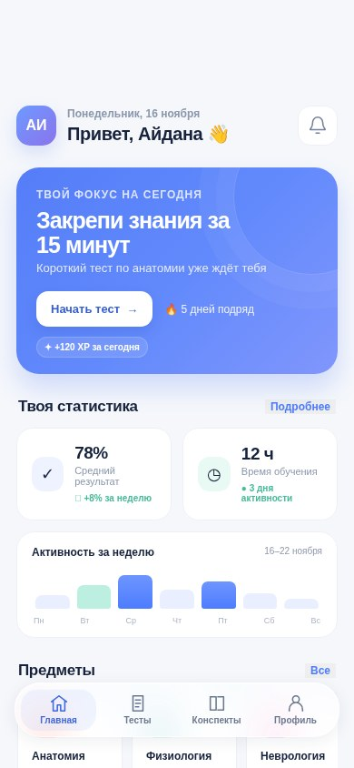
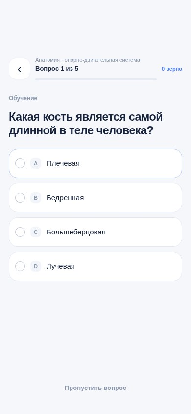
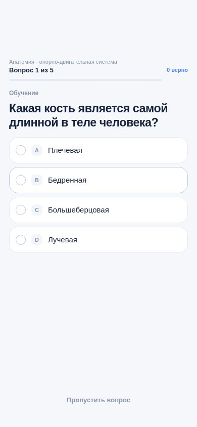

# ANATOMAI UI 5.2.1 — Liquid Glass & Test Screen Polish

Основа: `feature/anatomai-ui-5.2`, коммит `8d1e922`, включая восстановленные XP/streak. PR #1–#4 при начале работы открыты. Ветка исправлений: `fix/anatomai-ui-5.2.1`. Draft PR направлен в UI 5.2, а не устаревший main.

## Главная сохранена

Не менялись DailyFocusCard.tsx, HomePage.tsx, dailyFocus.ts, AppHeader.tsx, StatisticsSection.tsx, SubjectsSection.tsx, app.css, тестовые данные/подсчёт и zoomLock.ts. Заголовки, баннер, градиент, окружности, CTA, колокольчик, «🔥 5 дней подряд» и «✦ +120 XP за сегодня» сохранены.

Сравнение production build исходного `8d1e922` и 5.2.1 выполнено в одном Chromium с одинаковым viewport и mock Telegram metrics (system top 59, content top 45, bottom 34), reduced-motion. На 375/390/430px сняты PNG в начале и конце главной. Геометрия и scrollTop/scrollHeight/padding совпадают. Пиксельная разница вне объединённой области старой/новой капсулы и её мягкой тени (36px) равна **нулю** во всех шести сравнениях. Изменение размытия/тени самой навигации исключено как разрешённое.

## Навигация

- Высота 60px вместо 64px, горизонтальные отступы 16px, радиус 28px.
- Белый фон opacity .44 вместо .72, blur(20px) saturate(160%), полупрозрачная граница, более мягкая внешняя тень и внутренний блик.
- Активная вкладка: лёгкая голубая стеклянная подсветка без тяжёлого градиента.
- Иконки, подписи и 4 маршрута сохранены; min-height кнопок 44px. Fallback без backdrop-filter и reduced-motion сохранены.
- Положение над Home Indicator и вычисление safe-area не изменены. Нет белой полосы во всю ширину.
- Старый резерв прокрутки (64px + нижний offset + 12px) специально сохранён: новая капсула получает на 4px больше зазора, главная и её последние блоки не сдвигаются.

## Экран теста

Адаптер предоставляет readonly canUseBackButton: Telegram-контекст, SDK >=6.1, доступные show/hide/onClick/offClick. В этом случае внутренняя квадратная стрелка не рендерится, шапка переходит на две колонки. В обычном браузере или при отсутствии поддерживаемого API остаётся кнопка 44×44px. Регистрация/удаление callback и подтверждение потери прогресса сохранены; zoom/fullscreen lifecycle не менялся.

Отступы уменьшены только в .test-session: шапка/полоса прогресса, расстояние до «Обучение», вопроса и карточек. Минимальная высота карточки 52px, исходный шрифт вопроса сохранён. Измерение от верха header до низа блока ответов на первом вопросе:

| Ширина | UI 5.2 | UI 5.2.1 | Уплотнение |
|---|---:|---:|---:|
| 375px | 454,4px | 381,4px | 16,1% |
| 390px | 456,6px | 383,6px | 16,0% |
| 430px | 462,5px | 389,5px | 15,8% |

Обучение сохраняет мгновенную проверку/фиксацию и переход только через Далее. Экзамен не раскрывает ответы. Footer и центральная прокрутка не изменены функционально.

## Скриншоты до/после

Это Chromium с mock SDK, а не настоящий Telegram iOS; нативные системные кнопки не рисуются. JPEG предназначены для визуального просмотра; пиксельное сравнение выполнялось по исходным PNG.

| Экран | UI 5.2 / 8d1e922 | UI 5.2.1 |
|---|---|---|
| Главная |  |  |
| Вопрос |  |  |

## Проверки

- `npm run typecheck` — успешно.
- `npm test` — 15 unit-тестов, включая новый capability guard BackButton; существующие Core и zoom lock проходят.
- `npm run build` — успешно.
- `CHROMIUM_EXECUTABLE_PATH=/usr/bin/chromium npm run test:viewport` — 21 сценарий плюс полные learning/exam journeys: widths 375/390/430px, короткие экраны и landscape, browser/expanded/fullscreen, горизонтальный overflow, поиск/keyboard-resize, длинные вопросы, footer, reduced-motion, возврат/reload.
- В каждом сценарии подтверждены: внутренняя стрелка только в browser; native BackButton в Telegram; отмена выхода оставляет вопрос и один callback; подтверждение возвращает в каталог и снимает callback; все четыре вкладки доступны.
- `git diff --check` — успешно. Запрещённые файлы сверены с базой и не менялись.

Для повторения сравнения сначала соберите `8d1e922` в отдельной копии и запустите локальный HTTP-сервер для его dist; новый build также должен быть доступен локально:

```
BEFORE_URL=http://127.0.0.1:4180 AFTER_URL=http://127.0.0.1:4173 CHROMIUM_EXECUTABLE_PATH=/usr/bin/chromium node tests/ui-polish-comparison.mjs
python tests/compare-home-images.py
```

Вторая команда требует Pillow; COMPARISON_DIR можно передать обеим командам (по умолчанию /workspace/work/ui521-comparison). Baseline должен быть именно UI 5.2 с восстановленными метриками.

## Ограничения

Настоящие iPhone, Telegram iOS WebView и Safari не запускались. WebKit в окружении недоступен из-за системных библиотек. Keyboard/reopen/native SDK моделируются; нужны приёмка на устройстве и проверка читаемости Liquid Glass на реальном фоне, системного BackButton, клавиатуры и Home Indicator.

Backend/API, авторизация, алгоритм подсчёта, вопросы/ответы, zoom lock и MEDEXA не менялись. Merge и deploy не выполнялись.
