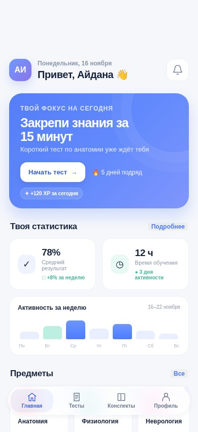
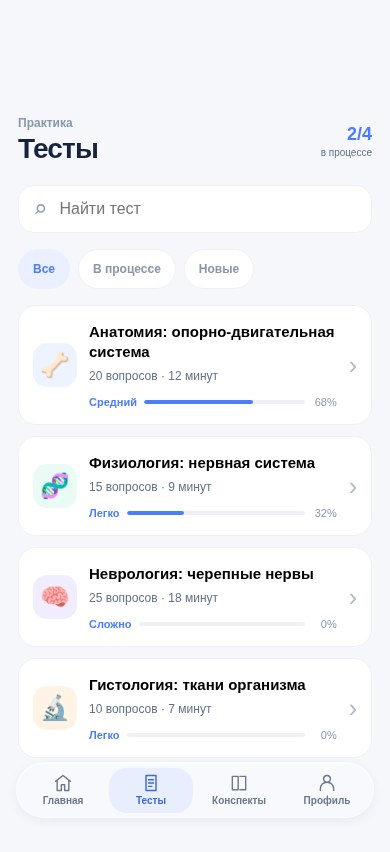
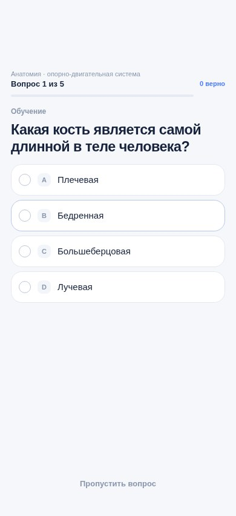
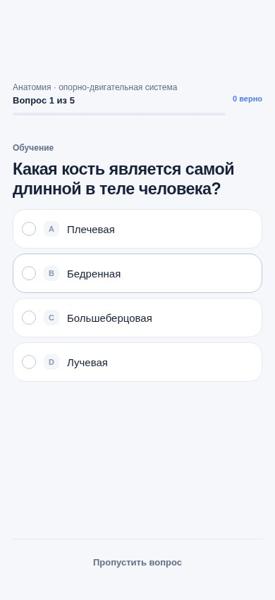
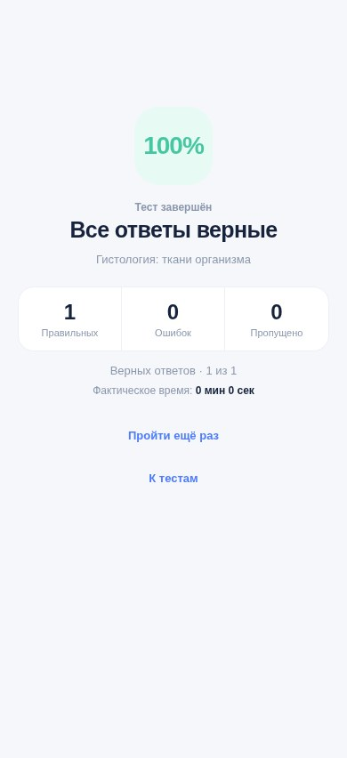
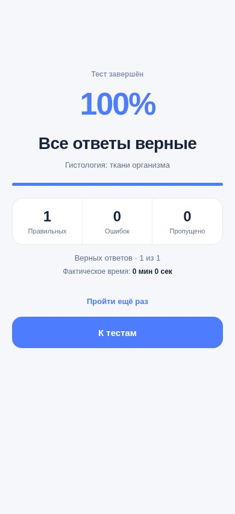
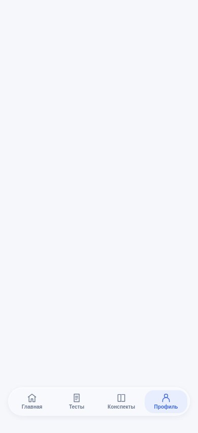

# ANATOMAI UI 6.0 — Premium iOS Final Polish

## Основа и согласованный объём

Ветка `feature/anatomai-ui-6-premium-polish` создана от `feature/anatomai-motion-5.3`, `bda3f72`, открытый Draft PR #6. По уточнению пользователя сохраняются **четыре существующие вкладки**, новые разделы не добавляются. «Конспекты» и «Профиль» в исходной версии не имеют полноценных экранов; их навигационное поведение сохранено.

## Аудит до изменений

| Проблема | Наблюдение в bda3f72 | Минимальное исправление |
|---|---|---|
| Разный визуальный словарь | Радиусы 16/18px, motion 150/160/180ms и оттенки повторялись в разных правилах | Общие tokens, применение к существующим тестовым экранам, объединение повторных селекторов |
| Бледные подписи тестов | Основной muted #8b97ad недостаточно выразителен на светлом фоне | Локальный secondary #62718a в тестировании, без глобального изменения главной |
| Выбор в экзамене | Светлый selected border был слабее остальных состояний | Brand-blue граница и более отчётливый вес выбранного текста; без раскрытия правильности |
| Результат терялся | Процент внутри маленького бейджа, затем много равнозначных подписей | Крупные 52px, тонкий progress bar, ясная статистика |
| 100% без главного действия | При отсутствии ошибок оставались только вторичные кнопки | К тестам становится primary; при ошибках primary остаётся Разобрать ошибки |
| Неотправленные вопросы | Result.answers может не включать остаток теста при таймауте | Только view-model учитывает отсутствие ответа как пропуск и показывает разбор доступных реальных вопросов; engine и saved result не меняются |
| Короткий вопрос и dock | Большая неоформленная свободная область перед нижними действиями | Чуть более полные карточки 56px, ограниченное верхнее дыхание 0–24px и тонкая граница dock; footer остаётся фиксированным |

## Дизайн-система

`src/styles/tokens.css`: поверхности, text primary/secondary, borders, радиусы card/control/small, spacing 4/8/12/16/20, типографика, success/error surfaces/borders/ink, motion press 130ms, page/progress 180ms.

Home tokens `--ink`, `--muted`, `--blue`, `--mint`, `--bg` и баннер не переопределялись. Общие новые токены не меняют статическую главную. Длительности применены к существующим motion/nav rules; повторные правила в TestsExperience.css объединены. Старый app.css не переписывался ради сохранения home-дизайна.

Каталог/режим/вопрос/результат используют общую типографику, радиусы и вторичные подписи. Вопрос остаётся крупным, ответы >=56px, текст переносится без горизонтального расширения. Правильность в обучении видна сразу, в экзамене до завершения отсутствует; green/red имеют явные иконки и доступный контраст.

Короткий контент не центрируется посреди экрана с огромным пустым верхом: дополнительное верхнее пространство ограничено 24px. Длинный вопрос скроллится в прежней центральной области; footer и safe-area не дублируются.

## Результат и motion

Процент — основной акцент, scaleX-progress имеет role=progressbar и числовое aria-valuenow. Три счётчика и время используют только существующий результат. 100%, 0%, пропуски, пустой тест и длинные названия покрыты проверками. Разбор содержит реальные ошибки/пропущенные вопросы; сохранённые данные не мутируются. Score/percent и алгоритм выбора правильного ответа не изменены.

При ошибках приоритетен разбор; повтор вторичен. Без ошибок primary — возврат к тестам. Разбор отображает исходный номер вопроса. Неотправленные записи учитываются только в presentation summary; это не изменение формата хранения или тестового движка.

Переходы и смена вопроса 180ms, pressed feedback 130ms; прогресс 180ms. Результат появляется спокойно, блок статистики и действия имеют небольшие задержки 40/80ms. Используются opacity/translate, scaleX для результата; blur не анимируется. Все новые эффекты отключаются при reduced-motion. Tab state, поиск и scroll restoration сохранены.

## Скриншоты до/после

Production builds bda3f72 и UI 6.0, Chromium 390×852, mock Telegram fullscreen (safe top 59 + content top 45, bottom 34), reduced-motion. Это **не настоящий Telegram iOS**, поэтому системные Telegram-кнопки на снимках не нарисованы.

| Экран | До / UI 5.3 | После / UI 6.0 |
|---|---|---|
| Главная |  |  |
| Каталог |  |  |
| Вопрос |  |  |
| Результат 100% |  |  |
| Профиль: существующее пустое состояние |  |  |

В PNG-сравнении главной на 320/375/390/430px в начале/конце прокрутки геометрия совпала. За пределами разрешённой области панели/тени — нулевая пиксельная разница. JPEG выше — визуальные previews; сравнение выполнялось по исходным PNG.

## Проверки

```
npm run typecheck
npm test
npm run build
CHROMIUM_EXECUTABLE_PATH=/usr/bin/chromium npm run test:viewport
BEFORE_URL=http://127.0.0.1:4183 AFTER_URL=http://127.0.0.1:4173 CHROMIUM_EXECUTABLE_PATH=/usr/bin/chromium node tests/premium-comparison.mjs
COMPARISON_DIR=/workspace/work/ui60-comparison python tests/compare-home-images.py
```

Baseline server должен обслуживать dist из bda3f72; Python pixel comparison использует Pillow. Новых npm-зависимостей нет.

- Typecheck и production build — успешно.
- 16 unit-тестов: Core/BackButton/zoom lock/состояния/серия плюс view-only result summary для 100%, пропусков, пустого теста и отсутствующих ответов, с проверкой отсутствия мутации.
- 54 UI-сценария: матрица 4 ширины × 4 высоты × browser/expanded/fullscreen, плюс 375×400 и 667×375 в трёх режимах. Проверяются safe-area, footer, длинные вопросы/ответы, overflow, скрытые CSS-scrollbar с работающим скроллом, keyboard-resize, BackButton и native/browser fallback.
- Полные learning/exam journeys, instant correctness/lock, отсутствие exam leakage, результаты/разбор/повтор, 100% без ошибок и 0% со всеми пропусками, длинное название результата, reduced-motion.
- Отдельный motion-сценарий: непрерывный индикатор, стабильные bounds вкладок >=44×44px, сохранение query/scroll, no replay на typing/scroll, отключение motion.
- Home comparison до/после и screenshots пяти экранов. Запрещённые файлы/движок/данные сверены с базой; git diff --check.

## Ограничения

Настоящие iPhone, Telegram iOS WebView и Safari не запускались. WebKit в окружении недоступен из-за системных библиотек. Keyboard, reopen и SDK моделируются в Chromium. Нативный scroll indicator UIScrollView Telegram может не подчиняться CSS; полное скрытие не обещается. Реальные FPS, glass/contrast и zoom gestures требуют приёмки на устройстве.

Профиль и конспекты не реализовывались по согласованному ограничению сохранять текущие разделы/логику. Известные ограничения таймера/истории/постоянного хранения остаются за пределами задачи. Backend/API, авторизация, MEDEXA, сервер и production не затрагивались. Merge/deploy не выполнялись.
