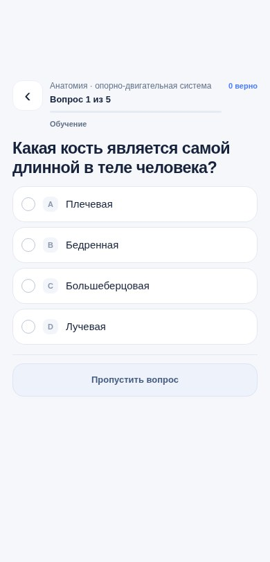
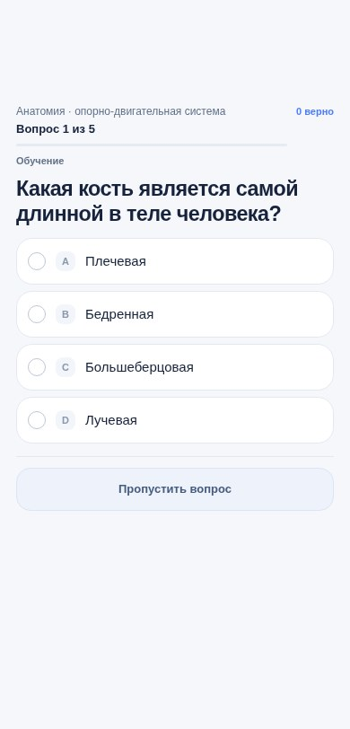
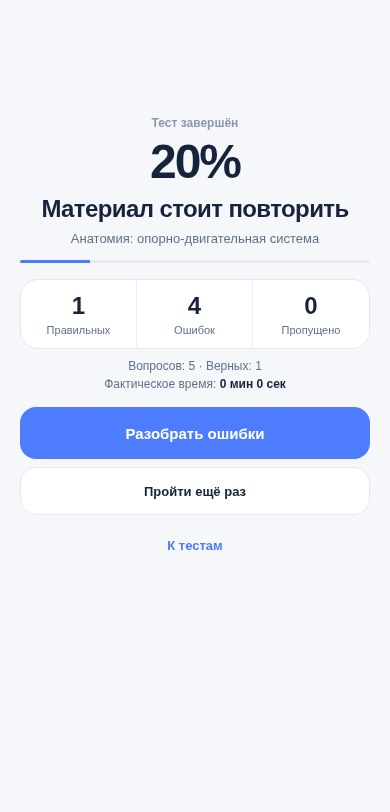
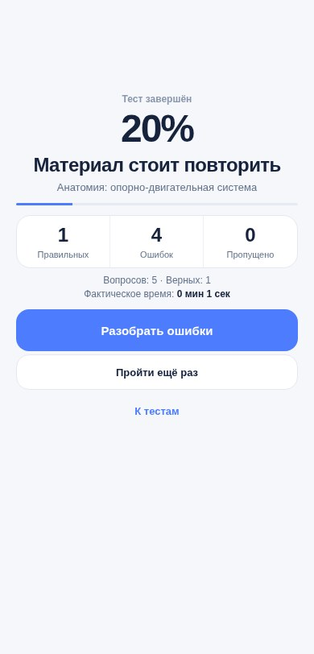

# ANATOMAI UI 6.1.1 — Telegram iOS hotfix

Основа: `fix/anatomai-ui-6.1-layout-refinement`, `a853c993e32f8affb84bde6569e4e299d562fe64`.
Ветка: `fix/anatomai-ui-6.1.1-telegram-ios-hotfix`. Merge и deploy не выполнялись.

## Причина и управление возвратом

В исходной реализации экран решал, показывать ли внутреннюю стрелку, через нерективный getter доступности методов BackButton. Это не подписка на готовность SDK и не подтверждение того, что приложение зарегистрировало callback и показало кнопку. В Chromium воспроизведён случай позднего появления API: SDK меняется без React-render, а внутренняя стрелка остаётся. Это подтверждённый дефект исходников; без доступа к конкретному iPhone нельзя доказать, что именно этот сценарий вызвал наблюдаемое поведение клиента.

Проверен официальный SDK: https://telegram.org/js/telegram-web-app.js . BackButton поддерживается с версии 6.1; show() меняет JavaScript isVisible и отправляет web_app_setup_back_button; onClick/offClick управляют backButtonClicked. Отдельного события изменения видимости нет. isVisible не является подтверждением нативной отрисовки. Кнопка панели самого клиента Telegram не считается принадлежащей приложению.

Теперь adapter публикует реактивный snapshot. Внутренняя стрелка скрывается только при распознанном Telegram-контексте (initData или известная platform), поддержке версии и полного API, активном владельце-экране, зарегистрированном callback и isVisible === true после вызова show(). Одна лишь window.Telegram или наличие методов недостаточны. Неизвестная видимость, отсутствие SDK и ошибка show() сохраняют внутренний возврат.

Пока экран владеет возвратом, проверка каждые 250 мс обнаруживает поздний SDK, методы, замену объекта BackButton и изменение видимости. На остальных экранах таймер отсутствует. Смена SDK снимает прежние подписки. Возврат имеет один bridge и владельца; устаревший cleanup не снимает нового владельца. Hook обновляет актуальный callback, объединяет native/popstate/internal exit и блокирует повторный вызов в том же цикле событий. Cleanup снимает callback, popstate и таймер. Подтверждение выхода с потерей прогресса сохранено.

Если видна только кнопка клиентской панели, а программный API не подтверждён, внутренняя стрелка остаётся: безопасно исключить визуальное дублирование такой панели из WebView невозможно. Реальную отрисовку после SDK show() необходимо проверить на Telegram iOS.

## Компоновка

Отступ перед вопросом уменьшен с 12 до 8 px. Карточки ответов, механизм проверки и палитра не менялись. Прежняя контрастная вторичная кнопка пропуска и закреплённое действие «Далее» сохранены.

На результате уменьшены только интервалы, вертикальные padding статистики и группы действий. Размеры шрифтов и цвета сохранены, вторичные действия имеют min-height 44 px. На контрольном результате 20% высота группы от подписи до действий сократилась с 451.2 до 416.2 px. Высота контента не фиксируется; искусственные блоки не добавлены.

AppShell, формулы safe-area/viewport, Liquid Glass, zoom lock, движок и данные не изменены. Нижние действия используют прежнюю единую безопасную область.

## Проверки

- `npm run typecheck`: успешно.
- `npm test`: 21 unit test, успешно; включая позднюю готовность, владение, cleanup, замену BackButton, неопределённую видимость, ошибки show и повторные события.
- `npm run build`: успешно, Vite production build.
- `node tests/viewport.mjs`: 54 адаптивных сценария, полный проход обучения/экзамена и motion-проверка — успешно.
- `AFTER_URL=... node tests/telegram-ios-hotfix.mjs`: 12 сценариев lifecycle (expanded/fullscreen × native/late API/late SDK/show failure/unknown visibility/browser) и 4 реальных прохождения для 0/20/80/100% — успешно. Проверены пропуски, ноль ошибок, повторный вход, выход с результата, подтверждение выхода, один переход при повторных событиях.
- Chromium: ширины 320/375/390/430 px, небольшие высоты, длинные дисциплины, вопросы, ответы и объяснения, прокрутка, нижние действия, safe-area, вкладки, reduced-motion и отсутствие горизонтального переполнения.
- `BEFORE_URL=... AFTER_URL=... node tests/hotfix-comparison.mjs`: сравнение с production build a853c99. Все 8 полноразмерных PNG главной (4 ширины × верх/низ прокрутки) попиксельно идентичны, включая нижнюю навигацию. Защищённые исходники главной, каталога, карточек, данных и движка не изменены.
- `git diff --check`: успешно.

Telegram в проверках — mock SDK в Chromium. Настоящий Telegram iOS WebView, iPhone и Safari не запускались. Native rendering, клиентская панель, реальные клавиатура/инсеты и последовательность lifecycle при восстановлении приложения требуют проверки на устройстве. Подавление повторов относится к одному циклу событий, а не к произвольным независимым пользовательским нажатиям.

## Скриншоты

Снимки вопроса демонстрируют воспроизведение позднего API; нативная панель Telegram в mock не отрисовывается. Снимки результата — 20%, одинаковые данные и viewport. JPEG предназначены для просмотра, точное сравнение главной выполнено на PNG.

| Экран | До | После |
| --- | --- | --- |
| Вопрос |  |  |
| Результат |  |  |

## Изменённые файлы

- `src/platform/telegram/TelegramPlatformAdapter.ts`: lifecycle и реактивное владение BackButton.
- `src/platform/telegram/useTelegramBackButton.ts`: общий hook экранного возврата.
- `src/vite-env.d.ts`: optional isVisible в типах SDK.
- `src/features/tests/TestSession.tsx`, `TestResult.tsx`: подключение hook.
- `src/styles/hotfix-6.1.1.css`, `src/App.tsx`: изолированные интервалы и импорт.
- `tests/telegram-platform.test.mjs`: unit lifecycle.
- `tests/viewport.mjs`: согласованный mock и длинное объяснение.
- `tests/telegram-ios-hotfix.mjs`: Chromium lifecycle и результаты.
- `tests/hotfix-comparison.mjs`: сравнение исходной/новой сборок и снимки.
- `docs/ui-6.1.1.md`, четыре JPG в `docs/screenshots/ui-6.1.1/`: отчёт и сравнения.
