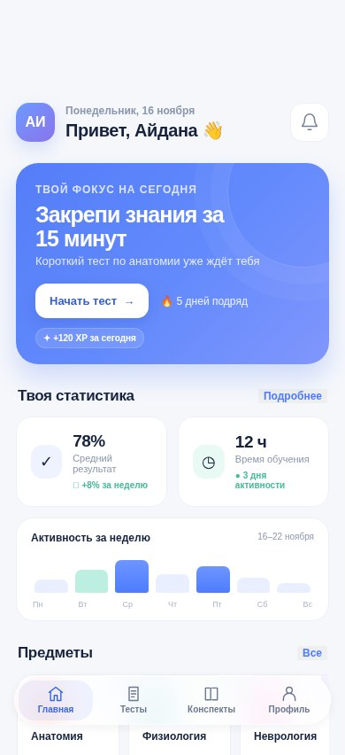
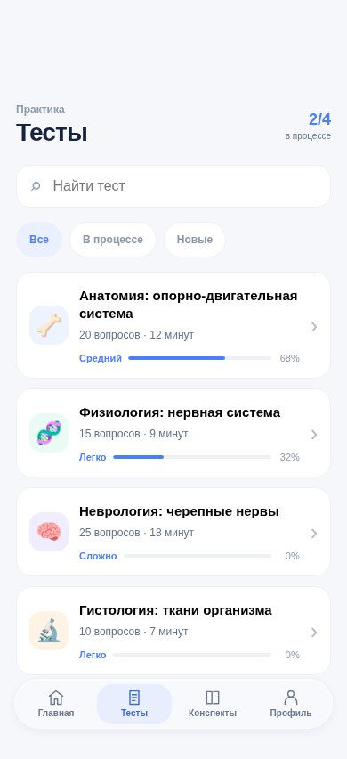
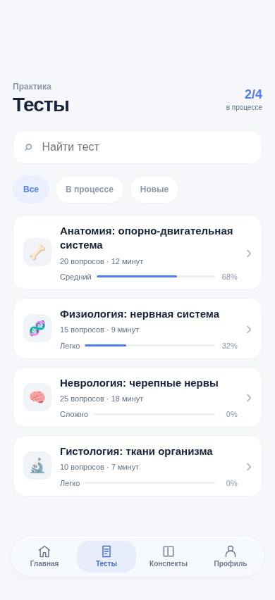
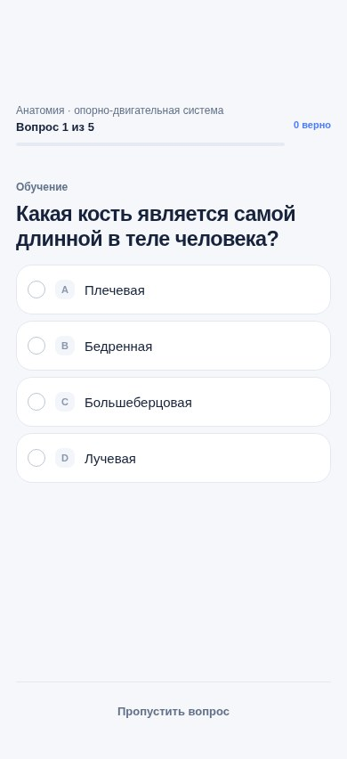
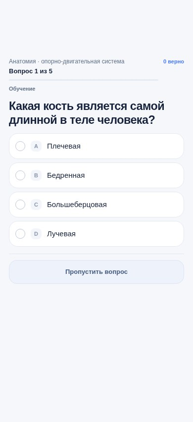
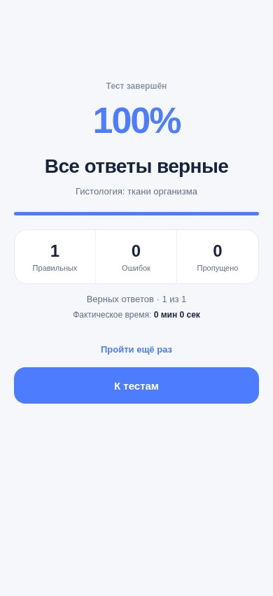
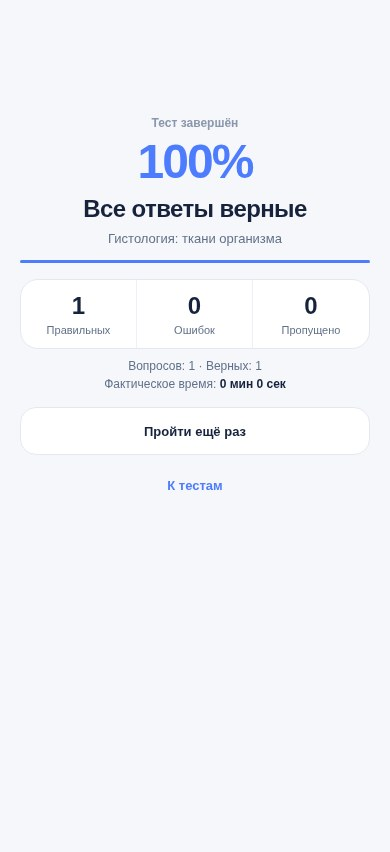

# ANATOMAI UI 6.1 — Layout Refinement & iOS Polish

## Основа и аудит

Основа — `feature/anatomai-ui-6-premium-polish`, `7363ee4`, открытый PR #7. Новая ветка: `fix/anatomai-ui-6.1-layout-refinement`.

| Наблюдение в UI 6.0 | Причина в компонентах/CSS | Исправление |
|---|---|---|
| Верх вопроса разрознен | Дисциплина/номер/полоса — в header, режим — в content с дополнительным отступом | Режим и серия перенесены внутрь информационного header; единая компактная композиция |
| Большой разрыв перед действиями | Центральный flex:1 растягивался даже при коротком вопросе; добавлялся viewport-dependent padding сверху | Content-led flex:0 1 auto, без дополнительного top padding; footer следует за коротким содержимым, длинное содержимое сжимается и скроллится |
| Skip слабо заметен | Прозрачный фон, маленькая вторичная подпись | Контрастная вторичная кнопка 48px, мягкая поверхность/граница |
| Процент и действия результата разобщены | Независимые отступы badge/title/progress/statistics/actions | Группы summary/details, небольшие постоянные интервалы, компактная статистика |
| Каталог растянут | Padding 16px, margin footer 12px, насыщенные синие уровни, разноцветные контейнеры иконок | Padding 12px, margin 8px, тонкий progress, нейтральные подписи/контейнеры |
| Потенциальная двойная стрелка | В исходном коде уже есть canUseBackButton и условный render | Не переписано: повторно подтверждены native/browser fallback, cancel/confirm и cleanup callbacks |

## Вопрос

Дисциплина, номер, счёт/таймер, progress и режим теперь образуют один header. Типографика вопроса сохранена (тот же clamp 22–28px); длинные формулировки естественно переносятся и прокручиваются. Карточки немного компактнее (min-height 52px вместо 56px, padding 9px), буквы и состояния сохранены.

Skip — читаемая вторичная кнопка с touch target >=48px. После проверки обучение показывает primary Далее/Завершить. В экзамене primary и skip располагаются рядом, чтобы не съедать высоту небольшого экрана. Порядок обработчиков и алгоритм не менялись.

На коротком вопросе действия следуют за ответами с небольшим зазором: свободное пространство остаётся ниже блока, а не искусственно растягивает расстояние до кнопки. На длинном вопросе только центральная область прокручивается, header/footer остаются видимыми. Safe-area учитывает прежний shell, повторно не прибавляется.

При доступном native BackButton внутренней стрелки нет. Без Telegram SDK или поддерживаемого BackButton остаётся кнопка 44×44px. Защита прогресса, history и существующий lifecycle сохранены.

## Результат

Summary объединяет подпись, крупный процент (48px), заголовок, название и тонкую progress-полосу. Под ним компактная карточка Правильных/Ошибок/Пропущено; ниже число вопросов и фактическое время.

При ошибках primary — Разобрать ошибки. Повтор — вторичная белая кнопка, К тестам — текстовая кнопка во всех случаях. При нуле ошибок разбор отсутствует. Прогресс, расчёт результата и сохранённые ответы не менялись; поддержка 0%/100%, пропусков и длинных названий сохранена.

Селекторы существующего result motion адаптированы к новым группам. Длительности и reduced-motion не изменены.

## Каталог и навигация

Названия явно используют спокойный primary text; брендовый синий остаётся в интерактивных элементах и progress. Сложность стала нейтральной подписью. Иконки берутся из прежних данных, новые эмодзи/наборы не вводились: унифицированы размер 40px, radius 12px и фон контейнера. Прогресс 3px вместо 4px.

Измерение реальных карточек до/после на 320/375/390/430px:

- Двухстрочные карточки: 120,3 → 106,9px, −11,1%.
- Однострочные карточки: 100,0 → 86,6px, −13,4%.
- Тест сравнения требует диапазон уменьшения 10–15%; все подписи/данные/фильтры/поиск/прогресс сохранены.

Liquid Glass подвергнута только точечной полировке: alpha .24 вместо .28, более лёгкая тень 0 2px 10px / .045. Высота 56px, targets >=44px, индикатор, bottom inset, резерв, fallback и reduced-motion прежние. Отдельного белого фона снизу нет.

## Скриншоты до/после

Одинаковые 390×852, Chromium, mock Telegram fullscreen с system top=59, content top=45, bottom=34, reduced-motion. Указатель мыши убран с карточек перед снимком. Нативные Telegram-кнопки не рисуются: это не screenshot настоящего iPhone.

| Экран | UI 6.0 / 7363ee4 | UI 6.1 |
|---|---|---|
| Главная |  |  |
| Каталог |  |  |
| Вопрос |  |  |
| Результат |  |  |

Главная сравнивалась отдельно по PNG на 320/375/390/430px в начале и конце прокрутки. Scroll geometry идентична; во всех восьми сравнениях вне разрешённой области навигации/тени — **0 изменённых пикселей**. Баннер, окружности, размеры, текст, CTA, bell, streak/XP, статистика и секции не менялись.

## Проверки

```
npm run typecheck
npm test
npm run build
CHROMIUM_EXECUTABLE_PATH=/usr/bin/chromium npm run test:viewport
BEFORE_URL=http://127.0.0.1:4184 AFTER_URL=http://127.0.0.1:4173 CHROMIUM_EXECUTABLE_PATH=/usr/bin/chromium node tests/layout-refinement-comparison.mjs
COMPARISON_DIR=/workspace/work/ui61-comparison python tests/compare-home-images.py
```

Baseline server должен обслуживать dist из 7363ee4; Python pixel comparison требует Pillow. Новых npm-зависимостей нет.

- Typecheck, 16 unit-тестов, production build, git diff --check — успешно.
- 54 адаптационных UI-сценария: 320/375/390/430 × 667/744/812/852 × browser/expanded/fullscreen, плюс 375×400 и 667×375 в трёх режимах.
- Полные learning/exam journeys, 100%/0%, пропуски, review/retake, длинное название, selected/correct/wrong, отсутствие exam leakage.
- Native/browser BackButton, отсутствие дубликата, отмена/подтверждение выхода и отсутствие накопления callbacks; safe-area, overflow, scrollbar+scroll, keyboard-resize и доступность footer.
- Motion-сценарий: stable tab bounds, анимированный индикатор, query/scroll retention и reduced-motion.
- Новые проверки: режим внутри header, skip target >=44px, зазор перед footer <=32px на коротком вопросе, каталог −10–15%, текстовый К тестам. Скриншоты и pixel comparison главной.

## Неизменённое и ограничения

DailyFocusCard/HomePage, AppHeader, данные XP/streak, app.css, все home-компоненты, App/navigation routing, профиль/конспекты, SDK adapter, zoom lock, data/types/useTestSession/presentation summary не менялись. Backend/API/авторизация/MEDEXA/production не затрагивались. Merge и deploy не выполнялись.

Настоящие iPhone, Telegram iOS и Safari не запускались. Chromium и mock SDK не подтверждают физическую клавиатуру/жесты, native WKWebView scroll indicator или реальные FPS. WebKit окружению недоступен из-за системных библиотек. На устройстве нужна приёмка нижних действий, нативного BackButton, keyboard, glass/contrast и safe-area; полное скрытие нативного scroll indicator не обещается.
