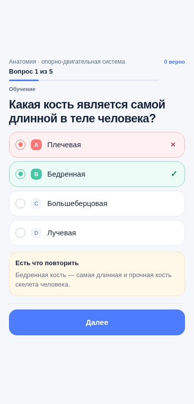
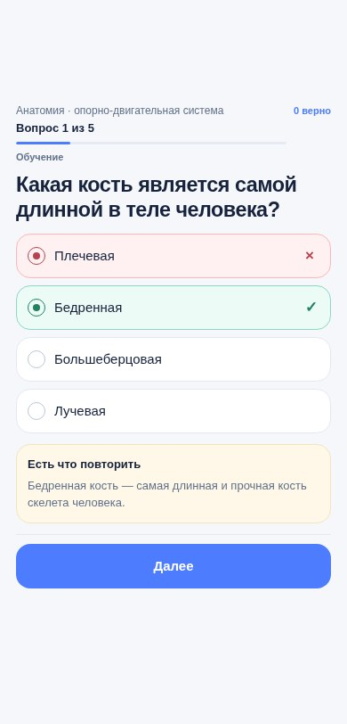
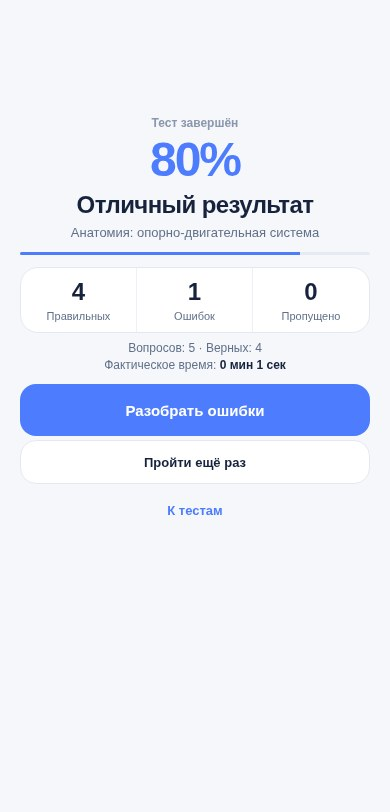
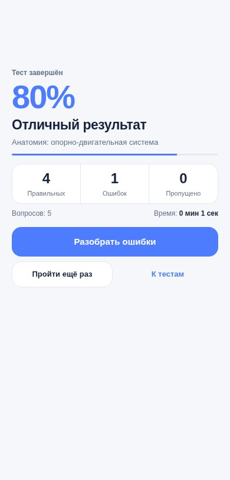
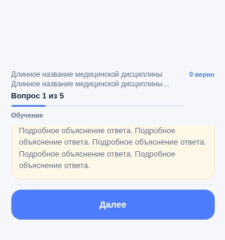

# ANATOMAI UI 6.2 — Test Experience

Основа: UI 6.1.2, `8d216b29d4d24edbc66e2f3d1657801db19d8d1e`.
Ветка: `redesign/anatomai-test-experience-6.2`. Merge и deploy не выполнялись.

## Изменения

Вопрос: компактная шапка с двухстрочным ограничением длинной дисциплины, вопрос 22–25 px, единые карточки с минимальной высотой 50 px и текстом 15 px. Дублирующая буква ответа удалена из карточки: остались индикатор выбора, текст и отметка состояния. Благодаря этому текст получает больше ширины. Существующие surface/border/ink токены ошибок и правильных ответов сохранены. Объяснение отделено спокойной поверхностью из существующей дизайн-системы. Поведение выбора, блокировка после проверки и обучение/экзамен не изменены.

Верхняя и нижняя части вопроса не прокручиваются; середина сжимается при длинном содержимом и прокручивается отдельно. При коротком содержимом действия следуют за ответами, без растягивания центрального промежутка. Footer находится в доступной области оболочки. В UI 6.2 не добавлено ни одного дополнительного env(safe-area-inset-*): единственным владельцем device safe-area остался неизменённый AppShell/viewport.css. Свободное место ниже короткого теста не заполняется искусственными блоками. Высота экрана ограничивает прокрутку, а не растягивает интервалы.

Результат: единое левое выравнивание, выразительный процент без декоративного badge, компактная статистика, общая строка количества вопросов и времени. Повторное указание числа верных ответов удалено из подписи, поскольку оно уже есть в статистике. «Разобрать ошибки» остаётся основным действием; «Пройти ещё раз» и «К тестам» размещены в один ряд, с областью касания не менее 44 px. При 100% разбор отсутствует как и прежде. Длинный результат/разбор прокручивается целиком.

На контрольном результате 80% (390×812) группа результата сократилась с 416.2 до 369.7 px. Нижняя граница действий вопроса после неверного ответа поднялась с 673.8 до 659.8 px; основной выигрыш карточек — больше полезной ширины текста без уменьшения его шрифта.

## CSS

`TestScreens.css` — единственный источник геометрии/оформления TestSession и TestResult. Их старые правила удалены из app.css, TestsExperience.css и TestSession.css; hotfix-6.1.1.css и его импорт удалены. TestSession.css сохраняет прежнее оформление выбора режима. Общие токены, оболочка, навигация и motion-инфраструктура остаются прежними. В общих CSS оставлены остальные селекторы, в том числе из смешанных списков. Их визуальная неизменность проверена PNG-сравнениями.

Telegram adapter, hook и BackButton не менялись. Данные, useTestSession, presentation и вычисления результата/времени не менялись. Backend, API, MEDEXA, главная, XP/streak и глобальная навигация не изменялись. Новых зависимостей нет.

## Проверки

- `npm run typecheck` — успешно.
- `npm test` — 23 теста, успешно.
- `npm run build` — успешно, Vite production build.
- `CHROMIUM_EXECUTABLE_PATH=/usr/bin/chromium node tests/viewport.mjs` — 54 сценария browser/expanded/fullscreen, ширины 320/375/390/430 px, высоты 400/667/744/812/852 и landscape; полный проход обучения/экзамена, пропуски, таймер, разбор, повтор, motion/reduced-motion — успешно.
- `AFTER_URL=... CHROMIUM_EXECUTABLE_PATH=/usr/bin/chromium node tests/telegram-ios-hotfix.mjs` — 14 lifecycle-сценариев и реальные прохождения результатов 0/20/80/100%, cleanup, повторный вход, возврат с результата — успешно.
- `BEFORE_URL=... AFTER_URL=... CHROMIUM_EXECUTABLE_PATH=/usr/bin/chromium node tests/test-experience-ui.mjs` — 16 побайтово идентичных PNG главной (верх/низ), каталога и выбора режима на 320/375/390/430 px; снимки до/после обоих экранов; разбор ошибки на 80%; 12 сценариев длинной дисциплины/вопроса/вариантов/объяснения на 375/390/430 × 400/812 × обучение/экзамен — успешно. При длинном содержимом header/footer не перемещаются, центральная область прокручивается; footer не выходит за safe-area. В экзамене правильность и объяснение не раскрываются до завершения.
- `git diff --check` — успешно.

Длинные тексты внедряются только в DOM тестового браузера, данные проекта не меняются. Новые вычисленные размеры сохранены в screenshots/ui-6.2/geometry.json. Настоящий Telegram iOS, iPhone и Safari здесь не запускались: SDK и safe-area моделировались в Chromium. Перед публикацией требуется проверка на устройстве, включая восстановление Mini App, реальную клавиатуру и fullscreen/expanded.

## Скриншоты

«До» — локальная production-сборка UI 6.1.2, не устаревшая опубликованная версия. Одинаковые размеры 390×812 и fullscreen mock (системная+контентная верхняя область 104 px, нижняя 34 px). Telegram chrome на снимках не отрисовывается. Показаны неверный ответ в обучении и результат 80%.

| Экран | До UI 6.1.2 | После UI 6.2 |
| --- | --- | --- |
| Вопрос |  |  |
| Результат |  |  |

Длинное объяснение на коротком экране 375×400, с доступной кнопкой «Далее»:

## Изменённые файлы

- `src/features/tests/TestSession.tsx`: удалён дублирующий маркер-буква, подключён единый CSS.
- `src/features/tests/TestResult.tsx`: общая строка служебной информации, подключён CSS; вычисления сохранены.
- `src/features/tests/TestScreens.css`: новое изолированное оформление двух экранов.
- `src/features/tests/TestSession.css`, `TestsExperience.css`, `src/styles/app.css`: удалены старые конфликтующие правила этих экранов, остальные селекторы сохранены.
- `src/styles/hotfix-6.1.1.css`: удалён, правила заменены единым CSS.
- `src/App.tsx`: удалён импорт устаревшего hotfix CSS.
- `tests/test-experience-ui.mjs`: сравнение с baseline, снимки, короткие экраны и длинные тексты.
- `docs/ui-6.2.md`, `docs/screenshots/ui-6.2/`: отчёт, пять JPG и JSON размеров.

## Соответствие сборки опубликованной версии

В диагностике до реализации preview.themedx.ru отдавал более старые assets (index-2ErnLm9a.js / index-3ZDk9Z4q.css). Эта задача не обновляет сервер. Новая локальная сборка UI 6.2: index-CXfAnqiD.js / index-DBSahMiP.css. Будущая публикация должна сверить commit и assets из dist/index.html; создание PR само по себе не меняет Mini App на iPhone.
