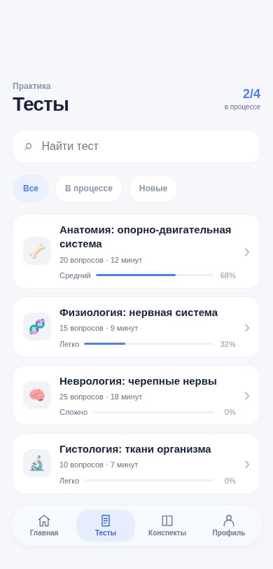
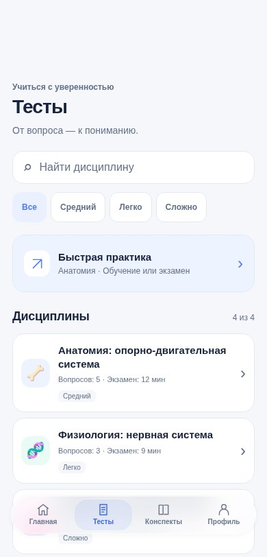
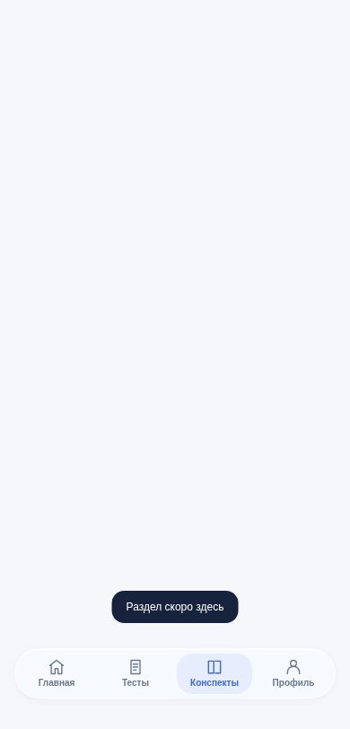
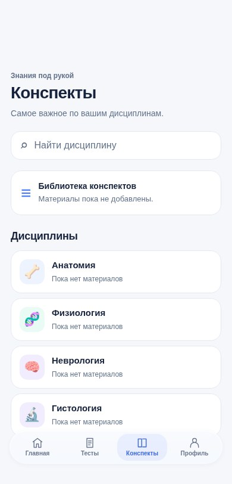
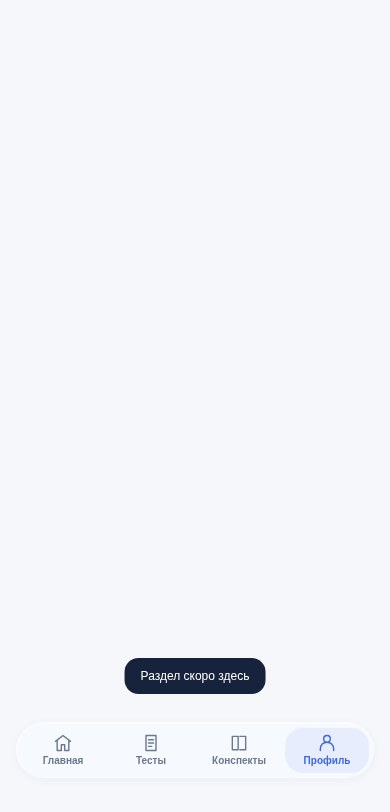
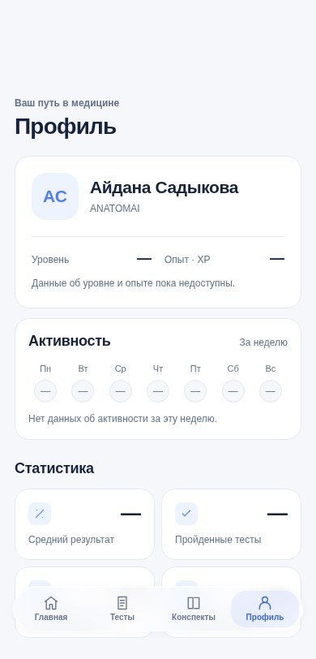
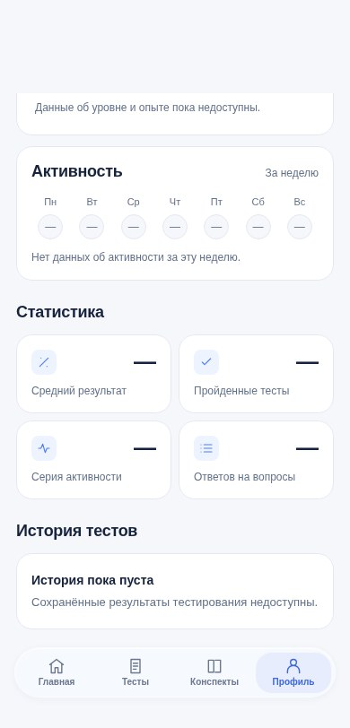

# ANATOMAI UI 7.0 — Premium Interface Redesign

Основа: `fix/anatomai-ui-6.1.2-native-back`, `8d216b29d4d24edbc66e2f3d1657801db19d8d1e`.
Ветка: `redesign/anatomai-ui-7.0`. PR UI 6.2 не включён: экраны вопроса/результата остаются именно из указанной основы. Merge и deploy не выполнялись.

## Три вкладки

**Тесты.** Обновлены заголовок, описание, поиск и мягкие фильтры. Единые компактные карточки сохраняют четыре дисциплины, порядок, существующие уровни сложности и переход в прежний выбор режима. «Быстрая практика» открывает первый доступный тест, затем пользователь выбирает обучение или экзамен; это работающий переход, а не декоративные отдельные кнопки режимов. Карточки показывают число фактически загруженных вопросов и установленное время экзамена. Новые вопросы и категории не создаются.

В прежнем каталоге meta/progress демонстрационные: например, meta анатомии говорит о 20 вопросах, но в data.ts загружено 5. UI 7.0 не отображает эти значения как достоверные. Количество вопросов — 5/3/1/1, получено из questionsForTest. Фильтры «В процессе»/«Новые», основанные на demo.progress, заменены фильтрами по реально существующим уровням «Средний», «Легко», «Сложно». Прогресс пользователя отсутствует и не рисуется. Данные и уровни исходного каталога не менялись.

**Конспекты.** Добавлена вкладка-справочник с поиском по названиям существующих дисциплин, спокойным информационным блоком и белыми карточками. В репозитории нет статей или конспектов: названия дисциплин берутся из существующего каталога тестов, они не выдаются за готовые материалы. Поиск работает локально по этим названиям. У карточек нет ложных переходов, счётчиков статей и неработающего избранного. Пустой результат поиска имеет работающий сброс.

**Профиль.** Добавлены карточка идентификации, уровень/XP, семидневная область активности, статистика 2×2 и пустое состояние истории. Имя читается из Telegram WebApp initData.user только при распознанном adapter-контексте Telegram. Аватар — инициалы имени; при отсутствии имени — нейтральная SVG-иконка и «Ваш профиль». Роль отсутствует, поэтому не выводится.

Реальных XP, уровня, серии, недельной активности, среднего результата и сохранённой истории в приложении нет. Они отмечены прочерками и пояснениями. Пустые дни недели означают отсутствие данных, а не нулевую активность. Прогресс уровня не придуман. Значения главной страницы (включая demo XP/streak) не копируются в профиль и не становятся серверными событиями.

Для статистики используется дополнительная ячейка «Ответов на вопросы», пока без значения. Достижения, настройки, избранное и история как отдельные интерактивные экраны отсутствуют и не имитируются. Информационное пустое состояние истории не является кнопкой.

## Источники данных

| Отображение | Источник | Ограничение |
| --- | --- | --- |
| Дисциплины, иконки, уровни | существующий demoTests в features/tests/data.ts | встроенный демонстрационный каталог, не backend |
| Количество доступных вопросов | questionsForTest(test.id).length | фактически загруженный набор, не заявленный размер внешнего банка |
| Время экзамена | test.examMinutes | существующая настройка таймера |
| Имя/инициалы | Telegram WebApp initData, поле user | только отображение, не авторизация и не проверка подписи |
| Конспекты | материалов нет; дисциплины из каталога | без статей и выдуманных количеств |
| XP, уровень, активность, статистика, история | источник отсутствует | корректные пустые состояния |

## Архитектура и ограничения

App использует прежние четыре route и AppShell. NotesPage/ProfilePage смонтированы через тот же hidden/page-view подход, что Home/TestsPage: локальный поиск, фильтр и scroll сохраняются при смене вкладки. Заглушка toast «Раздел скоро здесь» для этих двух вкладок удалена. Нижняя навигация, её Liquid Glass, геометрия, индикатор и safe-area не менялись.

Все новые CSS-правила ограничены `.library-page`, которая есть только у трёх обновлённых вкладок. Цвета взяты из существующих токенов/значений ANATOMAI: фон, white surface, blue, ink, secondary и прежние пастельные поверхности. Глобальные токены и CSS главной не менялись. Микроанимации 160–180 ms, без непрерывного движения и новых blur; поддержан reduced-motion. Новых зависимостей нет.

Тестовый движок, TestSession/TestResult, adapter, BackButton, zoom lock, backend/API и MEDEXA не изменялись. Начисления XP, история активности и серверные события не создавались. Настоящие материалы, профильная статистика, история, достижения и настройки отложены до появления соответствующих источников/функций.

## Проверки

- `npm run typecheck`: успешно.
- `npm test`: 26 unit-тестов, успешно. Добавлены проверки фактических количеств, поиска, отсутствующих/повреждённых Telegram-данных и имени.
- `npm run build`: успешно, production Vite build.
- `CHROMIUM_EXECUTABLE_PATH=/usr/bin/chromium node tests/viewport.mjs`: 54 сценария browser/expanded/fullscreen, ширины 320/375/390/430, разные высоты и landscape; полные learning/exam journeys, результат, пропуски, разбор ошибок, повтор, BackButton cleanup, keyboard-like resize, motion/reduced-motion — успешно.
- `AFTER_URL=... CHROMIUM_EXECUTABLE_PATH=/usr/bin/chromium node tests/telegram-ios-hotfix.mjs`: 14 lifecycle-сценариев SDK и результаты 0/20/80/100% — успешно.
- `BEFORE_URL=... AFTER_URL=... CHROMIUM_EXECUTABLE_PATH=/usr/bin/chromium node tests/library-ui.mjs`: 8 побайтово идентичных PNG главной (320/375/390/430, верх/низ) без масок; 24 сценария новых вкладок (четыре ширины × 400/812 × browser/expanded/fullscreen); поиск, уровни, пустые состояния, длинные имена/названия, большой DOM-список, прокрутка до конца, отсутствие горизонтального переполнения и перекрытия последнего элемента навигацией. Экраны вопроса и результата дополнительно сравниваются PNG с UI 6.1.2 при фиксированном времени. Отдельно проверены сохранение фильтра/позиции прокрутки и микроанимации/reduced-motion — успешно.
- `git diff --check`: успешно.

Большое число материалов моделируется только клонированием DOM-карточек в UI-тесте, не добавлением фиктивных статей в приложение. Telegram user на скриншотах — fixture SDK; это не настоящая подключённая учётная запись. Обычный браузер отдельно проверен с отсутствующим SDK и пустым профилем.

Настоящий iPhone, Telegram iOS WebView и Safari здесь не запускались. Safe-area и SDK моделировались в Chromium; нативное поведение при восстановлении WebView, клавиатуре и запуске необходимо проверить на устройстве. Создание PR не обновляет опубликованную Mini App.

## Скриншоты 390 px

«До» — production UI 6.1.2, «после» — UI 7.0; одинаковый viewport 390×812 и fullscreen mock. Панель самого клиента Telegram не рисуется. В исходной версии Notes/Profile были незаполненными вкладками с сообщением «Раздел скоро здесь», поэтому соответствующие снимки «до» не содержат готовых экранов.

| Вкладка | До | После |
| --- | --- | --- |
| Тесты |  |  |
| Конспекты |  |  |
| Профиль |  |  |

Нижняя часть профиля после прокрутки:

Главная подтверждена полным pixel-diff: изменения не маскируются, динамические области не исключаются. Компоненты Home, их данные/CSS и анимации остались исходными.

## Изменённые файлы

- `src/App.tsx`: подключение двух страниц и изолированного CSS, удаление заглушки для вкладок.
- `src/pages/TestsPage.tsx`: обновлённый каталог с реальными доступными количествами.
- `src/pages/NotesPage.tsx`: дисциплины и поиск с честными пустыми состояниями.
- `src/pages/ProfilePage.tsx`: имя из Telegram и профиль без демонстрационных метрик.
- `src/features/library/catalog.ts`: представление встроенного каталога, поиск и чтение display name.
- `src/features/library/LibraryIcon.tsx`: лёгкие SVG-иконки новых вкладок.
- `src/styles/library-7.0.css`: изолированное оформление и motion.
- `tests/library-data.test.mjs`, `tests/library-ui.mjs`: unit и Chromium-проверки.
- `docs/ui-7.0.md`, семь JPG в `docs/screenshots/ui-7.0/`: отчёт и сравнения.
