# ANATOMAI UI 7.1 — Visual Refinement

Основа: UI 7.0, PR #13, `0f69b983bd7b9e6fc99e9ac5fbb377f4ee7970b0`.
Ветка: `redesign/anatomai-ui-7.1`. Merge, deploy и изменения production не выполнялись.

## Что изменилось

**Тесты.** Полностью удалены UI-фильтры и бейджи сложности. Данные level и исходный банк сохранены. Поиск работает по полному названию (дисциплина + тема), а карточка показывает иконку, отдельные строки дисциплины/темы, число доступных вопросов и стрелку. Время экзамена убрано из карточки, но настройка examMinutes и таймер не менялись. «Быстрая практика» продолжает открывать существующий выбор режима.

**Конспекты.** Убраны общий повторяющийся notice и подпись об отсутствии материалов у каждой дисциплины. Компактные строки теперь открывают локальное представление выбранной дисциплины; там находится одно пустое состояние. Кнопка «К дисциплинам» возвращает список с прежним поиском и фокусом на карточке. Выбранная дисциплина/поиск сохраняются при смене вкладки. Это локальное состояние NotesPage: глобальные route, history и Telegram BackButton не менялись. Вымышленных конспектов и API-запросов нет.

**Профиль.** Уплотнены карточка имени, недельная активность и сетка статистики; повторяющиеся пустые поля уровня/XP заменены одной краткой подписью. История оформлена компактным пустым состоянием. Имя и HTTPS photo_url читаются из Telegram user в initData; поддержан SDK initDataUnsafe.user, когда launch user отсутствует. Эти данные служат только отображению и не заменяют авторизацию. Изображение загружается лениво, без referrer; при ошибке возвращаются инициалы. При отсутствии данных остаются нейтральный аватар/«Ваш профиль». Неизвестные показатели — прочерки, без демонстрационных цифр и выдуманных событий.

**Вопрос.** Шрифт 20–22 px вместо прежних 22–28 px, согласованы интервалы и карточки без дублирующего маркера-буквы. Правильный/неправильный ответ имеют более мягкие локальные поверхности #f2fcf8 / #fff6f6; отметки и границы сохраняют смысловые токены. Это не изменение глобальной палитры. Шапка и footer не прокручиваются, середина занимает оставшуюся высоту и прокручивается отдельно. Нижняя кнопка закреплена у безопасного края оболочки, при коротком вопросе свободная область остаётся между содержимым и footer, а не создаётся padding-патчами. Safe-area учитывается только существующей оболочкой, дополнительных env() в экранах нет.

**Результат.** Компактное левое выравнивание, процент, правильные/ошибки/пропуски сохранены. Количество вопросов и фактическое время объединены в одну служебную строку без дублирования верных ответов. «Разобрать ошибки» — полноширинное главное действие при наличии разбора, два вторичных действия стоят рядом (не менее 44 px). При 100% разбор по-прежнему отсутствует; пропуски включаются в разбор согласно прежней логике.

Вместо накопленных переопределений вопроса/результата используется единый TestScreens.css. Из app.css, TestsExperience.css и TestSession.css удалены только относящиеся к этим экранам селекторы; смешанные списки сохраняют остальные правила. Старый hotfix-6.1.1.css удалён вместе с импортом. TestSession.css сохраняет выбор режима. Существующая голубовато-белая палитра и Liquid Glass не менялись.

## Неизменённые области

Home-компоненты и данные, нижняя навигация, AppShell, Telegram adapter/hook/BackButton, zoom lock, банк вопросов, типы данных, useTestSession, presentation, backend/API, авторизация и MEDEXA не менялись. В TestSession/TestResult изменения касаются только разметки представления и CSS. Поиск и состояние вкладок сохраняются прежним способом; новая дисциплина NotesPage не добавляет глобальных маршрутов.

Реальных данных профиля и конспектов в проекте по-прежнему нет. Неизвестная активность не означает нулевую активность. Цифры количества вопросов происходят из длины фактически загруженных массивов, а не из старых демонстрационных meta/progress.

## Проверки

- `npm run typecheck`: успешно.
- `npm test`: 27 unit-тестов, успешно. Дополнены проверки Telegram photo_url, fallback user и отсутствующих/некорректных URL.
- `npm run build`: успешно.
- `CHROMIUM_EXECUTABLE_PATH=/usr/bin/chromium node tests/viewport.mjs`: 54 адаптивных сценария + полный проход обучения/экзамена + motion — успешно. Ширины 320/375/390/430, маленькие высоты и landscape, длинные вопросы/ответы/объяснения, прокрутка, safe-area, keyboard-like resize, отсутствие горизонтального переполнения. Добавлена строгая проверка footer у нижнего безопасного края; ожидаемые цвета карточек обновлены на смягчённые.
- `AFTER_URL=... CHROMIUM_EXECUTABLE_PATH=/usr/bin/chromium node tests/telegram-ios-hotfix.mjs`: 14 lifecycle-сценариев и результаты 0/20/80/100% — успешно; возврат с вопроса/результата, подтверждение выхода, один переход, повторный вход и cleanup сохранены.
- `BEFORE_URL=... AFTER_URL=... CHROMIUM_EXECUTABLE_PATH=/usr/bin/chromium node tests/library-ui.mjs`: 8 PNG главной на 320/375/390/430 (верх/низ), побайтовое совпадение без масок с UI 7.0. 24 сценария обновлённых вкладок (четыре ширины × 400/812 × browser/expanded/fullscreen): отсутствие сложности, поиск по теме, список/дисциплина/пустое состояние, сохранение поиска/выбранной дисциплины/scroll, длинные имена/темы, большой DOM-список, последний элемент выше навигации, работа быстрой практики. Проверены успешная загрузка аватара и fallback при ошибке, reduced-motion.
- `git diff --check`: успешно.

Размеры до/после сохранены в screenshots/ui-7.1/geometry.json. Скриншоты показывают вопрос после неверного ответа и результат 80%. Время зафиксировано для сопоставимости.

Все UI-проверки — Chromium и mock Telegram SDK. Настоящие iPhone, Telegram iOS и Safari здесь не запускались. Фото в тесте — локальный image fixture, имя — SDK fixture, не реальные данные пользователя. Перед публикацией требуется проверка на устройстве: реальная загрузка фото, клавиатура, fullscreen/expanded и восстановление WebView. Эта ветка не обновляет опубликованный сайт.

## Скриншоты 390×812

«До» — локальная production-сборка 0f69b98; «после» — UI 7.1. Одинаковый fullscreen mock: верхняя защищённая область 104 px, нижняя 34 px; Telegram chrome не отрисовывается.

| Экран | До | После |
| --- | --- | --- |
| Тесты | 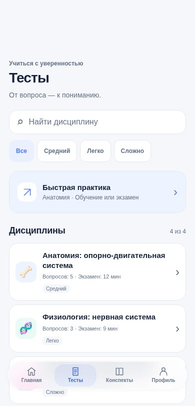 | 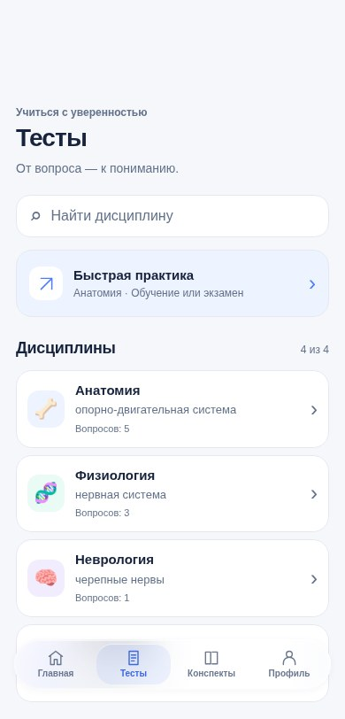 |
| Конспекты | 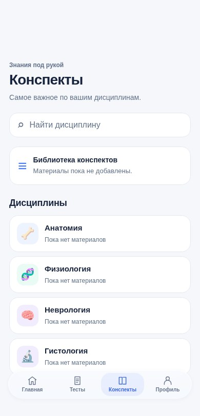 | 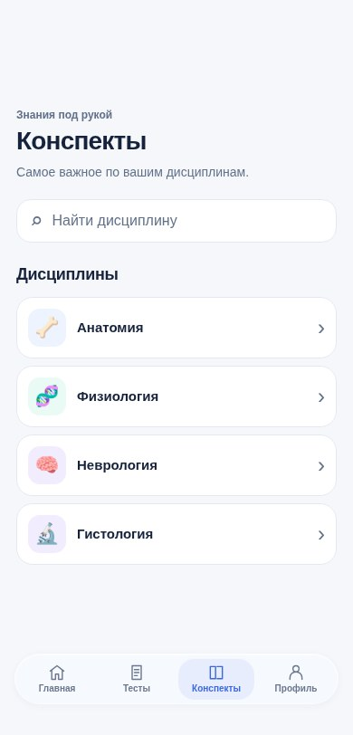 |
| Профиль | 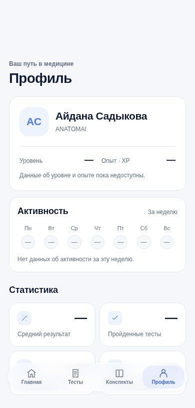 | 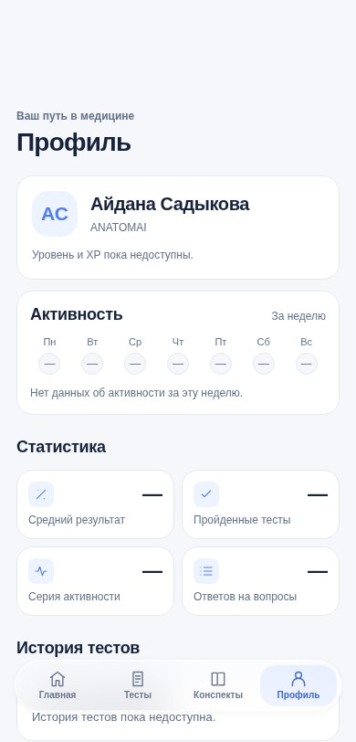 |
| Вопрос | 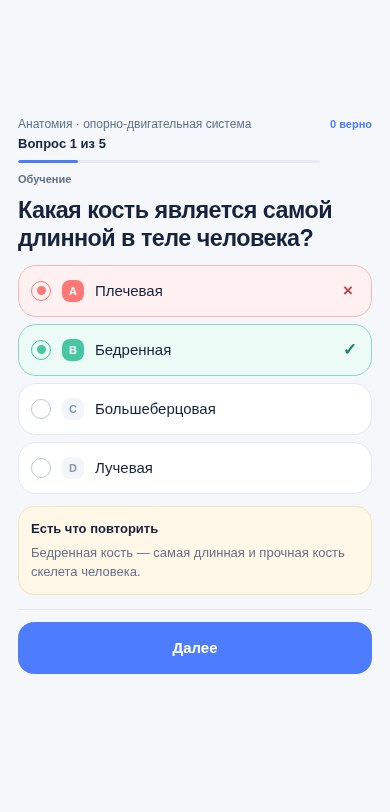 | 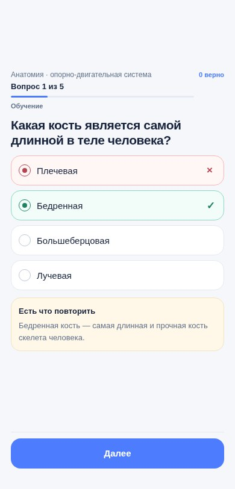 |
| Результат | 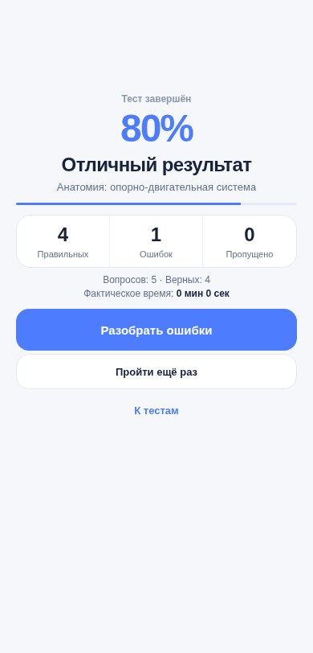 | 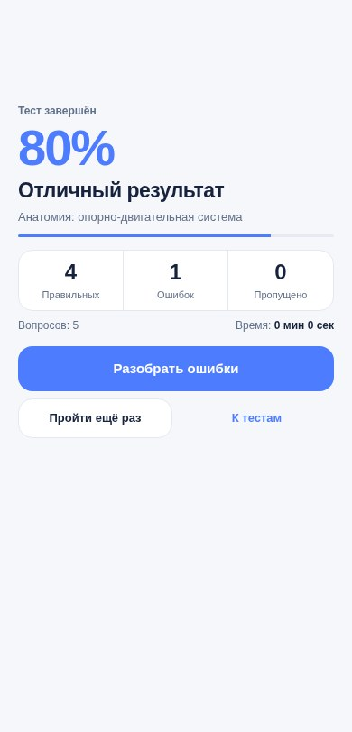 |

Пустое состояние только внутри выбранной дисциплины:

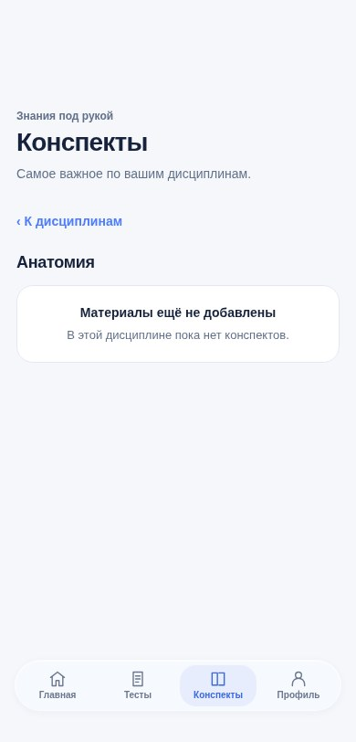

## Изменённые файлы

- `src/pages/TestsPage.tsx`, `NotesPage.tsx`, `ProfilePage.tsx`: уточнённое представление вкладок.
- `src/features/library/catalog.ts`: чтение Telegram display identity/avatar; поля исходных тестов сохранены.
- `src/styles/library-7.0.css`: обновлены существующие изолированные правила вкладок.
- `src/features/tests/TestSession.tsx`, `TestResult.tsx`: подключение единого CSS, упрощённый маркер ответа и группировка служебной строки.
- `src/features/tests/TestScreens.css`: новая каноническая геометрия и оформление вопроса/результата.
- `src/features/tests/TestSession.css`, `TestsExperience.css`, `src/styles/app.css`: удалены дублирующие правила вопроса/результата.
- `src/styles/hotfix-6.1.1.css`: удалён; `src/App.tsx`: удалён его импорт.
- `tests/library-data.test.mjs`, `library-ui.mjs`, `viewport.mjs`: проверки актуальных требований.
- `docs/ui-7.1.md`, 11 JPG и geometry.json в `docs/screenshots/ui-7.1/`: отчёт и сравнения.
