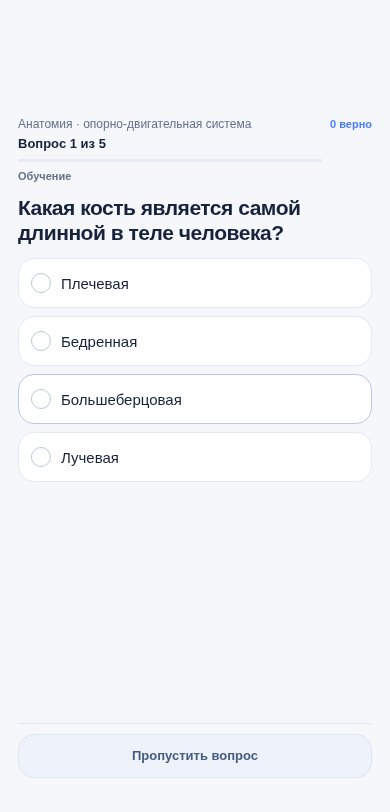
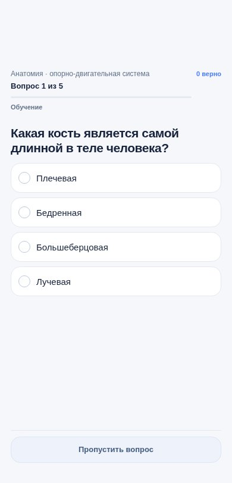
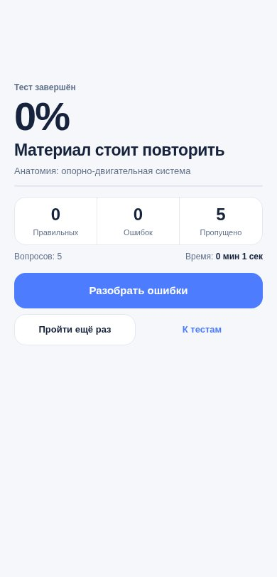
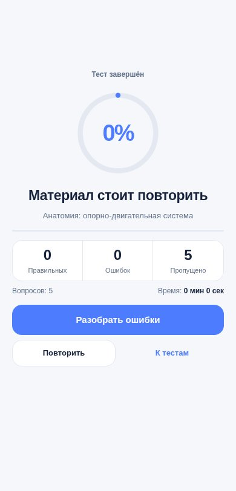
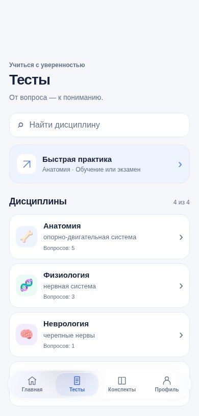
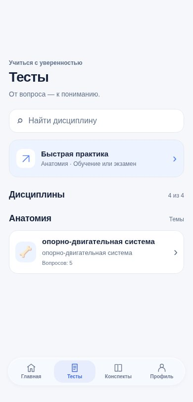
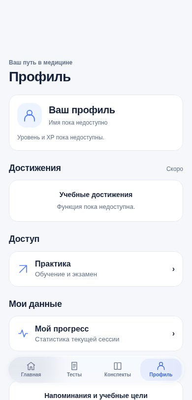
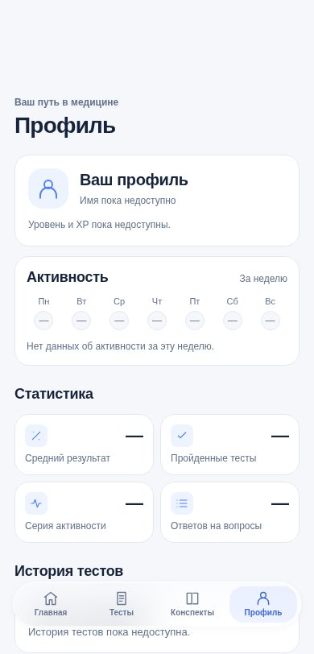
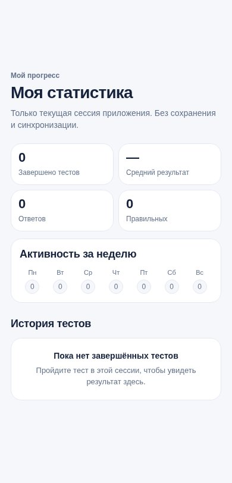

# ANATOMAI UI 7.2

Основа be2dc07, ветка redesign/anatomai-ui-7.2. Merge/deploy не выполнялись.

## Модель и ограничения

Аудит: fetch/API, серверной Telegram auth, localStorage/sessionStorage истории и отдельной модели категорий в исходниках нет. initData используется только для отображения пользователя. Поэтому не добавлена фиктивная серверная синхронизация.

Совместимая группировка предложена до реализации: дисциплина — часть существующего test.title до двоеточия, тема — после него, тест — существующий объект с прежним ID. Четыре дисциплины и вопросы сохранены. В текущем наборе по одной теме/тесту на дисциплину. Названия категорий не придуманы. Поиск и быстрый запуск сохранены, сложность не отображается. Локальная история браузера обеспечивает уровни и возврат; скрытый каталог не обрабатывает события вопроса. Hook возврата получил enabled/listenPopstate, чтобы вложенный каталог не создавал двойной history.back. Adapter не менялся.

Статистика — безопасный минимальный вариант в памяти текущего запуска, максимум 100 результатов. Записываются только фактические завершения, с дедупликацией по запуску теста. Перезагрузка очищает историю; нет привязки к аккаунту, записи в localStorage, сети или синхронизации. Экран явно сообщает это ограничение. Средний результат — среднее процентов завершённых попыток; ответы — фактическое answered, недельная активность — число завершений по локальным дням недели. Никаких XP или демонстрационных показателей Главной в статистике нет.

## Интерфейс

- Шапка вопроса увеличена padding/gap примерно на 15–20%, иерархия дисциплина/номер/прогресс/режим сохранена. Footer и safe-area остаются прежними.
- Результат получил SVG-кольцо, анимацию и reduced-motion, заголовки диапазонов, прежнюю статистику и действия. Расчёт resultSummary и движок не менялись.
- Профиль использует композицию референса: идентификация, достижения «Скоро», доступ к практике, действие «Мой прогресс», недоступные настройки с явной пометкой. Нет платных подписок, XP и фиктивных достижений. Имя/фото/fallback сохранены.
- Моя статистика открывается одинаковым экраном с Главной «Подробнее» и из профиля. Telegram использует системный BackButton без второй стрелки; браузер имеет внутреннюю кнопку. Проверены Back/Forward и возврат к источнику.
- HomePage изменён только передачей существующей кнопке callback. CSS и компоненты Главной, четыре вкладки Liquid Glass и фирменные токены не менялись.

## Проверки

TypeScript, 28 unit-тестов и production build прошли. Добавлен unit-тест пустой/реальной сессионной статистики и границ недели.

Chromium: tests/ui72.mjs проверяет 8 полных PNG Главной на 320/375/390/430 px без масок, входы в статистику и Back/Forward, Telegram callback, категории, завершение и запись результата. Скриншоты до/после на 390 px.

tests/viewport.mjs адаптирован к дополнительным уровням каталога: адаптивная матрица, длинные вопросы/ответы, безопасный footer, обучение/экзамен, разбор/повтор, reduced-motion. tests/telegram-ios-hotfix.mjs адаптирован к тому, что вложенный каталог сам владеет одним BackButton; проверяются результаты 0/20/40/80/100%.

Настоящие iPhone/Telegram iOS/Safari не запускались: Chromium и mock SDK. Перед публикацией проверить реальную геометрию Telegram и восстановление WebView. История текущей сессии намеренно не переживает перезагрузку. Отдельных экранов категорий и статистики в UI 7.1 не было: снимки «до» для них показывают исходный каталог/профиль.

## Скриншоты

| Экран | До | После |
|---|---|---|
| Вопрос |  |  |
| Результат |  |  |
| Каталог |  |  |
| Категории |  |  |
| Профиль |  |  |
| Статистика |  |  |

## Файлы и откат

App.tsx; HomePage.tsx (callback), TestsPage.tsx, ProfilePage.tsx, новый StatisticsPage.tsx; TestResult.tsx; useTelegramBackButton.ts; новые statistics.ts и refinement-7.2.css; tests/statistics.test.mjs, ui72.mjs, viewport.mjs, telegram-ios-hotfix.mjs; этот отчёт и screenshots/ui-7.2.

До merge достаточно закрыть Draft PR и вернуться к be2dc07. После merge отменить коммит UI 7.2 через git revert, запустить typecheck/test/build и отдельно согласовать публикацию предыдущей сборки. Миграций/API/localStorage нет, данные сервера откатывать не требуется.
