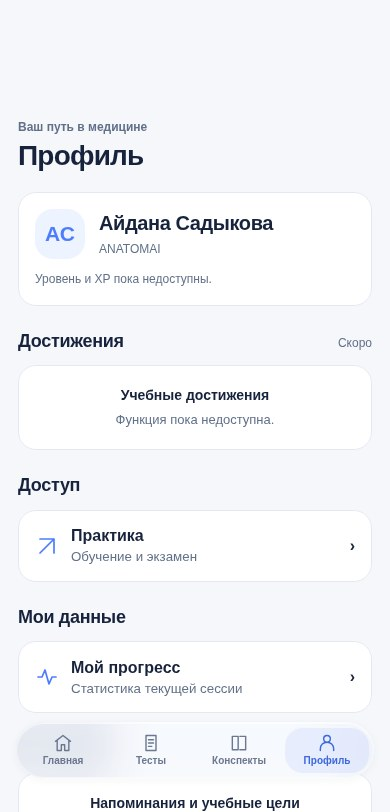
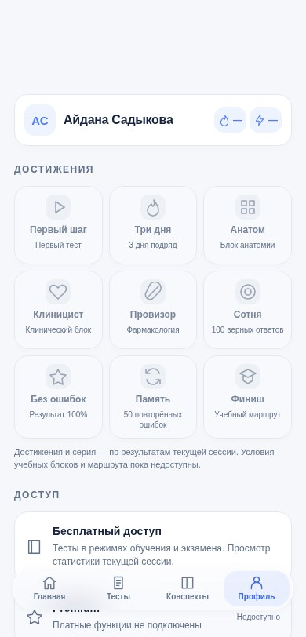
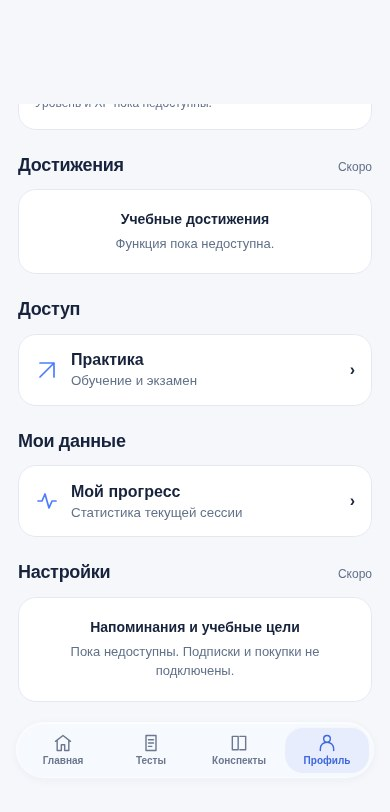
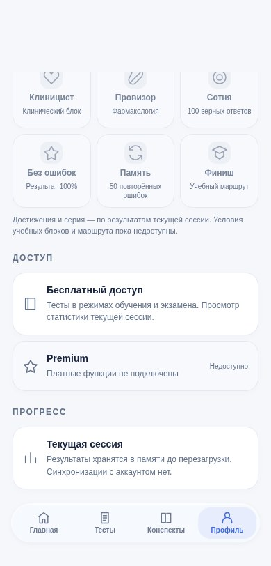

# ANATOMAI UI 7.3 — Profile Redesign

Основа: redesign/anatomai-ui-7.2, `1fc7fcef6cb884e7832d1594d02bb562c4164f72`.
Ветка: redesign/anatomai-ui-7.3. Merge/deploy не выполнялись.

## Композиция

Профиль повторяет порядок и приёмы двух предоставленных RADIX-референсов: компактная горизонтальная строка пользователя, два небольших индикатора, заголовки секций, сетка достижений 3×3, белые строки доступа и прогресса. Палитра ANATOMAI сохранена; коралловых/оранжевых акцентов и эмодзи нет. Используются лёгкие SVG-иконки, скругления 18 px, мягкие границы/тени. Карточки достижений имеют минимальную высоту 100 px и компактную типографику; это адаптация по скриншотам, а не утверждение точного масштаба Figma-макета.

Имя/фото берутся из прежнего Telegram display identity. Фото HTTPS, lazy loading и no-referrer сохранены; ошибка загрузки возвращает инициалы, отсутствие имени — нейтральную иконку и «Ваш профиль». Справа серия из реальных дат текущей сессии (либо нейтральное «—»), XP всегда «—»: источника XP нет.

## Достижения и данные

Все девять карточек присутствуют, заблокированные светло-серые, полученные — белые с фирменным голубым акцентом. Карточки не изображают несуществующие кнопки.

| Карточка | Условие |
| --- | --- |
| Первый шаг | Есть хотя бы один реально завершённый тест в текущей сессии |
| Три дня | Завершения в три последовательных локальных календарных дня; повторные тесты одного дня не увеличивают серию |
| Анатом | Заблокирован: заданного учебного блока нет |
| Клиницист | Заблокирован: клинического блока нет |
| Провизор | Заблокирован: фармакологического блока нет |
| Сотня | Сумма фактически правильных ответов текущей истории ≥100 |
| Без ошибок | Есть завершённый тест с total >0 и score===total |
| Память | Заблокирована: повторение 50 ошибок не отслеживается |
| Финиш | Заблокирован: учебного маршрута нет |

История UI 7.2 остаётся в памяти текущего запуска, максимум 100 результатов. Профиль не добавляет серверных событий, XP, localStorage или аккаунтной синхронизации. Достижения пересчитываются из этой истории; её границы явно подписаны под сеткой. Серия считается до сегодняшнего или вчерашнего дня, при разрыве равна нулю; пустая история даёт нейтральное состояние.

## Доступ и настройки

«Бесплатный доступ» описывает фактически доступные обучение, экзамен и сессионную статистику. Premium — неактивная информационная строка «Недоступно», без придуманного предложения или оплаты. Восстановления покупки нет: интеграция отсутствует.

Строка «Прогресс» честно сообщает хранение до перезагрузки и отсутствие синхронизации. «Цель на день» не показана: существующего сохраняемого параметра нет. «Сбросить прогресс» появляется только при непустой истории и очищает именно текущие результаты/производные достижения после window.confirm. Отмена не меняет данные; серверные данные не затрагиваются.

«Мои данные», «Мой прогресс» и их разделители удалены. Существующая StatisticsPage и callback «Подробнее» на Главной сохранены. App.tsx изменён только в props ProfilePage: переданы entries и очистка entries вместо удалённых переходов. Глобальная навигация не менялась.

## Проверки

- TypeScript: успешно.
- `npm test`: 30 unit-тестов, успешно. Новые проверки: пустая история, незаданные блоки, 100 правильных, 100%, три разных дня, несколько тестов одного дня, защита пустого теста от достижения 100%.
- Production build: успешно.
- `node tests/ui73.mjs`: 16 byte-identical PNG Главной (верх/низ), каталога и конспектов на 320/375/390/430 без масок; 24 сценария профиля (четыре ширины × 400/812 × browser/expanded/fullscreen), длинное имя, сетка 3×3, отсутствие выдуманных показателей/лишних кнопок, горизонтального переполнения и перекрытия последней строки навигацией. Проверены реальное завершение → «Первый шаг», отмена/подтверждение сброса, удаление кнопки сброса после очистки, вход в статистику с Главной и возврат.
- `node tests/profile-avatar-ui.mjs`: загрузка фото и fallback на инициалы при ошибке — успешно.
- `git diff --check`: успешно.

Тесты/конспекты/вопросы/результаты/StatisticsPage, HomePage, Telegram adapter/hook, AppShell, Liquid Glass, backend, API, авторизация, MEDEXA и глобальные CSS не изменены. Новый CSS ограничен `.radix-profile`; основные страницы защищены source diff и PNG-сравнениями. Новых зависимостей нет.

Настоящий iPhone/Telegram iOS/Safari здесь не запускались: Chromium и mock SDK. Имена и фото в тестах — fixtures, не реальная учётная запись. На устройстве остаётся проверить реальные изображения и геометрию WebView. Цифры достижений и история не переживают перезагрузку по прежнему ограничению UI 7.2.

## Скриншоты 390×812

Одинаковый fullscreen mock: верхняя safe-area 104 px, нижняя 34 px, нативная панель Telegram не рисуется. Пустая история намеренно не выдаёт достижений.

| Позиция | UI 7.2 | UI 7.3 |
| --- | --- | --- |
| Верх |  |  |
| Низ |  |  |

## Файлы

- src/pages/ProfilePage.tsx — новая композиция и условный подтверждаемый сброс.
- src/App.tsx — только данные/очистка для профиля.
- src/features/library/achievements.ts — вычисление достижений/серии из реальных завершений.
- src/features/library/ProfileIcon.tsx — SVG-иконки.
- src/styles/profile-7.3.css — изолированный CSS профиля.
- tests/achievements.test.mjs, tests/ui73.mjs, tests/profile-avatar-ui.mjs — проверки.
- docs/ui-7.3.md и четыре JPG в docs/screenshots/ui-7.3/ — отчёт и сравнения.
