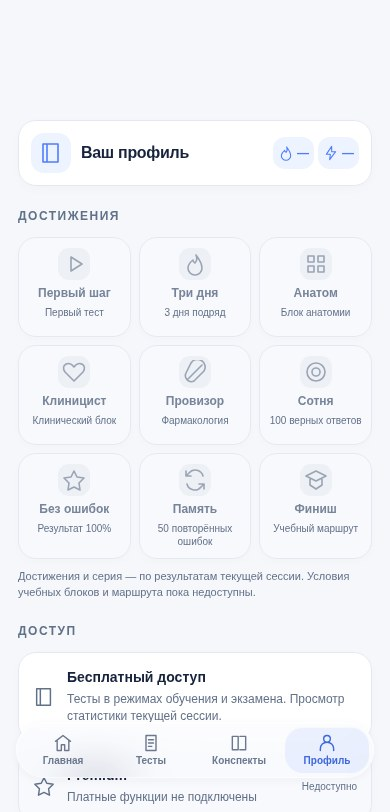
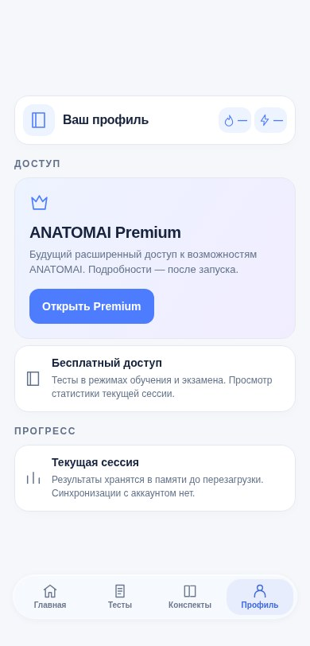
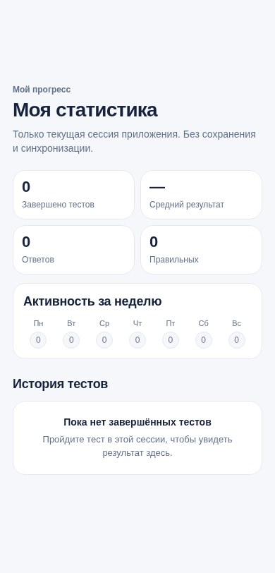
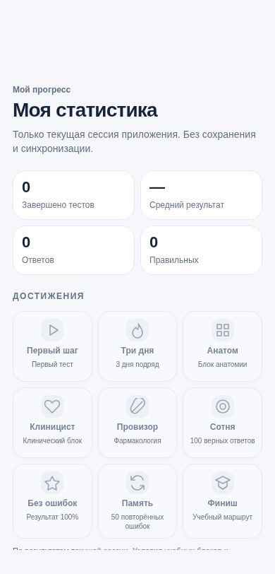
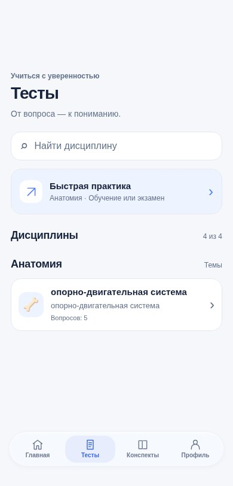
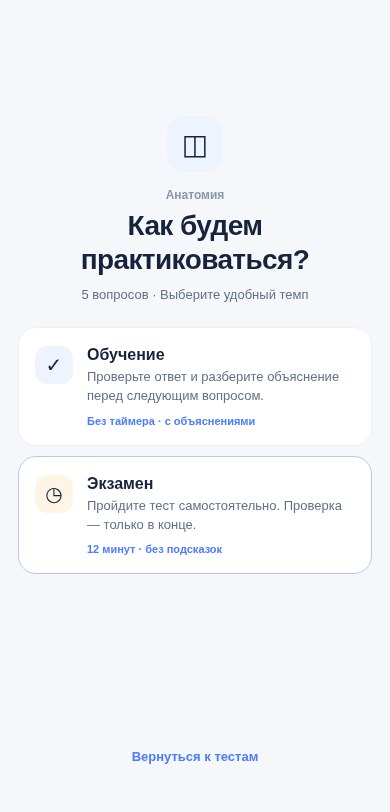
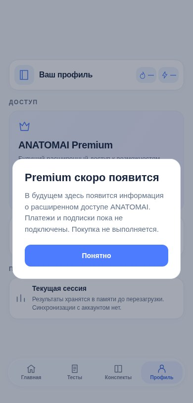
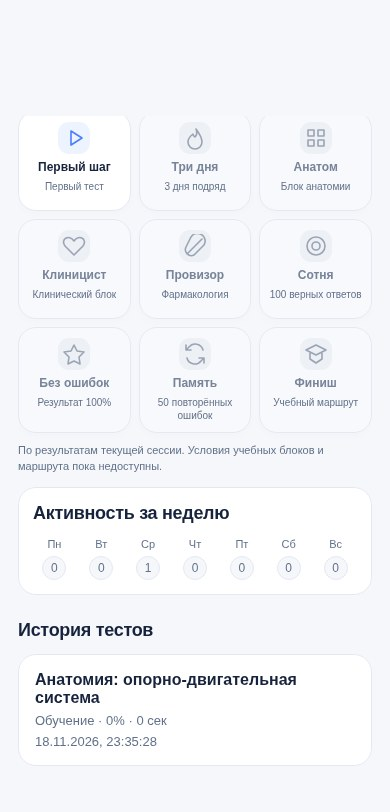

# ANATOMAI UI 7.4 — Navigation & Premium Profile

Основа: redesign/anatomai-ui-7.3, ed80543689a1891f6e36cde2b610b3af1ae21b3a.
Ветка: redesign/anatomai-ui-7.4. Merge, deploy и установка на сервер не выполнялись.

## Навигация тестов

Удалён шаг с единственной карточкой «Начать тест». В существующих данных у каждой из четырёх дисциплин одна тема: нажатие карточки открывает прежний выбор «Обучение / Экзамен» напрямую. Отдельная тема не создаёт лишний экран. Если у дисциплины несколько записей, сохраняется список тем; нажатие темы сразу открывает выбор режима. Поиск и быстрый запуск сохранены. Банк, ID, обработка ответов, результат и повтор ошибок не изменялись.

Используются прежние TestSession и lifecycle BackButton. При возврате к корню каталога callbacks отсутствуют; UI-тесты обновлены на это новое ожидаемое состояние. Для текущего каталога запуск требует одного нажатия вместо трёх. Навигация четырёх вкладок не менялась.

## Достижения

Сетка вынесена из профиля в общий AchievementGrid и расположена в StatisticsPage сразу после основных показателей. Все девять названий, иконок, подписей и условий сохранены. achievements.ts не изменялся. Пустая история не выдаёт достижений; реальное завершение в UI-проверке открывает только «Первый шаг».

Модели блока анатомии/клиники/фармакологии, повторения 50 ошибок и маршрута нет, поэтому эти карточки по-прежнему заблокированы. XP не добавлялся. История и достижения остаются сессионными, максимум 100 завершений, в памяти до перезагрузки. Новых API, localStorage, серверной статистики или аккаунтной синхронизации нет.

## Компактный профиль и Premium

Сохранены имя/фото Telegram и fallback. Профиль содержит компактную строку пользователя, доступ, прогресс и условный подтверждаемый сброс. «Мои данные» и «Мой прогресс» не возвращены. Секционные отступы уменьшены с 22/12 до 16/8 px, строки — с 15×14 до 12 px; интерактивные кнопки имеют минимум 44 px.

Premium-карточка использует существующие поверхности #edf3ff/#f1edff в мягком градиенте, голубой акцент, небольшую SVG-корону и кнопку «Открыть Premium». Кнопка выполняет только открытие информационного native dialog: «Premium скоро появится», платежи/подписки не подключены, покупка не выполняется. Нет цен, форм оплаты, серверных вызовов и выдачи подписки. Небольшая строка бесплатного доступа сохранена.

Dialog использует нативное удержание фокуса/блокировку фонового взаимодействия, Escape/cancel, кнопку «Понятно» и существующий Telegram hook. В истории браузера создаётся только локальный шаг #premium. Закрытие возвращает предыдущий URL. В Telegram не добавлена вторая стрелка «Назад». Модальное окно размещается отдельно в top layer и учитывает safe-area один раз; на коротких экранах прокручивается внутри безопасных границ.

## Проверки

- `npm run typecheck` — успешно.
- `npm test` — 30 unit-тестов, успешно; условия достижений не менялись.
- `npm run build` — успешно.
- `node tests/ui74.mjs` — 8 побайтово идентичных PNG Главной (320/375/390/430, верх/низ), без масок. 24 сценария (четыре ширины × 400/812 × browser/expanded/fullscreen): отсутствие достижений в профиле, Premium-info, закрытие Escape/Telegram BackButton/«Понятно», safe-area, кнопки >=44 px, отсутствие overflow, прямой запуск режима и возврат. Проверены девять достижений в статистике, реальное состояние после завершения и прокрутка до конца истории.
- `CHROMIUM_EXECUTABLE_PATH=/usr/bin/chromium node tests/viewport.mjs` — 54 сценария адаптивности + полные learning/exam journeys + motion. Проверяются поиск, viewport/keyboard-like resize, длинные вопросы/ответы/объяснения, цвета, pinned footer, режимы, разбор, повтор и reduced-motion.
- `AFTER_URL=http://127.0.0.1:4186 CHROMIUM_EXECUTABLE_PATH=/usr/bin/chromium node tests/telegram-ios-hotfix.mjs` — 14 SDK lifecycle-сценариев, результаты 0/20/40/80/100%, подтверждение выхода, один переход, повторный вход и cleanup.
- `git diff --check` — успешно.

Настоящий iPhone, Telegram iOS WebView и Safari здесь не запускались. Все UI-сценарии — Chromium и mock SDK. Перед публикацией проверить реальную top-layer геометрию dialog, поведение BackButton и клавиатуры на устройстве.

## Скриншоты

Сравнение с локальной production-сборкой UI 7.3, 390×812, fullscreen mock. Верхняя безопасная область 104 px, нижняя 34 px; клиентская панель Telegram не отрисовывается.

| Экран | До | После |
| --- | --- | --- |
| Профиль |  |  |
| Статистика |  |  |
| Первое нажатие дисциплины |  |  |

Premium — только информация:

История после реального завершения в UI-тесте:

## Изменённые файлы

- src/pages/TestsPage.tsx — сокращён путь запуска.
- src/pages/ProfilePage.tsx — компактный Premium-профиль без сетки достижений.
- src/pages/StatisticsPage.tsx — достижения после основных показателей.
- src/features/library/AchievementGrid.tsx и AchievementGrid.css — перенесённая сетка.
- src/features/library/PremiumDialog.tsx — честное информационное окно.
- src/features/library/ProfileIcon.tsx — добавлена корона.
- src/styles/profile-7.3.css — компактная геометрия, Premium и dialog; правила сетки вынесены.
- tests/ui74.mjs — сценарии текущей версии; tests/viewport.mjs и telegram-ios-hotfix.mjs — адаптация к короткому пути.
- docs/ui-7.4.md и 8 JPG в docs/screenshots/ui-7.4 — отчёт/сравнения.

App, HomePage и компоненты Главной, её стили/данные, Liquid Glass, TestSession/TestResult, engine/data, adapter/hook, статистические вычисления, MEDEXA и инфраструктура не менялись. Платежей/новых зависимостей нет.

## Откат

До merge: закрыть Draft PR и вернуться к ed80543. После merge: git revert коммита UI 7.4, затем typecheck/test/build. При проверке прежних UI-тестов использовать тестовые файлы соответствующего коммита. Миграций, серверных записей и новых сохраняемых схем нет. Публикацию/откат на сервере выполнять только по отдельному разрешению.
