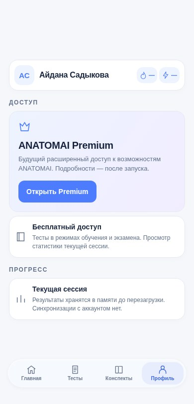
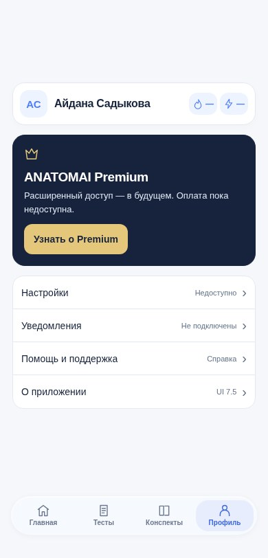
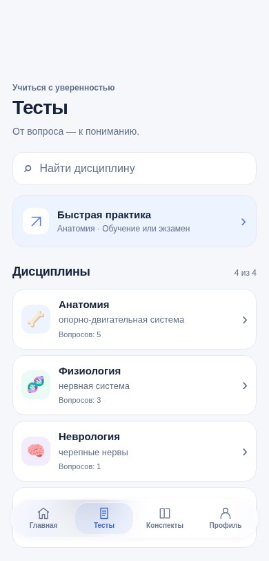
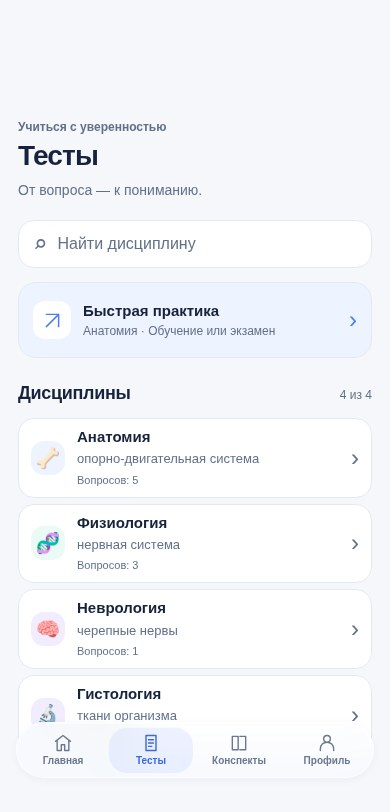
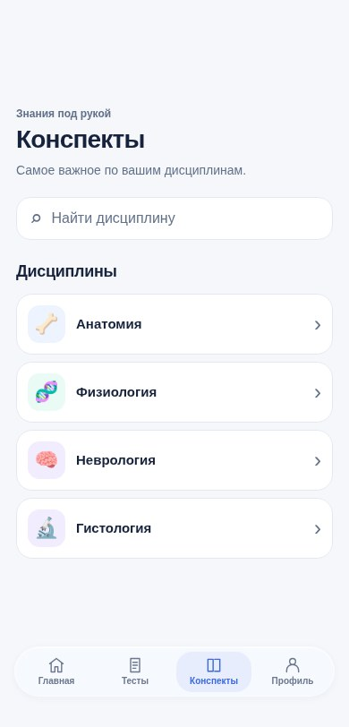
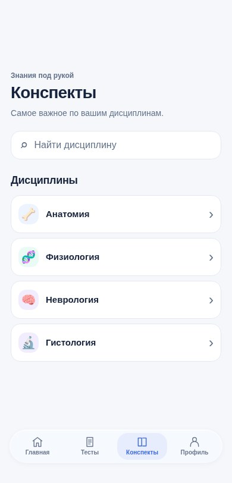
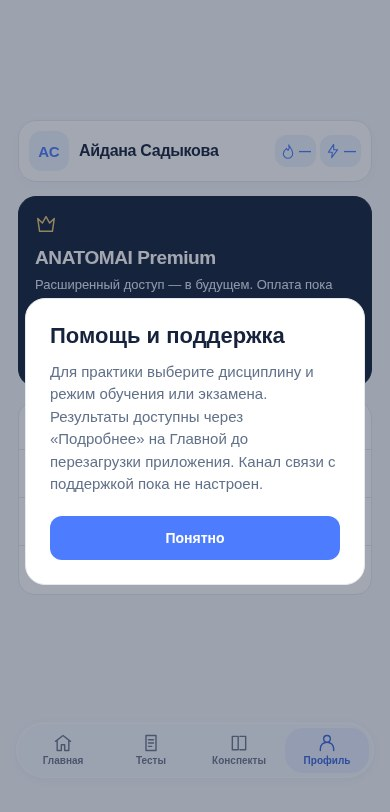

# ANATOMAI UI 7.5 — Compact & Native

Основа: redesign/anatomai-ui-7.4, d4ea153baf325870a832a02495ed190297ddb703.
Ветка: redesign/anatomai-ui-7.5. Merge/deploy, production и MEDEXA не затрагивались.

## Изменения

**Профиль.** Горизонтальная карточка пользователя, реальные имя/фото и fallback сохранены. Удалены «Бесплатный доступ» и большая карточка «Текущая сессия». Достижения и статистика не возвращены в профиль. Сессионные ограничения доступны на прежней странице статистики и в справке.

Premium — единственный новый тёмный акцент: существующий navy `--ink` (#17233d), локальный золотой #e5c77b, небольшая корона, короткое описание и кнопка «Узнать о Premium». Глобальные цветовые токены не менялись. Информационное окно по-прежнему честно сообщает, что платежей и подписок нет; покупка не выполняется.

Добавлена единая компактная группа из четырёх работающих пунктов. Каждый открывает информационный dialog с возвратом:

- Настройки — статус «Недоступно»; нет фиктивного сохранения параметров.
- Уведомления — «Не подключены»; нет запроса разрешений, toggle или включения отправки.
- Помощь и поддержка — работающая справка по запуску тестов/статистике; отсутствие настроенного канала поддержки обозначено явно. Контакты не выдуманы.
- О приложении — описание ANATOMAI, версия UI 7.5 и ограничения.

Повторно используется существующий dialog/hook: добавлены только optional title/description, логика Telegram BackButton и safe-area не менялась. Native dialog удерживает фокус; Escape, «Понятно» и Telegram callback возвращают предыдущий URL. Отдельные локальные hash обозначают открытый информационный пункт; серверных переходов нет. Сброс реальных результатов при наличии истории остаётся прежним действием с подтверждением.

**Тесты.** Карточки получили min-height 76 px, padding 8×12 px, иконки 34 px, интервал 6 px. В обычных данных при 375/390/430 измеренная высота укладывается в 72–80 px. Длинный текст может увеличивать высоту вместо обрезания. Названия, темы, фактическое число вопросов, поиск, быстрый запуск и короткий путь к выбору режима сохранены.

**Конспекты.** Компактные строки min-height 64 px, padding 10×12 px и иконки 34 px. Поиск, открытие дисциплины и возврат к прежнему запросу не менялись. Вымышленных материалов нет.

## Проверки

- `npm run typecheck`: успешно.
- `npm test`: 30 unit-тестов, успешно.
- `npm run build`: успешно.
- `node tests/ui75.mjs`: 8 byte-identical PNG Главной (320/375/390/430 × верх/низ), без масок. 24 сценария (четыре ширины × 400/812 × browser/expanded/fullscreen): длинные имена; все пять информационных окон, повторное открытие/возврат; ровно один callback при открытом окне и ноль после закрытия; Escape/«Понятно»/native mock callback; safe-area; отсутствие input/toggle для недоступных функций; кнопки ≥44 px; отсутствие горизонтального overflow; последняя строка выше навигации; измерения карточек; поиск по теме, запуск режима, возврат; поиск и навигация конспектов. Размеры сохранены в screenshots/ui-7.5/dimensions.json.
- `CHROMIUM_EXECUTABLE_PATH=/usr/bin/chromium node tests/viewport.mjs`: 54 адаптивных сценария и полные learning/exam/motion journeys — успешно. В том числе длинные вопросы/ответы/объяснения, прокрутка, keyboard-like resize, safe footer, результаты, разбор, повтор и reduced-motion.
- `AFTER_URL=http://127.0.0.1:4186 CHROMIUM_EXECUTABLE_PATH=/usr/bin/chromium node tests/telegram-ios-hotfix.mjs`: 14 lifecycle-сценариев SDK и результаты 0/20/40/80/100% — успешно.
- `git diff --check`: успешно.

Первый запуск двух UI-команд встретил остановленный локальный preview (connection refused). Preview заново запущен; приведены результаты успешных повторных прогонов. Это не изменение опубликованной версии.

Реальные Telegram iOS, iPhone и Safari здесь не запускались. Геометрия iOS safe-area моделировалась в Chromium. Перед публикацией проверить native dialog/клавиатуру и реальный Telegram BackButton на устройстве. Информационные окна не подключают недоступные функции. История по-прежнему сессионная, без серверной синхронизации.

## Скриншоты 390×812

До — локальная production-сборка UI 7.4, после — UI 7.5. Fullscreen mock: верхняя безопасная область 104 px, нижняя 34 px; Telegram chrome не рисуется. Имя — тестовый SDK fixture.

| Экран | До | После |
|---|---|---|
| Профиль |  |  |
| Тесты |  |  |
| Конспекты |  |  |

Работающая справка:

## Файлы

- src/pages/ProfilePage.tsx — компактный профиль и информационные пункты.
- src/features/library/PremiumDialog.tsx — параметры заголовка/текста без изменения lifecycle.
- src/styles/profile-7.3.css — navy/gold Premium и компактная группа строк.
- src/styles/library-7.0.css — размеры карточек тестов/конспектов.
- tests/ui75.mjs — новый UI-прогон, снимки и размеры.
- tests/ui74.mjs — совместимый selector нового текста Premium-кнопки.
- docs/ui-7.5.md и семь JPG/dimensions.json в docs/screenshots/ui-7.5/ — отчёт и сравнения.

App/HomePage/Главная, четыре вкладки и Liquid Glass, TestsPage/NotesPage (навигационная логика), TestSession/TestResult/движок/данные, статистика/достижения, Telegram adapter/hook и safe-area, backend/API/авторизация и MEDEXA не изменены. Новых зависимостей нет.

## Откат

До merge закрыть Draft PR и вернуться к d4ea153. После merge — git revert коммита UI 7.5, typecheck/test/build, затем отдельно согласованная публикация. Новых схем хранения, миграций и серверных записей нет. Ничего на сервер автоматически не устанавливается.
