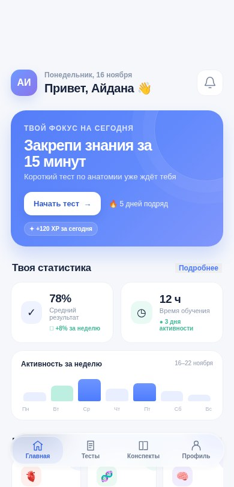
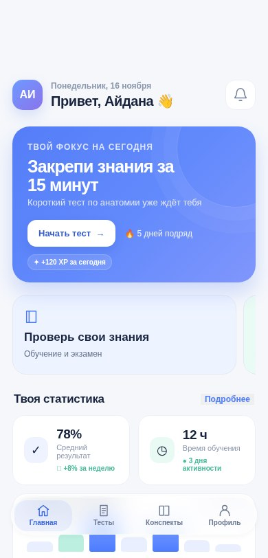
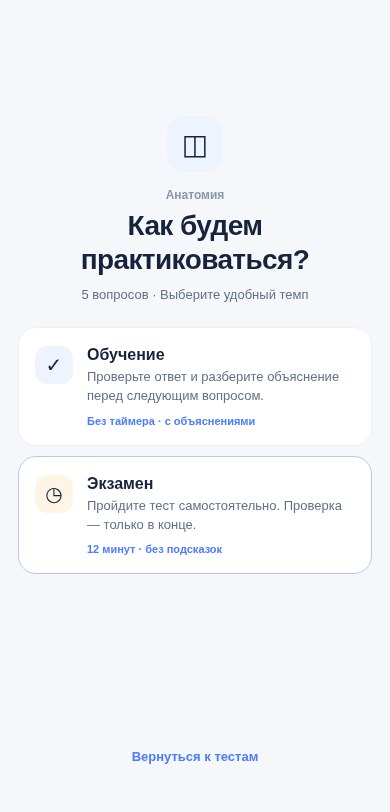
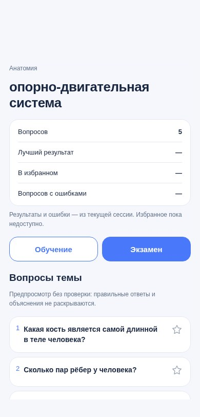
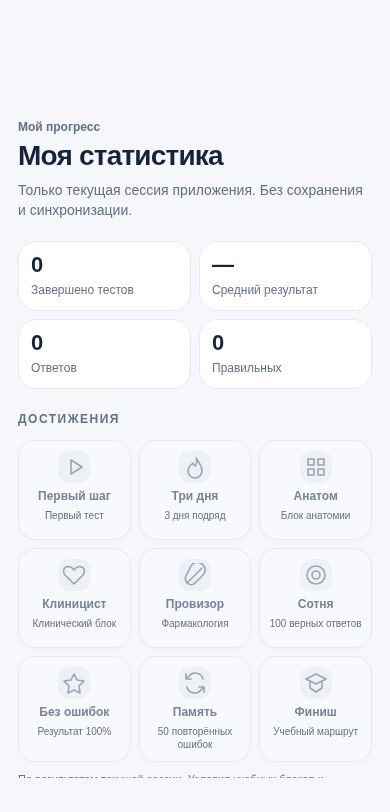
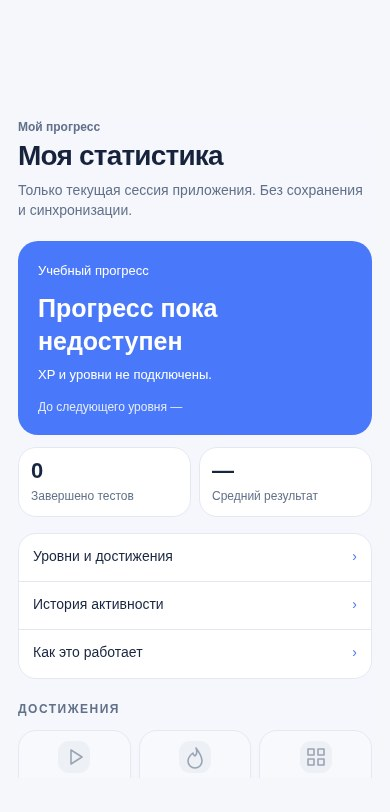
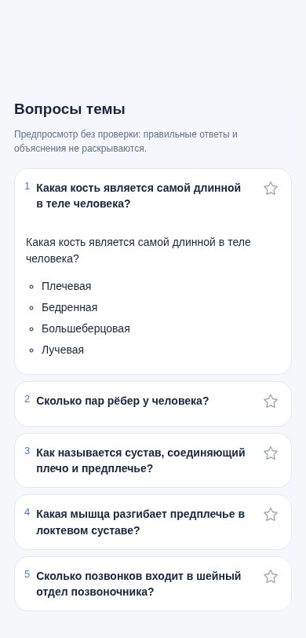

# ANATOMAI UI 7.7 — Study Experience

## Обязательная диагностика и база

Выбранная исходная ветка: redesign/anatomai-ui-7.5, коммит 24887eb24c31c0cc5aba453fb8a170225dc95e86 (PR #18). GitHub подтвердил тот же head PR #18. Новая ветка: redesign/anatomai-ui-7.7.

UI 7.6 в доступной базе не найдена: поиск веток/PR по 7.6 вернул пустые результаты, docs/ui-7.6.md отсутствует, локальная история ведёт от UI 7.5. **Изменения UI 7.6 не считаются реализованными.** Расположение/поведение «Далее»/«Пропустить» сохранено именно из проверенной UI 7.5. Если существует другая неопубликованная ветка 7.6, её нужно отдельно предоставить/сопоставить; этот PR не заявляет совместимость с неизвестными изменениями.

| Область базы | Компонент/источник | Что установлено |
|---|---|---|
| Home | HomePage, AppHeader, DailyFocusCard, StatisticsSection, SubjectsSection | существующие демонстрационные XP/streak/статистика; они не источник новых показателей |
| Tests | TestsPage, features/tests/data.ts, catalog.ts | четыре дисциплины, существующие темы в title, фактические массивы вопросов |
| Topic | отсутствовал | после карточки сразу открывался выбор режима TestSession |
| TestSession | useTestSession, TestScreens.css, Telegram hook | один движок; обучение/экзамен, проверка, пропуск, dirty-confirm, pinned footer |
| TestResult | resultSummary, существующие действия | результат текущего теста, разбор/повтор |
| Notes | NotesPage | дисциплины/поиск, реальных конспектов нет |
| Profile | ProfilePage, telegramProfile, PremiumDialog | Telegram display identity, информационные окна; настоящих XP/уровней нет |
| Statistics | StatisticsPage, summarizeHistory, AchievementGrid | реальные завершения текущего запуска, максимум 100 в памяти |

Источников избранного, localStorage/sessionStorage истории, серверной статистики или API начисления XP нет. Telegram launch data используются для отображения имени/фото, а не серверной авторизации. Модель вопросов/порядок, банк и правила оценки не менялись. Backend, MEDEXA и production не затрагивались.

## Реализация

**Тема.** Новый TopicPage показывает существующие дисциплину/тему, фактическое количество вопросов, лучший результат и число уникальных вопросов с неправильными выбранными ответами в завершённой истории этого запуска. Лучший процент использует существующий resultSummary. Пропуски не записываются как ошибки. До первого результата best/errors — «—»; после реального нулевого результата показывается 0%, а не неизвестность. Избранное — «—»: хранилища нет, кнопки-звёзды явно disabled и подписаны как недоступные. Новое хранилище не имитируется.

Список вопросов сохраняет порядок исходного массива и номера. Details раскрывает полный вопрос и существующие варианты без подсветки правильности и без объяснения. Ни correctAnswer, ни explanation не выводятся как подсказки в предпросмотре. Обучение/экзамен запускают прежний TestSession через optional initialMode; второй движок или новая оценка не создаются. Назад из вопроса возвращает тему с прежним подтверждением потери прогресса, затем — каталог. Повторное прохождение возвращает к выбору режима темы. Результат и разбор остаются прежними.

**Учебный прогресс.** Доработана существующая StatisticsPage, не создан её дубликат. Синяя карточка честно сообщает «Прогресс пока недоступен»: нет выдуманного уровня, процентов до уровня, XP, баланса или покупок. Ниже — два фактических показателя (завершения/средний результат), три работающих действия: прокрутка к существующим достижениям, к недельной активности/истории, раскрытие объяснения. Существующие AchievementGrid, история и summarizeHistory переиспользованы. Количество ответов/верных доступно в пояснении. Сессионное ограничение подписано; перезагрузка по-прежнему очищает историю.

**Промокарусель.** Новый отдельный StudyPromos после существующего баннера, перед статистикой. Три карточки ведут в реальные Tests, Notes и существующий PremiumDialog. Profile/Premium не дублируются. CSS scroll-snap, частично видимая следующая карточка, голубая/мятная/лавандовая поверхности, SVG, без картинок, автопрокрутки, JS-жестов или новых npm-зависимостей. Touch-action допускает горизонтальный и вертикальный нативный жест; корневое горизонтальное переполнение не создаётся.

Новая визуальная система #F5F7FC / #FFFFFF / #192641 / #4978FA ограничена новыми study-экранами и каруселью. Глобальные токены не заменены, чтобы сохранить исходные Home, баннер/градиенты/XP/streak, шапку, остальные секции и четыре вкладки. Карусель добавлена, поэтому нижние секции естественно сдвинуты; она не заменила ни одну существующую секцию.

## Проверки

- TypeScript — успешно.
- `npm test` — 31 unit-тест, успешно. Новый тест проверяет unknown-состояние, фактический best, уникальные ошибки, исключение пропусков и другой темы.
- Production build — успешно.
- `node tests/ui77.mjs` — 18 сценариев 375/390/430 × 400/812 × browser/expanded/fullscreen: три перехода карусели, scroll-snap/переполнение, тема/номера/disabled избранное/пустые метрики, предпросмотр без подсветки, длинное название, секретность экзамена после выбора, подтверждённый выход, обучение и реальные best/errors после завершения, экран прогресса и пояснение.
- `CHROMIUM_EXECUTABLE_PATH=/usr/bin/chromium node tests/viewport.mjs` — 54 адаптивных сценария + полные learning/exam/motion journeys, успешно: длинные вопросы/ответы/объяснения, safe-area, footer, scroll, keyboard-like resize, результаты, разбор/повтор, reduced-motion. UI-тесты адаптированы к новому промежуточному экрану темы.
- `AFTER_URL=http://127.0.0.1:4186 CHROMIUM_EXECUTABLE_PATH=/usr/bin/chromium node tests/telegram-ios-hotfix.mjs` — 14 SDK lifecycle-сценариев, результаты 0/20/40/80/100%, один возврат/подтверждение, повторный вход и cleanup, успешно.
- `git diff --check` — успешно.

Регрессия Home: при сравнении исключён только новый DOM-блок карусели, чтобы проверить прежнюю композицию без разрешённого сдвига. Геометрия (до 0.01 px), цвета, фон и шрифты существующих блоков совпадают на 320/375/390/430. Для 8 PNG применён явно заданный допуск сглаживания <=3 RGB и <=1000 пикселей; фактически верхние снимки отличались на 8/135/37/38 пикселях с максимальной разницей 1/2/2/2 RGB соответственно, нижние совпали. **Это не побайтовое совпадение полной новой Главной:** новый блок добавлен намеренно, различия сглаживания не скрываются. Для PNG-check требуется доступный Python/Pillow; runtime-приложение новых библиотек не использует.

Настоящие iPhone, Telegram iOS и Safari здесь не запускались. Safe-area/SDK и жестовые ограничения моделировались в Chromium. Реальный горизонтальный свайп внутри iOS WebView и отсутствие нативного bounce нужно подтвердить на устройстве. Код адаптера, hook, zoom lock и прежние footer CSS не менялись; новых touchmove preventDefault/обратных scroll-команд нет.

## Скриншоты

390×812, одинаковый fullscreen mock; нативная панель Telegram не отрисовывается. До — UI 7.5, не неизвестная UI 7.6. Предыдущего экрана темы не было: «до» показывает прежний выбор режима.

| Экран | До | После |
|---|---|---|
| Home |  |  |
| Тема |  |  |
| Учебный прогресс |  |  |

Предпросмотр без раскрытия правильного ответа:

## Изменённые файлы

- src/App.tsx — topic-состояние, запуск прежнего движка с выбранным режимом, существующий PremiumDialog для карусели.
- src/pages/TopicPage.tsx — новый экран темы/предпросмотра.
- src/features/library/topicSummary.ts — агрегация фактических результатов темы с resultSummary.
- src/features/tests/TestSession.tsx — optional initialMode, без изменения engine/оценки/разметки нижних действий.
- src/pages/ProfilePage.tsx — только номер UI 7.7 в существующем «О приложении», без редизайна.
- src/pages/StatisticsPage.tsx — честный учебный прогресс с существующей статистикой/достижениями.
- src/components/StudyPromos.tsx, src/pages/HomePage.tsx — новый отдельный блок и callbacks существующих переходов.
- src/styles/study-7.7.css — изолированные study-правила/карусель.
- tests/topic-summary.test.mjs, tests/ui77.mjs — проверки и снимки.
- tests/viewport.mjs, tests/telegram-ios-hotfix.mjs — адаптация к Topic перед режимом/при возврате.
- docs/ui-7.7.md, семь JPG в docs/screenshots/ui-7.7/ — аудит/отчёт/сравнения.

Композиция/функции профиля (кроме номера UI), конспекты, нижняя навигация, существующие Home-компоненты/их стили/демонстрационные значения, TestResult, useTestSession, presentation, банк/типы вопросов, safe-area, adapter/hook и MEDEXA не менялись.

## Недоступно без отдельных источников

XP/уровни, рабочее избранное, постоянная и серверная история/ошибки, синхронизация аккаунта, платежи. Не создавались фиктивные события, достижения, начисления, покупки или контент. Preview использует только уже существующие вопросы.

## Откат

До merge закрыть Draft PR и вернуться к 24887eb. После merge — git revert коммита UI 7.7, typecheck/test/build и отдельно согласованная публикация. Миграций и новых схем хранения нет; сервер автоматически не обновляется.
